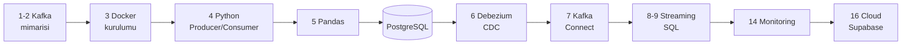

# Apache Kafka Rehberi — Başlangıçtan Production'a

Türkçe, uygulamalı ve production odaklı Apache Kafka dokümantasyonu. Bankacılık/finans örnekleriyle; KRaft tabanlı güncel mimari (ZooKeeper yok), Python, Pandas, PostgreSQL, Debezium CDC, Kafka Connect, streaming SQL, monitoring ve Supabase entegrasyonu.

**Öğrenme yolu:**



---

## İçindekiler

| # | Bölüm | İçerik |
|---|---|---|
| 1 | [Giriş](docs/01-giris.md) | Kafka nedir, event streaming, event-driven mimari, kuyruk/broker/streaming farkı, veritabanı mı?, saklama, batch vs stream, performans, alternatiflerle karşılaştırma, sektör senaryoları |
| 2 | [Mimari ve bileşenler](docs/02-mimari.md) | Cluster, broker, controller, KRaft, ZooKeeper (tarihsel), producer/consumer/group, topic/partition/offset, leader/follower, RF, ISR, acks, retention, compaction, key/value/headers/timestamp, serileştirme, rebalance, lag, delivery semantics, HA + 9 kritik soru |
| 3 | [Kurulum ortamları](docs/03-kurulum.md) | Lokal native, Docker (ana ortam), kendi sunucunuz (Ubuntu, systemd, firewall, TLS, backup), managed cloud |
| 4 | [Python entegrasyonu](docs/04-python.md) | confluent-kafka vs kafka-python, 16 örnek (basit → transactional), config, logging, testler |
| 5 | [Pandas ile işleme](docs/05-pandas.md) | DataFrame ↔ Kafka, CSV/PostgreSQL/REST API hatları, temizleme, feature engineering, aggregation, micro-batch, Spark/Flink'e geçiş kriterleri |
| 6 | [CDC — PostgreSQL + Debezium](docs/06-cdc-debezium.md) | WAL, logical replication, slot, publication, snapshot, before/after, tombstone, şema değişiklikleri, WAL riski, recovery; **PostgreSQL → Kafka → PostgreSQL** sıfırdan |
| 7 | [Kafka Connect](docs/07-kafka-connect.md) | Source/sink, worker, modlar, task, converter, SMT, REST API, yaşam döngüsü, hata toleransı, DLQ, izleme, plugin/sürüm; JDBC Source/Sink ve Debezium örnekleri |
| 8 | [Kafka Streams, ksqlDB, Spark, Flink](docs/08-stream-processing.md) | Filtering → exactly-once yetenek karşılaştırması |
| 9 | [Streaming SQL](docs/09-streaming-sql.md) | PostgreSQL / ksqlDB / Flink SQL söz dizimleri ayrı ayrı: SELECT, WHERE, GROUP BY, JOIN, pencereler, event-time |
| 10 | [Veri formatları ve şema](docs/10-veri-formatlari-sema.md) | JSON, CSV, Avro, Protobuf, JSON Schema, Schema Registry, evrim/uyumluluk, null, **Decimal**, timestamp/timezone |
| 11 | [Gerçek zamanlı ETL/ELT](docs/11-streaming-etl.md) | Ingestion → aggregation, DQ, idempotency, upsert, replay, backfill, DLQ, EOS vs end-to-end EOS, Outbox, dual-write |
| 12 | [Ekosistem](docs/12-ekosistem.md) | Airflow, NiFi, Spark, Flink, dbt, MinIO/S3, Iceberg, Delta, Snowflake, BigQuery, ClickHouse, Elasticsearch, Redis, Grafana, Prometheus, OpenTelemetry, n8n — mimari tablo |
| 13 | [Güvenlik](docs/13-guvenlik.md) | TLS, SASL/SCRAM, OAuth/OIDC, ACL, RBAC, ağ, secret, at-rest/in-transit, audit, PII/KVKK, finansal veri; dev vs prod |
| 14 | [Monitoring ve performans](docs/14-monitoring.md) | Lag, throughput, latency, skew, kaynaklar, URP/ISR, JMX, Prometheus, Grafana, alarmlar, producer/consumer parametreleri |
| 15 | [Production mimarisi](docs/15-production.md) | Multi-broker, dedicated controller, HA/DR, multi-AZ/region, MirrorMaker 2, kapasite, retention, upgrade, Strimzi, CI/CD, IaC, SLO |
| 16 | [Cloud: Supabase](docs/16-supabase-cloud.md) | Supabase'i CDC kaynağı ve sink olarak bağlamak |
| 17 | [Kafka'yı ne zaman kullanmamalı?](docs/17-ne-zaman-kullanmamali.md) | 7 senaryo; cron/Airflow/Python/SQL alternatifleri |

---

## Kullanılan sürümler (Kasım 2026 itibarıyla kontrol edildi)

| Bileşen | Sürüm | Not / kaynak |
|---|---|---|
| Apache Kafka | **4.4.0** (22 Eki 2026); olgun hat **4.3.2** (23 Eki 2026) | [Downloads](https://kafka.apache.org/community/downloads/) · Docker: `apache/kafka:4.4.0` |
| Java | Broker/Connect/araçlar 17+, istemci/Streams 11+ | Kafka 4.x gereksinimi |
| confluent-kafka (Python) | 2.16.2 (librdkafka 2.16.0) | PyPI |
| kafka-python | 3.0.13 | PyPI |
| pandas / SQLAlchemy / psycopg / fastavro | 3.1.1 / 2.1.9 / 3.3.9 / 1.13.1 | PyPI |
| Debezium | **3.7.1.Final** (6 Kas 2026) — Kafka Connect 3.1+, Java 17+, PostgreSQL 14–18 | [Releases](https://debezium.io/releases/) · image: `quay.io/debezium/connect:3.7.1.Final` |
| PostgreSQL | 17 (Docker), testler 16.15 üzerinde | |
| Confluent Platform (Schema Registry, ksqlDB) | 8.2.0 image'ları | `cp-schema-registry:8.2.0`, `cp-ksqldb-server:8.2.0` |
| Apache Flink | 2.3.0 (25 Haz 2026) | [Downloads](https://flink.apache.org/downloads/) |
| Apache Spark | 4.3.0 (27 Eki 2026) | [endoflife.date](https://endoflife.date/apache-spark) |
| Strimzi | 1.2.0 (Kafka 4.3.1 desteği, sadece `v1` API) | [Releases](https://github.com/strimzi/strimzi-kafka-operator/releases) |
| Kafbat UI | v1.5.0 | `ghcr.io/kafbat/kafka-ui:v1.5.0` |

> **Eski vs güncel mimari:** Kafka 4.0 (Mart 2025) ile ZooKeeper modu kaldırıldı. İnternetteki `cp-zookeeper` / `KAFKA_ZOOKEEPER_CONNECT` içeren örnekler **eski mimaridir**; bu rehberdeki her şey **KRaft** kullanır. Kafka 4.x'teki diğer önemli değişiklikler: yeni consumer rebalance protokolü (KIP-848) GA, MirrorMaker 1 kaldırıldı, eski istemci protokol sürümleri kaldırıldı (KIP-896), Log4j 2'ye geçiş, Queues for Kafka (share groups).

---

## Hızlı başlangıç (15 dakika)

```bash
# 0) Gereksinimler: Docker Desktop/Engine (Compose v2), Python 3.11+

# 1) Kafka (KRaft, tek broker) + Kafka UI
docker compose -f code/docker/docker-compose.yml up -d
bash code/scripts/create_topics.sh                       # http://localhost:8080

# 2) Python ortamı
cd code/python
python -m venv .venv && source .venv/bin/activate
pip install -r requirements.txt
pytest -q tests                                          # broker gerektirmeyen testler

# 3) Üret ve tüket (iki terminal)
python 03_json_producer.py --adet 1000
python 04_json_consumer.py

# 4) CDC laboratuvarı (PostgreSQL → Debezium → Kafka → PostgreSQL)
cd ../..
docker compose -f code/docker/docker-compose.yml down
docker compose -f code/docker/docker-compose.cdc.yml up -d
bash code/scripts/register_connectors.sh
bash code/scripts/cdc_demo_changes.sh
```

---

## Depo yapısı

```
kafka-rehberi/
├── README.md
├── docs/                       # 17 bölüm
└── code/
    ├── docker/                 # compose: dev (tek broker), cluster (3+3), cdc, streaming (ksqlDB+Flink), monitoring
    ├── python/                 # 00–16 örnekleri, common.py, avro, kafka-python, tests/
    ├── pandas/                 # pandas_utils.py, p01–p06
    ├── sql/                    # kaynak/hedef init, outbox, streaming karşılıkları, Supabase hazırlık
    ├── connect/                # Debezium source, Debezium JDBC sink, Confluent JDBC source/sink, outbox, Supabase
    ├── schemas/                # Avro v1/v2
    ├── ksqldb/  flink/  spark/  streams/kafka-streams-java/
    ├── monitoring/             # JMX exporter kuralları, Prometheus, alert kuralları
    ├── security/               # SASL_SSL broker/istemci, ACL script'i
    ├── k8s/                    # Strimzi (KafkaNodePool, Kafka, KafkaTopic, KafkaUser)
    ├── scripts/                # create_topics, register_connectors, cdc_demo_changes
    └── data/                   # örnek CSV (kasıtlı kirli satırlarla), örnek kur JSON
```

---

## Doğrulama durumu

Rehber hazırlanırken her şey aynı derecede test edilemedi. Hangi parçanın nasıl doğrulandığını aşağıda görebilirsiniz:

| Parça | Durum | Nasıl |
|---|---|---|
| Python birim testleri (29 test) | ✅ Geçti | Python 3.13, confluent-kafka 2.16.2, pandas 3.1.1, fastavro 1.13.1 — `pytest -q tests` |
| Python ↔ PostgreSQL entegrasyon testleri (upsert idempotentliği, offset koruması, p04 özet) | ✅ Geçti | PostgreSQL 16.15 |
| librdkafka config geçerliliği (producer, transactional, consumer `consumer`/`classic` protokol, store deseni) | ✅ Geçti | Nesne oluşturma ile (librdkafka config'i yerelde doğrular) |
| Tüm `.py` dosyaları | ✅ Derlendi | `py_compile` |
| SQL dosyaları (`source_init`, `target_init`, `outbox_pattern`, `postgres_batch_karsiliklari`, `supabase_cdc_hazirlik`) | ✅ Çalıştırıldı | PostgreSQL 16.15, `wal_level=logical` |
| Logical replication (publication, slot, `test_decoding`/`pgoutput` çıktıları) | ✅ Çalıştırıldı | PostgreSQL 16.15 |
| Docker Compose dosyaları | ✅ Sözdizimi | `docker compose config` |
| Connector JSON, Prometheus/alert/JMX YAML, Strimzi YAML | ✅ Sözdizimi | JSON/YAML ayrıştırma |
| Bash script'leri | ✅ Sözdizimi | `bash -n` |
| **Kafka broker'a karşı uçtan uca çalıştırma** (producer/consumer döngüleri, Debezium/Connect, ksqlDB, Flink, Spark, Kafka Streams Java, monitoring stack) | ⚠️ **Çalıştırılmadı** | Hazırlık ortamında Docker image registry'lerine ve Maven Central'a erişim yoktu. Kodlar resmi dokümantasyona göre yazıldı; "beklenen çıktılar" bu nedenle temsilidir |
| Flink Kafka connector jar URL'i (`code/flink/Dockerfile`), monitoring image etiketleri | ⚠️ Doğrulanmadı | İlgili sayfalardan güncel sürümü kontrol edin |
| Production güvenlik ve Strimzi yapılandırmaları | ⚠️ Cluster'a uygulanmadı | Güvenlik ekibinizle gözden geçirin |

Testlerin yakalayıp düzelttiği iki gerçek hata dokümanda anlatılıyor: transactional producer'da `message.timeout.ms ≤ transaction.timeout.ms` kuralı ([4.19](docs/04-python.md#419-15-transactional-producer--15_transactional_processorpy)) ve `DataFrame.itertuples()`'ın `_` ile başlayan kolon adlarını değiştirmesi ([5.4](docs/05-pandas.md#54-çoklu-mesajlardan-dataframe-oluşturma-messages_to_df)).

---

## Yazım kuralları

- Teknik terimlerin İngilizcesi parantez içinde verilir: *tüketici grubu (consumer group)*.
- Her kod bloğunun üstünde dosya yolu ve çalıştırma komutu bulunur.
- SQL blokları hangi motora ait olduğunu belirtir (PostgreSQL / ksqlDB / Flink SQL / ClickHouse).
- Örnek veriler sentetiktir; gerçek müşteri verisi kullanmayın.
