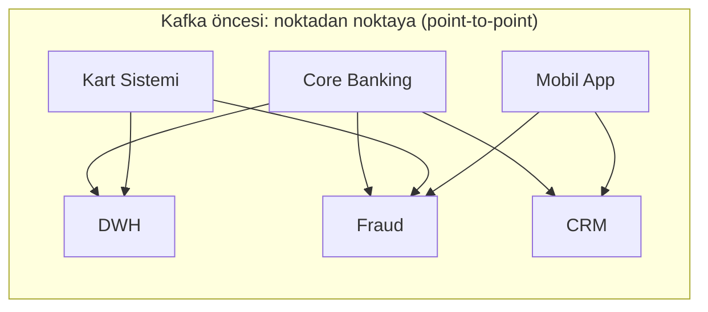
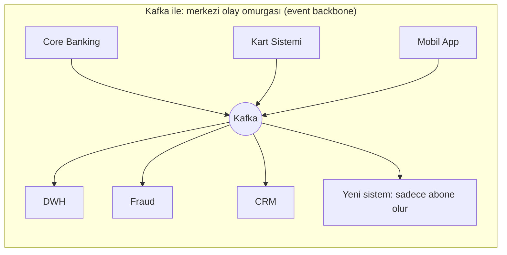
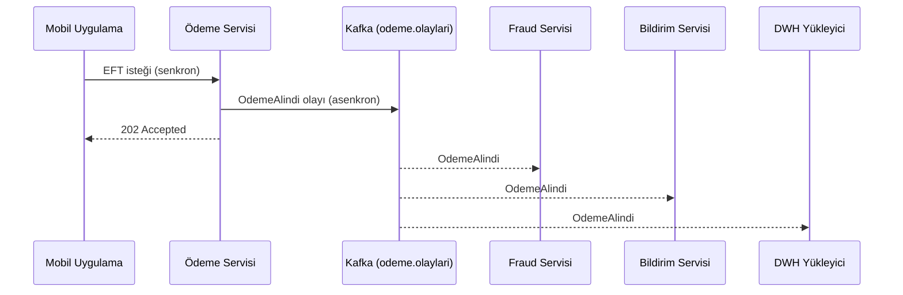
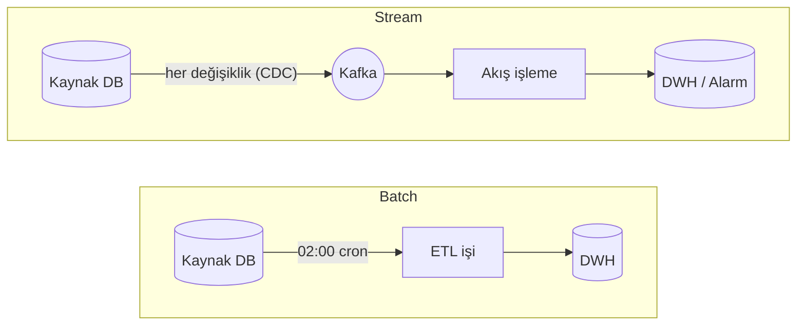

# 1. Apache Kafka'ya Giriş

> **Bu bölümde:** Kafka'nın ne olduğu, hangi problemi çözdüğü, event streaming ve event-driven mimari, kuyruk/broker/streaming farkları, Kafka'nın veritabanı olup olmadığı, saklama süresi, batch–stream farkı, performansın kaynağı, avantaj/dezavantajlar, alternatiflerle karşılaştırma ve sektör senaryoları.
>
> **Ön koşul:** Yok. Bu bölüm kavramsaldır; kod 3. bölümde başlar.

---

## 1.1 Apache Kafka nedir?

**Basit anlatım:** Kafka, sistemler arasında olup biten her şeyi (bir EFT yapıldı, bir kart çekildi, bir sensör ölçüm gönderdi) **sırasıyla kaydeden ve isteyen herkesin bu kaydı istediği hızda okumasını sağlayan** bir platformdur. Bir bankanın "olay defteri" gibi düşünebilirsiniz: deftere yazılan satır silinmez, defteri okuyan herkes kendi kaldığı sayfayı bilir.

**Teknik anlatım:** Apache Kafka; dağıtık (distributed), bölümlenmiş (partitioned), çoğaltılmış (replicated), yalnızca sona eklenen (append-only) bir **commit log** üzerine kurulu, açık kaynaklı bir **olay akışı platformudur (event streaming platform)**. Üç temel yeteneği vardır:

| Yetenek | Açıklama | Kafka bileşeni |
|---|---|---|
| Yayınla / abone ol (publish/subscribe) | Olayları yazmak ve okumak | Producer API, Consumer API |
| Sakla (store) | Olayları dayanıklı (durable) ve hataya dayanıklı (fault-tolerant) biçimde, istenen süre boyunca tutmak | Broker, log segmentleri, replication |
| İşle (process) | Olayları geldikçe dönüştürmek, birleştirmek, toplamak | Kafka Streams, Kafka Connect, (dış) Flink / Spark / ksqlDB |

Kafka 2011'de LinkedIn'de geliştirildi, Apache Software Foundation'a devredildi. Bu rehberin yazıldığı Kasım 2026 itibarıyla en güncel sürüm **Apache Kafka 4.4.0**'dır (22 Ekim 2026); 4.3.x hattının son yaması **4.3.2**'dir.

---

## 1.2 Hangi problemleri çözmek için geliştirilmiştir?

LinkedIn'in 2010'larda yaşadığı problem bugün her büyük kurumda yaşanır: **N kaynak × M hedef = N×M entegrasyon.**

Çözülen problemler:

1. **Entegrasyon karmaşası (spaghetti integration):** Her kaynak verisini bir kez Kafka'ya yazar; her hedef ihtiyaç duyduğunu okur. N×M → N+M.
2. **Gecikme (latency):** Gece çalışan batch ETL yerine olaylar milisaniyeler–saniyeler içinde ulaşır.
3. **Bağımlılık (coupling):** Üretici, tüketicinin varlığından haberdar olmak zorunda değildir. Fraud sistemi çökse bile ödeme sistemi yazmaya devam eder.
4. **Geri oynatma (replay):** Mesajlar okunduktan sonra silinmediği için yeni bir model veya hatalı çalışmış bir tüketici geçmişi baştan okuyabilir.
5. **Ölçek (scale):** Saniyede milyonlarca olayı yatay ölçeklenerek (partition + broker ekleyerek) taşır.
6. **Hız farkı (backpressure):** Hızlı üretici ile yavaş tüketici arasında tampon görevi görür; tüketici geride kalırsa (lag) veri kaybolmaz, sadece gecikir.

---

## 1.3 Event Streaming nedir?

**Olay (event):** "Bir şey oldu" bilgisidir. Geçmiş zaman kipindedir ve değişmez (immutable):
`{"hareket_id": 1002, "islem_tipi": "EFT", "tutar": "98000.00", "islem_zamani": "2026-11-24T06:20:00Z"}`

**Event streaming:** Olayları **oluştukları anda** yakalamak (capture), **dayanıklı biçimde saklamak** (store), **gerçek zamanlı ve geriye dönük işlemek** (process) ve **gerekli yere iletmek** (route) pratiğidir.

Basit benzetme: Banka hesap ekstresi bir **akıştır** (her satır bir olay); hesap bakiyesi ise o akışın o anki **durumudur (state)**. Akış elinizdeyse bakiyeyi her zaman yeniden hesaplayabilirsiniz; ama sadece bakiye elinizdeyse geçmişi bilemezsiniz. Buna **stream–table duality** denir ve Kafka ekosisteminin temel fikridir.

| Kavram | Tablo (state) | Akış (stream) |
|---|---|---|
| Soru | "Şu an ne?" | "Ne oldu, hangi sırayla?" |
| Örnek | Müşterinin güncel bakiyesi | Tüm hesap hareketleri |
| Değişim | UPDATE ile üzerine yazılır | Sadece sona eklenir |
| Kafka karşılığı | Compacted topic / KTable | Normal topic / KStream |

---

## 1.4 Event-driven architecture (olay güdümlü mimari) nedir?

**Basit:** Servisler birbirini doğrudan çağırmak yerine "şu oldu" diye ilan eder; ilgilenen servisler tepki verir.

**Teknik:** Bileşenlerin senkron istek/yanıt (request/response) yerine asenkron olay yayınlama/abone olma ile haberleştiği mimari stildir. Üç yaygın desen:

| Desen | Ne taşınır | Örnek |
|---|---|---|
| **Event notification** | Sadece "oldu" bilgisi ve ID | `HesapAcildi{musteri_id: 7}` → tüketici detayı API'den çeker |
| **Event-carried state transfer** | Olayın tüm verisi | `HesapAcildi{musteri_id, segment, sube, ...}` → tüketici API'ye gitmez |
| **Event sourcing** | Sistemin tek doğruluk kaynağı olaylardır; durum olaylardan türetilir | Bakiye = tüm hareketlerin toplamı |

**Avantaj:** Gevşek bağlılık (loose coupling), bağımsız ölçeklenme, yeni tüketiciyi kodu değiştirmeden ekleme, denetim izi (audit trail).
**Dezavantaj:** Nihai tutarlılık (eventual consistency), hata ayıklamanın zorlaşması (dağıtık izleme gerekir), olay şemalarının sözleşme olarak yönetilmesi gerekliliği, "olay fırtınası" riski.

---

## 1.5 Message Queue, Message Broker ve Event Streaming farkları

| Özellik | Message Queue (ör. klasik JMS kuyruğu) | Message Broker (ör. RabbitMQ) | Event Streaming (Kafka) |
|---|---|---|---|
| Temel model | Noktadan noktaya: bir mesajı **bir** tüketici alır | Yönlendirme (exchange, routing key) + kuyruklar | Dağıtık, kalıcı **log** |
| Okunan mesaj | Silinir | Onaylanınca (ack) silinir | **Silinmez**; retention dolunca silinir |
| Birden çok tüketici | Rekabetçi tüketim (competing consumers) | Her kuyruğa kopya (fan-out) | Her consumer group kendi offset'iyle bağımsız okur |
| Geri oynatma (replay) | Yok | Yok (stream eklentisi hariç) | Var (offset'i geri sarmak) |
| Sıralama | Kuyruk içinde | Kuyruk içinde | **Partition içinde** |
| Ana güç | Görev dağıtımı | Esnek yönlendirme, düşük gecikme, karmaşık protokoller (AMQP, MQTT) | Yüksek throughput, saklama, akış işleme, çoklu tüketici |
| Durum kimde? | Broker (her mesajın durumu) | Broker | Tüketici (offset) |

> **Güncel not (Kafka 4.x):** Kafka 4.0 ile önizlemeye giren **share groups** (KIP-932, "Queues for Kafka") özelliği, Kafka'ya klasik kuyruk semantiği ekler: aynı partition'daki mesajlar birden fazla tüketiciye tek tek dağıtılabilir ve mesaj bazında onay verilir. Confluent bu özelliğin Kafka 4.2 tabanlı ürünlerinde genel kullanıma (GA) açıldığını duyurmuştur. Yani "Kafka kuyruk yapamaz" bilgisi artık eskimiştir; ancak sıralama garantisi share group'larda consumer group'taki gibi değildir. Bu rehber klasik consumer group modelini esas alır.

---

## 1.6 Kafka bir veritabanı mıdır?

**Kısa cevap:** Hayır, ama bazı veritabanı özellikleri taşır.

| Veritabanı özelliği | Kafka'da var mı? | Not |
|---|---|---|
| Dayanıklı saklama (durability) | ✅ | Disk + replication |
| Transaction | ⚠️ Kısmen | Sadece Kafka içi (producer transactions); SQL anlamında değil |
| Anahtara göre güncel değer | ⚠️ Kısmen | Compacted topic son değeri tutar ama sorgulanamaz |
| İkincil indeks (secondary index) | ❌ | Sadece offset ve zaman damgasına göre konumlanma |
| Ad-hoc sorgu (`SELECT ... WHERE`) | ❌ | ksqlDB/Flink gibi dış motorlar gerekir |
| JOIN, GROUP BY | ❌ | Akış işleme motorları ile |
| Rastgele satır güncelleme/silme | ❌ | Append-only; silme sadece retention/compaction/tombstone ile |

**Doğru konumlandırma:** Kafka bir **olay saklama ve taşıma katmanıdır**. Veritabanları (PostgreSQL, ClickHouse, Snowflake) sorgulama içindir. Doğru mimari: *Kafka = sistemin damarları; veritabanları = organlar.*

---

## 1.7 Kafka veri saklar mı? Ne kadar süre saklar?

**Evet.** Kafka her mesajı diske yazar ve **retention (saklama) politikasına** göre tutar. Okunmuş olması mesajı silmez.

| Ayar (topic seviyesi) | Broker varsayılanı | Anlamı |
|---|---|---|
| `retention.ms` | 604800000 (7 gün) | Bu süreden eski **segment**ler silinir |
| `retention.bytes` | -1 (sınırsız) | Partition başına boyut üst sınırı |
| `cleanup.policy` | `delete` | `delete`, `compact` veya `compact,delete` |
| `segment.ms` / `segment.bytes` | 7 gün / 1 GiB | Silme/compaction **kapalı segment** bazında yapılır |

Örnekler:
- `retention.ms=-1` → **süresiz** saklama (olay kaynaklı/event sourcing ya da denetim izi için).
- `cleanup.policy=compact` → Her **key** için en son değer süresiz tutulur (müşteri profili, kur tablosu).
- **Tiered Storage (KIP-405):** Kafka 3.9'dan itibaren üretimde kullanılabilir. Eski segmentler S3/GCS gibi nesne depolamaya taşınır; broker diskleri küçük kalır, geçmiş ucuza aylarca/yıllarca saklanır.

> **Dikkat:** Silme partition seviyesinde ve segment bazındadır; "7 gün" dediğinizde bazı mesajlar 7 günden biraz daha uzun yaşayabilir, çünkü aktif segment kapanmadan silinmez.

---

## 1.8 Batch Processing ile Stream Processing farkı

| Boyut | Batch (toplu) işleme | Stream (akış) işleme |
|---|---|---|
| Veri | Sınırlı (bounded): "dünün tüm işlemleri" | Sınırsız (unbounded): "gelmeye devam eden işlemler" |
| Tetikleme | Zaman planı (cron, Airflow) | Her olay veya küçük pencere |
| Gecikme | Dakikalar–saatler | Milisaniyeler–saniyeler |
| Sonuç | Kesin, bir kez hesaplanır | Sürekli güncellenir; geç gelen veri sonucu değiştirebilir |
| Zorluklar | Yük pencereleri, büyük tek seferlik iş | Durum (state), sıralama, geç veri, exactly-once |
| Tipik araç | SQL, Spark batch, dbt, Dataiku recipe | Kafka Streams, Flink, Spark Structured Streaming, ksqlDB |
| Bankacılık örneği | Gün sonu BDDK raporu, mutabakat | Anlık fraud skoru, limit aşımı uyarısı |

Arada **micro-batch** vardır: akış, birkaç saniyelik küçük paketler halinde işlenir (Spark Structured Streaming varsayılanı, bu rehberdeki Pandas tüketicileri).

---

## 1.9 Kafka neden yüksek performanslıdır?

1. **Sıralı disk yazımı (sequential I/O):** Mesajlar log dosyasının sonuna eklenir. Sıralı yazma, rastgele yazmadan kat kat hızlıdır (HDD'de bile).
2. **İşletim sistemi sayfa önbelleği (page cache):** Kafka JVM heap'inde büyük önbellek tutmaz; OS'in boş RAM'ini kullanır. Yeni yazılan veri çoğunlukla RAM'den okunur.
3. **Zero-copy (`sendfile`):** Diskten ağa aktarımda veri kullanıcı alanına kopyalanmaz (TLS açıkken bu avantaj azalır, çünkü şifreleme için veri JVM'e alınmak zorundadır).
4. **Batching:** Producer mesajları biriktirip (`linger.ms`, `batch.size`) toplu gönderir; broker ve consumer da toplu çalışır.
5. **Sıkıştırma (compression):** Batch bazında `zstd`, `lz4`, `snappy`, `gzip`. Broker sıkıştırılmış batch'i açmadan saklar.
6. **Partition ile paralellik:** Bir topic N partition'a bölünür; N broker'a ve N tüketiciye yayılır.
7. **Basit broker:** Broker mesaj bazında durum tutmaz (kim okudu, onaylandı mı?). Offset'i tüketici yönetir.
8. **İkili protokol (binary protocol) ve uzun ömürlü TCP bağlantıları.**

---

## 1.10 Avantajlar, dezavantajlar ve kullanılmaması gereken durumlar

**Avantajlar**
- Çok yüksek throughput, yatay ölçeklenme
- Dayanıklılık ve hata toleransı (replication, ISR)
- Geri oynatma (replay), çoklu bağımsız tüketici
- Partition içinde sıralama garantisi
- Geniş ekosistem: Connect (yüzlerce connector), Streams, Schema Registry, Debezium, Flink
- Açık kaynak, bulut sağlayıcılarda yönetilen (managed) seçenekler

**Dezavantajlar**
- Operasyonel karmaşıklık (cluster, disk, partition, upgrade, güvenlik, izleme)
- Öğrenme eğrisi (offset, rebalance, delivery semantics)
- Sorgulama yeteneği yok; ek motor gerekir
- Mesaj bazında yönlendirme, öncelik, gecikmeli teslim (delayed delivery) gibi broker özellikleri yok veya sınırlı
- Partition sayısı sonradan artırılabilir ama **azaltılamaz**; artırmak key→partition eşlemesini bozar
- Küçük işler için maliyet/karmaşıklık orantısız

**Kullanılmaması gereken durumlar** (ayrıntısı [17. bölümde](17-ne-zaman-kullanmamali.md)):
- Günde bir kez çalışan, kaynağı zaten batch olan ETL'ler
- Senkron istek/yanıt gereken işlemler (ör. "bakiye yeterli mi?" kontrolü)
- Küçük hacimli, tek veritabanlı sistemler
- Karmaşık sorgu ihtiyacı olan analitik iş yükleri (Kafka değil, OLAP veritabanı)

---

## 1.11 Karşılaştırma: Kafka, RabbitMQ, Redis Streams, Amazon Kinesis, Apache Pulsar, SQL tabanlı ETL

| Kriter | Apache Kafka | RabbitMQ | Redis Streams | Amazon Kinesis Data Streams | Apache Pulsar | SQL tabanlı batch ETL |
|---|---|---|---|---|---|---|
| Model | Dağıtık log | Broker + kuyruk (AMQP); ayrıca "Streams" tipi | Bellek içi log veri yapısı | Yönetilen shard'lı log | Log + kuyruk; compute/storage ayrık (BookKeeper) | Zamanlanmış sorgu/iş |
| Throughput | Çok yüksek | Orta–yüksek | Yüksek (RAM sınırlı) | Shard başına sınırlı, shard ekleyerek ölçeklenir | Çok yüksek | Düşük gecikme hedefi yok |
| Saklama | Gün–yıl, tiered storage | Tüketilene kadar | RAM'e bağlı (MAXLEN ile kırpma) | 24 saat varsayılan, en fazla 365 gün | Uzun, tiered storage yerleşik | DB'de |
| Replay | ✅ | ⚠️ Sadece Streams kuyruklarında | ✅ | ✅ | ✅ | Tabloyu tekrar sorgulamak |
| Sıralama | Partition içinde | Kuyruk içinde | Stream içinde | Shard içinde | Partition/key içinde | — |
| Tüketici grubu | Consumer group | Rekabetçi tüketici | Consumer group (XREADGROUP) | KCL ile | Subscription tipleri (exclusive, shared, failover, key_shared) | — |
| Ekosistem | En geniş (Connect, Debezium, Flink, Streams) | Geniş (protokoller) | Redis ekosistemi | AWS (Lambda, Firehose) | Büyüyor (Functions, IO) | dbt, Airflow, Dataiku |
| İşletim | Kendi kurulum veya managed | Kolay–orta | Kolay | Tamamen yönetilen (AWS'e bağımlı) | Karmaşık (broker + BookKeeper + metadata store) | Kolay |
| En iyi olduğu iş | Olay omurgası, CDC, akış işleme | Görev kuyrukları, RPC, karmaşık yönlendirme | Hafif akışlar, zaten Redis varsa | AWS-native gerçek zamanlı veri | Multi-tenant, coğrafi replikasyon | Günlük/haftalık raporlama |

**Yorum:** Bankacılık gibi denetim izi, replay ve çoklu tüketici gerektiren ortamlarda omurga olarak Kafka; iş/görev kuyrukları için RabbitMQ; düşük hacimli günlük raporlama için hâlâ SQL + scheduler en mantıklısıdır. Pulsar teknik olarak güçlüdür ama ekosistem ve yetkin personel bulunabilirliği Kafka kadar geniş değildir.

---

## 1.12 Sektör senaryoları

### Bankacılık
| Senaryo | Akış | Neden Kafka? |
|---|---|---|
| Gerçek zamanlı fraud | Kart/EFT olayı → Kafka → Flink kural + ML skoru → alarm topic'i | Milisaniye–saniye gecikme, aynı olayı birden çok sistem okur |
| Core banking CDC | Core DB → Debezium → Kafka → DWH / CRM / risk | Batch yükü ve gece penceresi azalır, kaynağa sorgu yükü binmez |
| Müşteri 360 | Kanal olayları (mobil, şube, çağrı merkezi) → compacted profil topic'i | Tek olay kaynağından çoklu görünüm |
| Limit ve risk izleme | İşlemler → pencereli toplam (müşteri/grup bazında) → limit aşımı | Stateful akış işleme |
| Denetim izi (audit trail) | Personel sorgu olayları → süresiz retention'lı topic | Değişmez, sıralı kayıt; anomali modelleri için kaynak |

### Finans / Piyasa
- Fiyat (tick) verisinin dağıtımı, emir olayları, risk hesaplarının sürekli güncellenmesi, piyasa verisinden sinyal üretimi.

### E-ticaret
- Sipariş yaşam döngüsü (`SiparisVerildi` → `OdemeAlindi` → `KargoyaVerildi`), stok senkronizasyonu, tıklama akışı (clickstream) ile öneri sistemleri, Outbox Pattern ile mikroservis tutarlılığı.

### IoT
- Sensör telemetrisi (ATM sıcaklık/kasa durumu, POS cihaz sağlığı), MQTT → Kafka köprüsü, pencereli anomali tespiti, uç (edge) cihazlardan merkeze toplama.

### Log işleme ve gözlemlenebilirlik
- Uygulama logları → Kafka → Elasticsearch/OpenSearch, ClickHouse veya S3. Kafka, log toplayıcılar ile depolama arasında tampon olur; Elasticsearch çökse bile log kaybolmaz.

---

## Bölüm özeti

- Kafka bir **dağıtık commit log**'dur: yazar, saklar, okutur, işletir.
- Okunan mesaj silinmez; **retention** belirler.
- Sıralama **partition** içinde garantidir.
- Kafka veritabanı değildir; **olay omurgasıdır**.
- Gerçek zamanlı ihtiyaç ve çoklu tüketici yoksa Kafka genellikle gereksiz karmaşıklıktır.

## Kaynaklar

- [Apache Kafka — Introduction](https://kafka.apache.org/documentation/#introduction)
- [Apache Kafka — Downloads (sürümler ve Docker image etiketleri)](https://kafka.apache.org/community/downloads/)
- [Apache Kafka 4.3.0 Release Announcement](https://kafka.apache.org/blog/2026/05/22/apache-kafka-4.3.0-release-announcement/)
- [KIP-405: Kafka Tiered Storage](https://cwiki.apache.org/confluence/display/KAFKA/KIP-405%3A+Kafka+Tiered+Storage)
- [KIP-932: Queues for Kafka](https://cwiki.apache.org/confluence/display/KAFKA/KIP-932%3A+Queues+for+Kafka)
- [Confluent — Introducing Apache Kafka 4.1 / Queues for Kafka duyurusu](https://www.confluent.io/blog/introducing-apache-kafka-4-1/)
- [Amazon Kinesis Data Streams — Data retention](https://docs.aws.amazon.com/streams/latest/dev/kinesis-extended-retention.html)
- [RabbitMQ — Streams](https://www.rabbitmq.com/docs/streams)
- [Redis — Streams](https://redis.io/docs/latest/develop/data-types/streams/)
- [Apache Pulsar — Architecture overview](https://pulsar.apache.org/docs/next/concepts-architecture-overview/)
