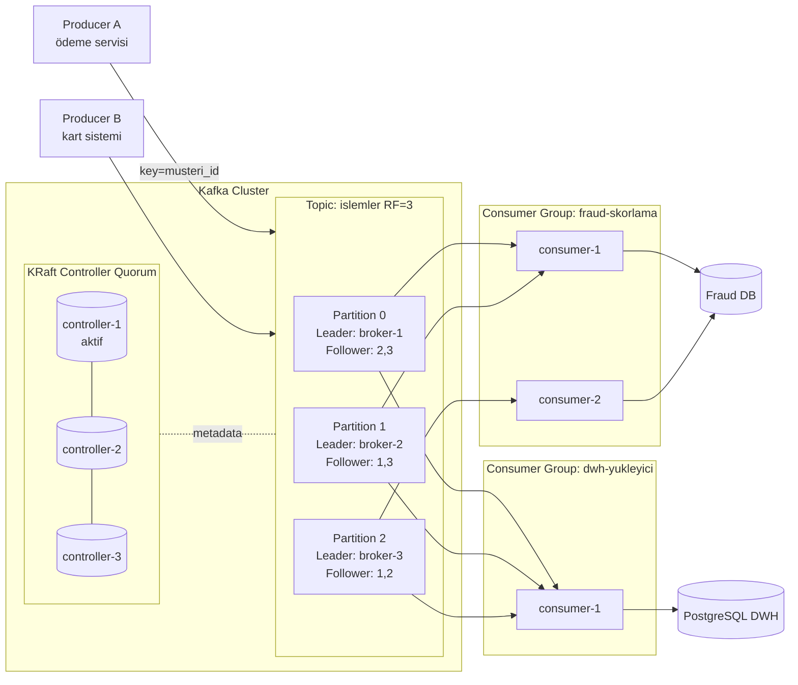
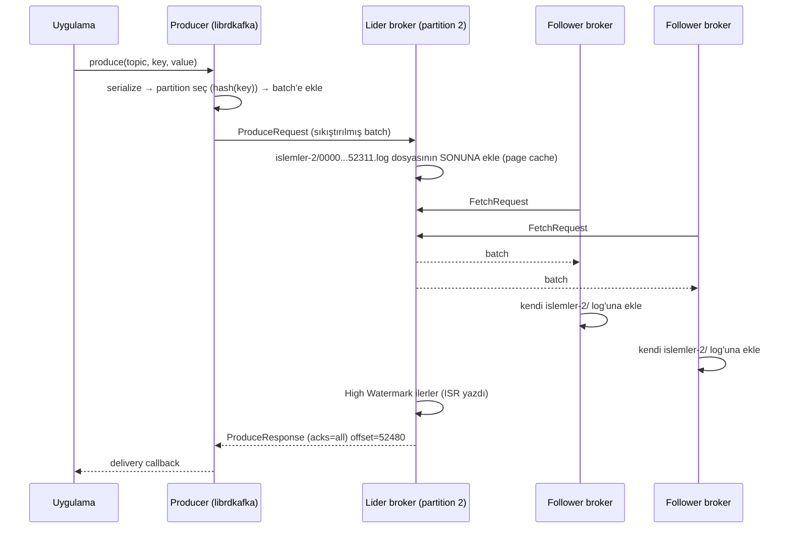
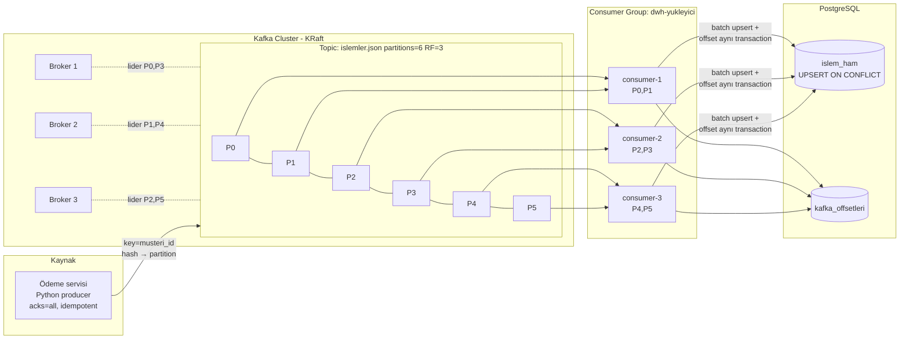

# 2. Kafka Mimarisi ve Bileşenleri

> **Bu bölümde:** Cluster'dan offset'e kadar tüm yapı taşları, KRaft ve ZooKeeper'ın tarihsel yeri, mesajın fiziksel yolculuğu ve sık sorulan dokuz kritik soru.
>
> **Ön koşul:** [1. bölüm](01-giris.md). Uygulamalı denemeler için [3. bölümdeki](03-kurulum.md) tek broker'lı Docker ortamı yeterlidir.

---

## 2.0 Büyük resim



İki farklı consumer group **aynı mesajları bağımsız** okur. Bir grup içinde ise her partition **tek bir** tüketiciye atanır.

---

## 2.1 Kafka Cluster

**Basit:** Birlikte çalışan Kafka sunucularının (node) tamamı.

**Teknik:** Ortak bir `cluster.id` paylaşan, metadata'sını bir **KRaft controller quorum**'u ile yöneten broker ve controller düğümleri kümesi. İstemciler cluster'ın tamamını bilmek zorunda değildir; birkaç **bootstrap** adresinden metadata alır ve hangi partition'ın lideri hangi broker'daysa doğrudan ona bağlanır.

- **Amaç:** Ölçek ve hata toleransı.
- **Avantaj:** Broker ekleyerek kapasite artar; bir düğüm kaybı hizmeti durdurmaz (RF ≥ 3 ise).
- **Dezavantaj:** Dağıtık sistem karmaşıklığı (ağ bölünmesi, disk dengesizliği, rolling upgrade).

---

## 2.2 Broker

**Basit:** Mesajları diskinde tutan ve istemcilere hizmet veren Kafka sunucusu.

**Teknik:** `process.roles=broker` olan düğüm. Görevleri: produce isteklerini kabul edip log'a yazmak, fetch isteklerine yanıt vermek, follower olarak lider partition'ları çoğaltmak, consumer group koordinatörlüğü (group coordinator) ve transaction koordinatörlüğü yapmak.

Her broker'ın benzersiz bir `node.id`'si vardır. Broker başına partition sayısı için genel pratik: birkaç bin partition (lider + follower) rahattır; KRaft ile cluster başına çok daha yüksek partition sayıları desteklenir.

---

## 2.3 Controller

**Basit:** Cluster'ın "yöneticisi": hangi partition'ın lideri kim, hangi broker canlı, hangi topic'in ayarı ne — bunları kaydeder ve karar verir.

**Teknik:** `process.roles=controller` olan düğümler bir **Raft quorum**'u oluşturur. Bunlardan biri **aktif controller**'dır (Raft lideri); diğerleri yedektir (hot standby). Aktif controller:
- Broker kayıtlarını ve canlılık (heartbeat) bilgisini tutar,
- Partition lider seçimini (leader election) yapar,
- Topic/config/ACL/SCRAM değişikliklerini **metadata log**'una (`__cluster_metadata` iç topic'i) yazar,
- Broker'lar bu log'u takip ederek metadata önbelleklerini günceller.

Quorum çoğunluk ister: 3 controller → 1 kayıp, 5 controller → 2 kayıp tolere edilir.

---

## 2.4 KRaft (Kafka Raft)

**Basit:** Kafka'nın kendi metadata'sını kendi içinde, ek bir sisteme ihtiyaç duymadan yönetme yöntemi.

**Teknik:** KIP-500 ile başlayan, Raft uzlaşı (consensus) protokolüne dayalı metadata yönetimi. Metadata, olay log'u olarak saklanır ve broker'lara akıtılır.

| Kilometre taşı | Durum |
|---|---|
| Kafka 2.8 (2021) | KRaft erken erişim |
| Kafka 3.3 (2022) | KRaft production-ready |
| Kafka 3.9 (2024) | ZooKeeper'ı destekleyen **son** sürüm hattı; ZooKeeper → KRaft göçü için köprü |
| **Kafka 4.0 (Mart 2025)** | **ZooKeeper modu tamamen kaldırıldı.** Sadece KRaft |

**Dağıtım modları:**
- **Combined mode:** Aynı düğüm hem broker hem controller (`process.roles=broker,controller`). Sadece geliştirme/test için.
- **Isolated (dedicated) mode:** Controller'lar ayrı düğümlerde. **Production için önerilen.**

**Avantajları:** Tek sistem işletmek, daha hızlı controller failover, çok daha fazla partition desteği, metadata'nın tutarlı olay log'u olarak saklanması, daha basit güvenlik modeli.

---

## 2.5 ZooKeeper (tarihsel mimari)

> ⚠️ **Eski mimari.** Kafka 4.x'te ZooKeeper **yoktur**. İnternetteki `confluentinc/cp-zookeeper` içeren, `KAFKA_ZOOKEEPER_CONNECT` ortam değişkenli Docker Compose örnekleri güncel değildir. Bu rehberdeki tüm örnekler KRaft kullanır.

ZooKeeper döneminde (Kafka ≤ 3.x) ayrı bir Apache ZooKeeper ensemble'ı; broker kayıtlarını, controller seçimini, topic/partition metadata'sını ve ACL'leri tutardı. Brokerlardan biri ZooKeeper üzerinden "controller" seçilirdi.

| | ZooKeeper dönemi | KRaft dönemi |
|---|---|---|
| İşletilen sistem | Kafka + ZooKeeper | Sadece Kafka |
| Metadata | ZooKeeper znode'ları | `__cluster_metadata` log'u |
| Controller failover | Yavaş (tüm metadata ZK'den yeniden okunur) | Hızlı (standby controller'lar güncel) |
| Partition ölçeği | ~200 bin civarı pratik sınır | Milyonlar mertebesi hedeflenir |
| Eski istemci bayrağı | `--zookeeper` (CLI) | `--bootstrap-server` |

3.x ZooKeeper cluster'ınızı 4.x'e taşımak için önce 3.9'da **KRaft migration** yapmanız gerekir; 4.x doğrudan ZooKeeper'dan yükseltmeyi desteklemez.

---

## 2.6 Producer

**Basit:** Kafka'ya mesaj yazan uygulama.

**Teknik akış:**
1. `produce(topic, key, value, headers, timestamp)` çağrılır.
2. **Serializer** key ve value'yu byte dizisine çevirir.
3. **Partitioner** hedef partition'ı seçer: key varsa `hash(key) % partition_sayısı`; key yoksa "sticky" (bir batch dolana kadar aynı partition).
4. Mesaj, ilgili partition'ın **bellek içi batch**'ine eklenir (`batch.size`, `linger.ms`).
5. Arka plan thread'i batch'i sıkıştırıp partition **lider** broker'ına gönderir.
6. Broker `acks` ayarına göre yanıt döner; istemci **delivery callback**'i çağırır.
7. Hata geçiciyse (ör. lider değişti) istemci otomatik **retry** yapar (`delivery.timeout.ms` dolana kadar).

> **Python (librdkafka) notu:** Varsayılan partitioner `consistent_random`'dır; Java istemcisinin `murmur2` hash'iyle **aynı partition'ı üretmez.** Java ve Python producer'lar aynı topic'e aynı key ile yazıyorsa Python'da `partitioner=murmur2_random` ayarlayın.

---

## 2.7 Consumer

**Basit:** Kafka'dan mesaj okuyan uygulama.

**Teknik:** Consumer **pull** modeliyle çalışır: broker'a "partition X, offset Y'den itibaren ver" diye **fetch** isteği atar. Bu sayede tüketici kendi hızında okur (backpressure doğal olarak çözülür). Okuduğu son konumu **offset commit** ile `__consumer_offsets` iç topic'ine yazar.

Önemli ayarlar: `group.id`, `auto.offset.reset` (`earliest`/`latest`: commit edilmiş offset yoksa nereden başlanacağı), `enable.auto.commit`, `max.poll.interval.ms` (iki poll arasında izin verilen maksimum süre; aşılırsa gruptan atılır), `isolation.level` (`read_committed` ile abort edilmiş transaction mesajları görünmez).

---

## 2.8 Consumer Group

**Basit:** Aynı işi paylaşan tüketiciler takımı. Takım, topic'in partition'larını aralarında böler.

**Teknik:**
- Aynı `group.id`'ye sahip tüketiciler bir gruptur.
- Bir partition, bir grup içinde **en fazla bir** tüketiciye atanır → grup içinde sıralı ve tekil işleme.
- Tüketici sayısı > partition sayısı ise fazlalar **boşta** bekler.
- Farklı gruplar aynı topic'i **bağımsız** okur (her grubun kendi offset'leri vardır).
- Grubu broker tarafında bir **group coordinator** yönetir.

| Topic: 6 partition | Tüketici sayısı | Atama |
|---|---|---|
| | 1 | 1 tüketici 6 partition |
| | 3 | her biri 2 partition |
| | 6 | her biri 1 partition (maksimum paralellik) |
| | 8 | 6'sı 1'er partition, **2'si boşta** |

---

## 2.9 Topic

**Basit:** Aynı türden olayların toplandığı isimli kanal (`islemler`, `musteri.profil`).

**Teknik:** Mantıksal bir isimdir; fiziksel olarak **partition**'lardan oluşur. Topic seviyesinde ayarlanan başlıca config'ler: `partitions`, `replication.factor`, `retention.ms`, `cleanup.policy`, `min.insync.replicas`, `compression.type`, `max.message.bytes`.

**İsimlendirme önerisi:** `<alan>.<varlık>.<olay>.<versiyon>` → `odeme.eft.gerceklesti.v1`. Nokta ve alt çizgiyi karıştırmayın (Kafka metrik adlarında ikisi çakışır ve uyarı verir).

---

## 2.10 Partition

**Basit:** Topic'in sıralı, bağımsız parçası. Paralelliğin birimi.

**Teknik:** Her partition, broker diskinde bir **dizin**dir (`islemler-0/`). İçinde **segment** dosyaları bulunur:

```
/var/lib/kafka/data/islemler-0/
├── 00000000000000000000.log        # mesaj batch'leri (asıl veri)
├── 00000000000000000000.index      # offset -> dosya konumu (seyrek indeks)
├── 00000000000000000000.timeindex  # zaman damgası -> offset
├── 00000000000000052311.log        # sonraki segment (ilk offset'i dosya adıdır)
├── 00000000000000052311.index
├── 00000000000000052311.timeindex
├── leader-epoch-checkpoint
└── partition.metadata
```

Partition **içinde** offset'ler artan sıralıdır ve **sıralama garantisi sadece partition içindedir.**

---

## 2.11 Offset

**Basit:** Partition içindeki mesajın sıra numarası. Kitaptaki sayfa numarası gibi.

**Teknik:** 64-bit, partition başına 0'dan başlayan, monoton artan tamsayı. Offset'ler **yeniden kullanılmaz**; compaction veya transaction marker'ları nedeniyle "boşluklar" olabilir.

Önemli offset türleri:

| Terim | Anlamı |
|---|---|
| Log Start Offset | Partition'da hâlâ duran en eski mesaj (retention sonrası ilerler) |
| **High Watermark (HW)** | Tüm ISR üyelerine çoğaltılmış son offset + 1. **Tüketiciler sadece HW'ye kadar okuyabilir.** |
| Log End Offset (LEO) | Liderin yazdığı son offset + 1 (henüz çoğaltılmamış olabilir) |
| Last Stable Offset (LSO) | Açık transaction'lardan önceki son offset; `read_committed` tüketicinin sınırı |
| Committed Offset | Consumer group'un "buraya kadar işledim" dediği konum (bir sonraki okunacak mesaj) |
| **Consumer Lag** | `LEO (veya HW) − committed offset` |

---

## 2.12 Leader ve Follower

**Basit:** Her partition'ın bir "asıl" kopyası (leader) ve "yedek" kopyaları (follower) vardır.

**Teknik:**
- Tüm **yazmalar liderden** geçer. Okumalar da varsayılan olarak liderden yapılır (KIP-392 ile `client.rack` ayarlanırsa en yakın follower'dan okunabilir — çok AZ'li kurulumlarda ağ maliyetini düşürür).
- Follower'lar liderden sürekli **fetch** yaparak log'u kopyalar.
- Lider düşerse controller, **ISR** içinden yeni lider seçer.
- **Preferred leader:** Replica listesindeki ilk broker. `auto.leader.rebalance.enable=true` ile liderlik zamanla tercih edilen broker'a geri döner, böylece yük dengelenir.

---

## 2.13 Replication Factor (RF)

**Basit:** Her partition'ın kaç kopyası olacağı.

**Teknik:** RF=3 → 1 lider + 2 follower, farklı broker'larda (ve `broker.rack` tanımlıysa farklı rack/AZ'lerde).

| RF | Tolere edilen broker kaybı (veri kaybı olmadan) | Kullanım |
|---|---|---|
| 1 | 0 | Sadece geliştirme |
| 2 | 1 (ama yazmaya devam için `min.insync.replicas=1` gerekir → risk) | Önerilmez |
| **3** | 1 broker kaybında yazma devam eder (`min.insync.replicas=2` ile) | **Production standardı** |
| 5 | 2 | Kritik, çok AZ'li |

---

## 2.14 In-Sync Replicas (ISR)

**Basit:** Liderle "güncel" sayılan kopyalar listesi.

**Teknik:** Bir follower, `replica.lag.time.max.ms` (varsayılan 30 sn) süresi içinde liderin log sonuna yetiştiyse ISR'dedir. Yetişemeyen follower ISR'den çıkarılır (**under-replicated partition** durumu). Yetişince geri eklenir.

`min.insync.replicas` (topic/broker ayarı) + `acks=all` birlikte çalışır:
- ISR boyutu ≥ `min.insync.replicas` ise yazma kabul edilir.
- Altına düşerse producer `NOT_ENOUGH_REPLICAS` hatası alır → **veri kaybı yerine kullanılamazlık** seçilmiş olur.

`unclean.leader.election.enable=false` (varsayılan): ISR dışındaki geride kalmış bir kopyanın lider olmasına izin verme (veri kaybını önler). `true` yapmak erişilebilirliği artırır ama **commit edilmiş veriyi kaybettirebilir.** Finansal veride kapalı tutun.

---

## 2.15 Acknowledgments (acks)

| `acks` | Broker ne zaman "tamam" der? | Dayanıklılık | Gecikme | Kullanım |
|---|---|---|---|---|
| `0` | Hiç beklemez (producer gönderir ve unutur) | En düşük; kayıp olası | En düşük | Kayıp tolere edilen metrik/log |
| `1` | Lider kendi log'una yazınca | Lider yazıp çökerse ve follower'lar almamışsa **kayıp** | Düşük | Eski varsayılan |
| `all` (`-1`) | Tüm **ISR** üyeleri yazınca | En yüksek (`min.insync.replicas` ile birlikte) | Daha yüksek | **Finansal veri, varsayılan önerisi** |

> Java istemcisinde Kafka 3.0'dan beri varsayılan `acks=all` + `enable.idempotence=true`'dur. **librdkafka/confluent-kafka-python'da `enable.idempotence` varsayılanı `false`'tur**; bu rehberin `common.py`'si bunu açıkça `true` yapar.

---

## 2.16 Retention

Ayrıntı [1.7'de](01-giris.md#17-kafka-veri-saklar-mı-ne-kadar-süre-saklar). Mimari açıdan kritik noktalar:
- Retention **partition + segment** bazında uygulanır; aktif segment silinmez.
- Retention, tüketicilerin okuyup okumadığına **bakmaz**. Tüketici retention süresinden fazla geride kalırsa mesajlar silinir ve tüketici `auto.offset.reset` davranışına düşer (**sessiz veri kaybı** riski → lag alarmı şart).
- Disk kapasitesi = `günlük_veri × retention_gün × RF × (1 + pay)`.

---

## 2.17 Log Compaction

**Basit:** Her anahtar için sadece en son değeri tutan temizlik modu. "Defterin her müşteri için son sayfası."

**Teknik:** `cleanup.policy=compact`. Arka plandaki **log cleaner** thread'leri kapalı segmentleri tarar; aynı key'in eski kayıtlarını siler, en sonuncusunu tutar.

```
Önce:   offset 0 k=7 {"sehir":"Ankara"}   offset 1 k=9 {...}   offset 2 k=7 {"sehir":"İzmir"}   offset 3 k=9 null
Sonra:  offset 2 k=7 {"sehir":"İzmir"}                         (k=9 tombstone, delete.retention.ms sonra tamamen silinir)
```

- **Tombstone:** Value'su `null` olan mesaj = "bu key'i sil". `delete.retention.ms` (varsayılan 1 gün) boyunca tutulur ki tüketiciler silmeyi görebilsin.
- **Kullanım:** Müşteri profili, kur tablosu, CDC topic'leri, Kafka'nın kendi `__consumer_offsets` ve Connect config topic'leri.
- `compact,delete`: Hem compaction hem süre bazlı silme.
- **Garanti:** Compaction sonrası bile, bir tüketici partition'ı baştan okursa her key'in **en az son değerini** görür. Ara değerlerin silinme zamanı garanti değildir (`min.compaction.lag.ms`, `max.compaction.lag.ms`).

---

## 2.18 Message Key ve Value

| | Key | Value |
|---|---|---|
| Amaç | Partition seçimi, sıralama ve compaction anahtarı | Olayın içeriği |
| Zorunlu mu? | Hayır (null olabilir) | Hayır (null = tombstone) |
| Örnek | `"musteri_id=7"` | JSON/Avro/Protobuf olay gövdesi |

**Key seçimi en kritik tasarım kararlarından biridir:**
- Sıralamanın önemli olduğu varlık (müşteri, hesap, kart) key olmalı.
- **Sıcak anahtar (hot key):** Kurumsal büyük bir müşteri tüm işlemlerin %30'unu üretiyorsa o partition tıkanır (**partition skew**). Gerekirse key'e alt bölüm ekleyin (`musteri_id + hesap_no`), ama bu müşteri bazında sıralamayı bozar — iş gereksinimine göre karar verin.

---

## 2.19 Record Headers

Key/value dışında, mesaja eklenen `(string anahtar, byte değer)` çiftleri. İçeriği açmadan yönlendirme ve izleme için kullanılır:
- `schema=islem.v1`, `kaynak=mobil`, `trace-id` / `traceparent` (OpenTelemetry), `correlation-id`
- DLT bağlamı: `dlt.original.topic`, `dlt.exception.message` (bkz. `code/python/13_dead_letter_topic.py`)

Header'lar sıkıştırılır ve saklanır; büyük veri koymayın.

---

## 2.20 Timestamp

Her kaydın bir zaman damgası vardır. Topic ayarı `message.timestamp.type`:
- `CreateTime` (varsayılan): Producer'ın verdiği zaman (veya gönderim anı). Bu rehberdeki producer, **olay zamanını** (event time) `timestamp=` parametresiyle verir.
- `LogAppendTime`: Broker'ın log'a yazdığı an.

Akış işlemede üç zaman kavramı vardır:

| Zaman | Tanım | Örnek |
|---|---|---|
| Event time | Olayın gerçekte olduğu an | Kartın POS'ta çekildiği saniye |
| Ingestion / log append time | Kafka'ya yazıldığı an | Broker'a ulaştığı an |
| Processing time | Tüketicinin işlediği an | Fraud servisinin skorladığı an |

Pencereli hesaplarda (dakikalık toplam) **event time** kullanılmalıdır; aksi halde gecikmeli gelen olaylar yanlış pencereye düşer.

---

## 2.21 Serialization ve Deserialization

Kafka içerik bilmez: key ve value **byte dizisi**dir. Dönüşüm istemcide yapılır:
- **Serializer (producer):** Nesne → byte (`json.dumps(...).encode()`, Avro binary, Protobuf).
- **Deserializer (consumer):** Byte → nesne.

Seçenekler ve şema yönetimi [10. bölümde](10-veri-formatlari-sema.md). Finansal veri için altın kural: **tutarı asla `float` ile serileştirmeyin**; `Decimal` → string (JSON) veya Avro `decimal` mantıksal tipi.

---

## 2.22 Rebalancing

**Basit:** Grup üyeleri değişince (yeni tüketici geldi, biri çöktü) partition'ların yeniden paylaştırılması.

**Tetikleyiciler:** Tüketici katılması/ayrılması, `session.timeout.ms` içinde heartbeat gelmemesi, `max.poll.interval.ms` aşılması, abone olunan topic'e partition eklenmesi.

| Protokol | Nasıl çalışır | Etki |
|---|---|---|
| Classic – eager (`range`, `roundrobin`) | Herkes **tüm** partition'larını bırakır, sonra yeniden atanır | "Stop-the-world": tüm grup durur |
| Classic – cooperative (`cooperative-sticky`, KIP-429) | Sadece taşınması gereken partition'lar bırakılır, birkaç tur | Kesinti azalır |
| **Consumer protocol (KIP-848)** — Kafka 4.0'da GA | Atama mantığı **broker'da** (group coordinator), artımlı, istemci tarafında senkronizasyon bariyeri yok | Çok daha hızlı ve öngörülebilir rebalance |

Kafka 4.x + confluent-kafka-python ≥ 2.12 ile `group.protocol=consumer` production'da kullanılabilir; Kafka 4.3 klasik protokolle başlatılan tüketiciler için yeni protokolü öneren bir uyarı loglamaktadır. Rebalance sırasında işlenmiş ama commit edilmemiş mesajlar yeni sahibine tekrar gider → **idempotent işleme** ve `on_revoke` callback'inde commit önemlidir (bkz. `16_graceful_shutdown.py`).

**Static membership** (`group.instance.id`): Kubernetes pod'u yeniden başladığında aynı kimlikle dönerse rebalance tetiklenmez (`session.timeout.ms` içinde dönmek şartıyla).

---

## 2.23 Consumer Lag

**Tanım:** Bir consumer group'un partition başına "kaç mesaj geride" olduğu: `log end offset − committed offset`.

- Lag **sabit ve düşük** → sağlıklı.
- Lag **sürekli artıyor** → tüketici yetişemiyor (yavaş işlem, yetersiz paralellik, DB darboğazı).
- Lag **retention'ı aşarsa** → veri kaybı.

Ölçme:
```bash
docker exec kafka /opt/kafka/bin/kafka-consumer-groups.sh --bootstrap-server kafka:19092 \
  --describe --group rehber-json
# GROUP        TOPIC          PARTITION  CURRENT-OFFSET  LOG-END-OFFSET  LAG  CONSUMER-ID ...
# rehber-json  islemler.json  0          1520            1532            12   rdkafka-...
```
İzleme ve alarm: [14. bölüm](14-monitoring.md).

---

## 2.24 Bootstrap Servers

İstemcinin cluster'a ilk bağlanmak için kullandığı adres listesi (`bootstrap.servers=broker-1:9092,broker-2:9092`). İstemci bunlardan birinden **tüm cluster metadata'sını** alır, sonra lider broker'lara doğrudan bağlanır.

**En sık hata — advertised listeners:** Broker, metadata'da kendini `advertised.listeners`'daki adresle tanıtır. Docker'da broker `kafka:19092` diye tanıtırken laptop'taki Python kodu bu ismi çözemez → "bağlandı ama mesaj gönderemiyor/timeout". Çözüm: iç ve dış ağ için **ayrı listener** (bu rehberin compose dosyalarında `INTERNAL://kafka:19092` ve `EXTERNAL://localhost:9092`).

---

## 2.25 Delivery Semantics (teslim garantileri)

| Semantik | Anlamı | Nasıl elde edilir | Risk |
|---|---|---|---|
| **At-most-once** | En fazla bir kez; kayıp olabilir, tekrar olmaz | Offset'i işlemeden **önce** commit et; producer `acks=0`/retry yok | Kayıp |
| **At-least-once** | En az bir kez; kayıp olmaz, **tekrar** olabilir | İşle, **sonra** commit et; producer `acks=all` + retry | Duplicate |
| **Exactly-once (Kafka içi)** | Kafka'dan okuyup Kafka'ya yazarken her olayın etkisi bir kez | Idempotent producer + transactions + `read_committed` (Kafka Streams'te `processing.guarantee=exactly_once_v2`) | Yalnız Kafka→Kafka kapsar |
| **End-to-end exactly-once** | Dış sistem (DB) dahil tek etki | At-least-once + **idempotent hedef** (upsert, unique key) veya offset'i hedefle aynı transaction'da saklamak | Tasarım gerektirir |

Bu rehberdeki karşılıkları: `14_idempotent_producer.py`, `15_transactional_processor.py`, `11_batch_consume.py` (idempotent upsert), `p04_kafka_pandas_postgres.py` (offset'i DB'de saklama). Ayrıntı [11. bölüm](11-streaming-etl.md).

---

## 2.26 High Availability ve Fault Tolerance

Kafka'nın HA reçetesi:

| Katman | Ayar / pratik |
|---|---|
| Veri | `replication.factor=3`, `min.insync.replicas=2`, `acks=all`, `unclean.leader.election.enable=false` |
| Yerleşim | `broker.rack` ile replikaları farklı AZ/rack'lere yay |
| Metadata | 3 (veya 5) dedicated KRaft controller, farklı AZ'lerde |
| İstemci | Birden fazla bootstrap adresi, idempotent producer, retry, static membership |
| Operasyon | Rolling restart, under-replicated partition alarmı, kapasite payı (%30–40 boş disk) |
| Felaket kurtarma | MirrorMaker 2 / cluster linking ile ikinci bölge ([15. bölüm](15-production.md)) |

---

## 2.27 Kritik sorular ve cevapları

### S1. Bir mesaj producer tarafından gönderildiğinde fiziksel olarak nereye yazılır?



Fiziksel konum: `log.dirs` altındaki `<topic>-<partition>/` dizininde, **aktif segment**in `.log` dosyasının sonu. Önce OS page cache'e yazılır; diske fsync'i işletim sistemi yapar (Kafka dayanıklılığı fsync'e değil **replikasyona** dayandırır).

### S2. Consumer bu mesajı nasıl bulur?
1. Bootstrap'tan metadata alır: partition 2'nin lideri hangi broker?
2. Group coordinator'dan partition atamasını ve **committed offset**'i öğrenir (yoksa `auto.offset.reset`).
3. Lidere `Fetch(partition=2, offset=52480)` gönderir.
4. Broker `.index` dosyasında **ikili arama** ile 52480'e en yakın önceki girdiyi bulur, `.log` içinde o konumdan sıralı okur ve batch'i (zero-copy ile) gönderir.

### S3. Aynı mesajı birden fazla consumer okuyabilir mi?
- **Farklı consumer group'lar:** Evet, her grup tüm mesajları bağımsız okur (fan-out).
- **Aynı grup içindeki consumer'lar:** Hayır, bir partition gruptan tek bir tüketiciye atanır. (İstisna: rebalance sırasında commit edilmemiş mesajlar yeni sahibine tekrar gelir; share group'lar farklı semantiğe sahiptir.)

### S4. Partition sayısı performansı nasıl etkiler?
- **Artı:** Paralellik üst sınırı = partition sayısı (bir gruptaki aktif tüketici sayısı). Yük daha çok broker'a yayılır.
- **Eksi:** Her partition dosya tanıtıcısı, bellek, replikasyon trafiği ve metadata demektir; çok fazla partition producer batch'lerini küçültür (her partition'ın ayrı batch'i var), uçtan uca gecikmeyi ve lider seçimi süresini artırır.
- **Kural:** `partition_sayısı ≥ max(hedef_throughput / partition_başı_producer_throughput, hedef_throughput / partition_başı_consumer_throughput)` ve gelecekteki tüketici sayısı. Partition sonradan **artırılabilir ama azaltılamaz**; artırmak key→partition eşlemesini değiştirir (aynı müşterinin yeni olayları başka partition'a gider → geçiş anında sıralama bozulabilir). Baştan biraz fazla planlayın (ör. 12, 24).

### S5. Mesajların sıralaması hangi koşullarda garanti edilir?
- Sadece **aynı partition** içinde.
- Aynı key → aynı partition (partition sayısı değişmediği sürece).
- Producer'da retry varken sıralama için `enable.idempotence=true` (bu durumda `max.in.flight.requests.per.connection ≤ 5` ile sıra korunur). Idempotence kapalıyken retry + in-flight > 1 sırayı bozabilir.
- Consumer tarafında sıralı işleme: partition başına tek thread. Bir partition'ın mesajlarını paralel thread'lere dağıtırsanız sıralamayı siz bozarsınız.
- Topic genelinde (partition'lar arası) **global sıralama yoktur**; gerekiyorsa tek partition (ölçek kaybı).

### S6. Consumer kapanırsa mesajlar kaybolur mu?
**Hayır.** Mesajlar broker'da durur. Consumer geri geldiğinde son **commit edilmiş** offset'ten devam eder. Grup içinde başka tüketici varsa rebalance ile partition ona geçer. Kayıp yalnızca şu durumlarda olur: (a) consumer retention süresinden uzun kapalı kalırsa, (b) offset'i işlemeden önce commit ettiyseniz (at-most-once).

### S7. Broker çökerse ne olur?
- Çöken broker'ın **lider** olduğu partition'lar için controller, ISR'den yeni lider seçer (genelde saniyeler). İstemciler metadata'yı yenileyip yeni lidere bağlanır; producer bu sırada retry eder.
- RF=3, `min.insync.replicas=2`: Bir broker kaybında yazma/okuma devam eder, partition'lar *under-replicated* olur. İkinci broker da giderse ISR=1 < 2 → `acks=all` yazmaları reddedilir (okuma devam eder).
- RF=1: O partition'lar broker dönene kadar **erişilemez**; disk kaybolduysa veri **kaybolur**.
- Broker geri gelince follower olarak katılır, eksikleri liderden kopyalar, ISR'e döner.

### S8. Mesajlar Kafka'dan okunduktan sonra silinir mi?
**Hayır.** Okuma hiçbir şeyi silmez. Silme sadece **retention** (süre/boyut), **compaction** (aynı key'in eski değerleri) veya yönetici komutu (`kafka-delete-records.sh`) ile olur.

### S9. Offset commit edilmezse ne olur?
- Tüketici çalışmaya devam ettiği sürece bellekteki konumundan okumaya devam eder; sorun görünmez.
- Yeniden başladığında veya rebalance olduğunda **son commit edilmiş** offset'e döner → aradaki mesajlar **yeniden işlenir** (duplicate).
- Hiç commit yoksa `auto.offset.reset` uygulanır: `earliest` → baştan (büyük tekrar), `latest` → sadece yeni mesajlar (**arada kalanlar atlanır**).
- Grup uzun süre boş kalırsa commit'ler `offsets.retention.minutes` (varsayılan 7 gün) sonra silinir.

---

## 2.28 Uçtan uca akış: Producer → Broker → Topic → Partition → Consumer Group → Database



Kodda karşılığı: `03_json_producer.py` → `islemler.json` → `11_batch_consume.py` veya `p04_kafka_pandas_postgres.py` → PostgreSQL.

---

## Kaynaklar

- [Apache Kafka Documentation — Design](https://kafka.apache.org/documentation/#design)
- [Apache Kafka Documentation — KRaft](https://kafka.apache.org/documentation/#kraft)
- [KIP-500: Replace ZooKeeper with a Self-Managed Metadata Quorum](https://cwiki.apache.org/confluence/display/KAFKA/KIP-500%3A+Replace+ZooKeeper+with+a+Self-Managed+Metadata+Quorum)
- [KIP-848: The Next Generation of the Consumer Rebalance Protocol](https://cwiki.apache.org/confluence/display/KAFKA/KIP-848%3A+The+Next+Generation+of+the+Consumer+Rebalance+Protocol)
- [KIP-392: Allow consumers to fetch from closest replica](https://cwiki.apache.org/confluence/display/KAFKA/KIP-392%3A+Allow+consumers+to+fetch+from+closest+replica)
- [Apache Kafka 4.3.0 Release Announcement (klasik protokol uyarısı)](https://kafka.apache.org/blog/2026/05/22/apache-kafka-4.3.0-release-announcement/)
- [confluent-kafka-python Changelog (KIP-848 production-ready 2.12.0)](https://docs.confluent.io/kafka-clients/python/current/changelog.html)
- [librdkafka CONFIGURATION.md (partitioner, enable.idempotence varsayılanları)](https://github.com/confluentinc/librdkafka/blob/master/CONFIGURATION.md)
