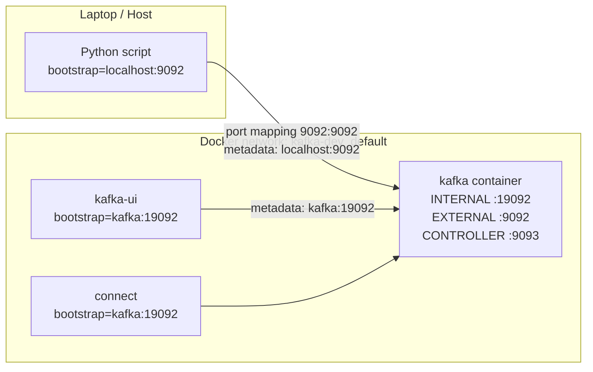

# 3. Kafka Nerede ve Nasıl Çalıştırılır?

> **Bu bölümde:** Dört ortamın karşılaştırması — (A) lokal native kurulum, (B) Docker, (C) kendi sunucunuz, (D) yönetilen bulut (managed cloud). Bu rehberin geri kalanı **B (Docker)** ortamını esas alır.
>
> **Kullanılan sürümler (Kasım 2026):** Apache Kafka **4.4.0** (`apache/kafka:4.4.0`), production için önerilen kararlı hat **4.3.2**, Java **17 veya 21**, Kafbat UI **v1.5.0**.

---

## 3.0 Ortam seçimi — özet

| Kriter | A. Lokal native | B. Docker | C. Kendi sunucum | D. Managed cloud |
|---|---|---|---|---|
| Kurulum süresi | 10–15 dk | 2–5 dk | Saatler–günler | Dakikalar |
| Kime uygun | CLI öğrenmek, Kafka'nın iç yapısını görmek | Geliştirme, test, eğitim, CI | On-prem zorunluluğu, tam kontrol, regülasyon | Ekip küçük, operasyon yükü istenmiyor |
| Çok broker | Zahmetli | Kolay (compose) | Gerçek HA | Sağlayıcı yönetir |
| Maliyet | 0 | 0 | Donanım + insan | Kullanım bazlı (yüksek hacimde pahalı) |
| Production? | ❌ | ❌ (tek makine) | ✅ | ✅ |
| Güvenlik/operasyon sorumluluğu | Siz | Siz | **Tamamen siz** | Büyük ölçüde sağlayıcı |

---

## A. Lokal (native) kurulum

### A.1 Java gereksinimleri

| Bileşen | Kafka 4.x gereksinimi |
|---|---|
| Broker, controller, Kafka Connect, CLI araçları | **Java 17+** |
| Java istemci kütüphanesi ve Kafka Streams | Java 11+ |

Java 17 veya 21 (LTS) kurun. Kontrol: `java -version`.

### A.2 macOS

```bash
# Seçenek 1: Homebrew (en kolay)
brew install openjdk@21 kafka
# Homebrew kafka paketi KRaft config'i ile gelir; servis olarak başlatma:
brew services start kafka
# CLI araçları PATH'tedir: kafka-topics, kafka-console-producer ...

# Seçenek 2: Resmi binary (Linux ile aynı adımlar, aşağıya bakın)
```

### A.3 Linux (resmi binary, tek broker, KRaft)

```bash
# 1) İndir ve aç (sürüm ve imza: https://kafka.apache.org/community/downloads/)
cd ~
curl -O https://dlcdn.apache.org/kafka/4.4.0/kafka_2.13-4.4.0.tgz
tar -xzf kafka_2.13-4.4.0.tgz && cd kafka_2.13-4.4.0

# 2) Cluster ID üret ve storage'ı formatla (KRaft'ta ilk açılıştan önce ZORUNLU)
KAFKA_CLUSTER_ID="$(bin/kafka-storage.sh random-uuid)"
bin/kafka-storage.sh format --standalone -t "$KAFKA_CLUSTER_ID" -c config/server.properties

# 3) Başlat (ön planda)
bin/kafka-server-start.sh config/server.properties
```

Beklenen çıktının son satırları:
```
[KafkaRaftServer nodeId=1] Kafka Server started (kafka.server.KafkaRaftServer)
```

> **Eski bilgi uyarısı:** Kafka 3.x'te KRaft dosyası `config/kraft/server.properties` idi ve `bin/zookeeper-server-start.sh` vardı. Kafka 4.x'te `config/kraft/` dizini ve ZooKeeper script'leri **kaldırıldı**; `config/server.properties` doğrudan KRaft (combined mode) yapılandırmasıdır.

Olası hatalar:

| Hata | Sebep | Çözüm |
|---|---|---|
| `No readable meta.properties files found` | `kafka-storage.sh format` çalıştırılmadı | A.3 adım 2 |
| `UnsupportedClassVersionError` | Java 11 ile broker başlatıldı | Java 17+ |
| `Address already in use :9092` | Port dolu (başka Kafka/Docker) | `lsof -i :9092`, eski süreci kapatın |
| `Invalid cluster.id` | Log dizini başka cluster ID ile formatlanmış | Dev'de `/tmp/kraft-combined-logs` dizinini silip yeniden formatlayın |

### A.4 Windows

Kafka'nın `bin\windows\*.bat` script'leri vardır, ancak Windows production için desteklenen bir platform değildir ve dosya kilitleme sorunları (log silme/compaction sırasında) yaşanır. Öneri:
1. **WSL2 (Ubuntu)** kurun ve A.3 adımlarını WSL içinde uygulayın, **veya**
2. **Docker Desktop** kullanın (B bölümü). Bankacılık kurumsal laptoplarında genelde en sorunsuz yol budur.

### A.5 CLI araçları (en çok kullanılanlar)

```bash
B=localhost:9092
# Topic
bin/kafka-topics.sh --bootstrap-server $B --create --topic islemler --partitions 6 --replication-factor 1
bin/kafka-topics.sh --bootstrap-server $B --list
bin/kafka-topics.sh --bootstrap-server $B --describe --topic islemler
bin/kafka-configs.sh --bootstrap-server $B --alter --entity-type topics --entity-name islemler --add-config retention.ms=259200000

# Mesaj yaz / oku
bin/kafka-console-producer.sh --bootstrap-server $B --topic islemler --property parse.key=true --property key.separator=:
#  > 7:{"tutar":"100.00"}
bin/kafka-console-consumer.sh --bootstrap-server $B --topic islemler --from-beginning \
  --property print.key=true --property print.partition=true --property print.offset=true

# Consumer group / lag / offset sıfırlama
bin/kafka-consumer-groups.sh --bootstrap-server $B --list
bin/kafka-consumer-groups.sh --bootstrap-server $B --describe --group rehber-json
bin/kafka-consumer-groups.sh --bootstrap-server $B --group rehber-json --topic islemler.json \
  --reset-offsets --to-datetime 2026-11-24T00:00:00.000 --execute      # grup kapalıyken!

# Cluster / KRaft
bin/kafka-metadata-quorum.sh --bootstrap-server $B describe --status
bin/kafka-broker-api-versions.sh --bootstrap-server $B
bin/kafka-features.sh --bootstrap-server $B describe

# Performans testi
bin/kafka-producer-perf-test.sh --topic perf --num-records 1000000 --record-size 500 --throughput -1 \
  --producer-props bootstrap.servers=$B acks=all linger.ms=20 compression.type=zstd
bin/kafka-consumer-perf-test.sh --bootstrap-server $B --topic perf --messages 1000000
```

---

## B. Docker ile kurulum (bu rehberin ana ortamı)

### B.1 Docker Desktop / Docker Engine

- macOS/Windows: Docker Desktop (Windows'ta WSL2 backend). Kaynak ayarlarında en az **4 CPU, 8 GB RAM** verin (CDC laboratuvarı Connect + 2 PostgreSQL içerir).
- Linux: Docker Engine + Compose plugin (`docker compose version` ≥ v2).

### B.2 Docker Compose — tek broker + Kafka UI

Dosya: [`code/docker/docker-compose.yml`](../code/docker/docker-compose.yml)

```bash
# Repo kökünden
docker compose -f code/docker/docker-compose.yml up -d
docker compose -f code/docker/docker-compose.yml ps
```

Beklenen çıktı:
```
NAME       IMAGE                            STATUS                    PORTS
kafka      apache/kafka:4.4.0               Up 30 seconds (healthy)   0.0.0.0:9092->9092/tcp
kafka-ui   ghcr.io/kafbat/kafka-ui:v1.5.0   Up 10 seconds             0.0.0.0:8080->8080/tcp
```

Ardından topic'leri oluşturun:
```bash
bash code/scripts/create_topics.sh
# veya Python ile:  cd code/python && python 00_admin_topics.py
```
Kafka UI: <http://localhost:8080>

### B.3 Compose dosyasının parçaları

**Image:** `apache/kafka` resmi Apache image'ıdır (JVM). `apache/kafka-native` GraalVM native image'ıdır: saniyenin altında açılır, az bellek kullanır; **sadece geliştirme/test** için önerilir. Confluent'in `confluentinc/cp-kafka` image'ı da KRaft destekler ancak ortam değişkeni adları ve lisans paketleri farklıdır; bu rehber Apache image'ını kullanır.

**Ortam değişkeni → server.properties eşlemesi (apache/kafka image):**

| Kural | Örnek |
|---|---|
| `KAFKA_` öneki atılır, `_` → `.`, küçük harf | `KAFKA_LOG_RETENTION_HOURS` → `log.retention.hours` |
| Özellik adında `_` varsa `__` (çift) | `KAFKA_LISTENER_NAME_INTERNAL_SSL_KEY__PASSWORD` gibi |
| Özellik adında `-` varsa `___` (üçlü) | — |
| `CLUSTER_ID` | Storage formatlamada kullanılır (önek yok) |

**Listener'lar (en kritik kısım):**

```yaml
KAFKA_LISTENERS: INTERNAL://:19092,EXTERNAL://:9092,CONTROLLER://:9093
KAFKA_ADVERTISED_LISTENERS: INTERNAL://kafka:19092,EXTERNAL://localhost:9092
KAFKA_LISTENER_SECURITY_PROTOCOL_MAP: INTERNAL:PLAINTEXT,EXTERNAL:PLAINTEXT,CONTROLLER:PLAINTEXT
KAFKA_INTER_BROKER_LISTENER_NAME: INTERNAL
```



- **Port mapping** `9092:9092` → host'tan erişim. `19092` ve `9093` dışarı açılmaz.
- **Network:** Compose varsayılan bir bridge ağ oluşturur (`kafka-dev_default`); container'lar birbirine servis adıyla ulaşır. `docker-compose.streaming.yml` bu ağa `external: true` ile katılır.
- **Volume:** `kafka-data:/var/lib/kafka/data` → container silinse de veri kalır. `down -v` veriyi siler.
- **Healthcheck:** `kafka-broker-api-versions.sh` broker'a gerçek bir istek atar; `depends_on: condition: service_healthy` ile UI/Connect, broker hazır olmadan başlamaz.

### B.4 Kalıcı veri saklama

| Yöntem | Avantaj | Dezavantaj |
|---|---|---|
| Named volume (`kafka-data:`) | Docker yönetir, izin sorunları az | Konumu `docker volume inspect` ile bulunur |
| Bind mount (`./data:/var/lib/kafka/data`) | Dosyaları doğrudan görürsünüz | apache/kafka `appuser` (uid 1000) ile çalışır → host dizin izinleri ayarlanmalı (`chown 1000:1000`) |
| Volume yok | Her başlatmada temiz | Container silinince veri gider |

> **Dikkat:** `CLUSTER_ID`'yi değiştirip aynı volume'ü kullanırsanız broker `Invalid cluster.id` hatasıyla açılmaz. Ya ID'yi koruyun ya `down -v`.

### B.5 Çok broker'lı yerel cluster

Dosya: [`code/docker/docker-compose.cluster.yml`](../code/docker/docker-compose.cluster.yml) — 3 dedicated controller + 3 broker, `default.replication.factor=3`, `min.insync.replicas=2`.

```bash
docker compose -f code/docker/docker-compose.cluster.yml up -d
docker compose -f code/docker/docker-compose.cluster.yml exec broker-1 \
  /opt/kafka/bin/kafka-metadata-quorum.sh --bootstrap-server broker-1:19092 describe --status
# LeaderId: 1 ... CurrentVoters: [{"id":1...},{"id":2...},{"id":3...}]

# Replikasyonu gözlemle
docker compose -f code/docker/docker-compose.cluster.yml exec broker-1 /opt/kafka/bin/kafka-topics.sh \
  --bootstrap-server broker-1:19092 --create --topic ha-test --partitions 3 --replication-factor 3
docker compose -f code/docker/docker-compose.cluster.yml exec broker-1 /opt/kafka/bin/kafka-topics.sh \
  --bootstrap-server broker-1:19092 --describe --topic ha-test
# Partition: 0 Leader: 5 Replicas: 5,6,4 Isr: 5,6,4

# Broker çökmesini simüle et
docker compose -f code/docker/docker-compose.cluster.yml stop broker-2
#   tekrar --describe: Leader değişti, Isr'den 5 düştü (under-replicated)
docker compose -f code/docker/docker-compose.cluster.yml start broker-2
```

Host'tan bağlantı: `KAFKA_BOOTSTRAP=localhost:29092,localhost:39092,localhost:49092`.

### B.6 Docker'da sık hatalar

| Belirti | Sebep | Çözüm |
|---|---|---|
| Python: `Connect to ipv4#127.0.0.1:9092 failed: Connection refused` | Broker henüz ayakta değil | `docker compose ps` → `healthy` bekleyin |
| Python bağlanıyor ama `produce` timeout, log'da `kafka:19092` çözümlenemiyor | Host'tan INTERNAL listener'a yönlendirildi | Bootstrap olarak `localhost:9092` kullanın; advertised listeners'ı kontrol edin |
| `TOPIC_AUTHORIZATION_FAILED` / `UNKNOWN_TOPIC_OR_PART` | `auto.create.topics.enable=false` ve topic yok | `create_topics.sh` |
| Apple Silicon'da image çalışmıyor | Mimari | `apache/kafka` multi-arch'tır; eski 3. parti image'lar amd64 olabilir |
| Container sürekli yeniden başlıyor, `OutOfMemoryError` | Docker Desktop RAM'i az | Kaynakları artırın; dev'de `KAFKA_HEAP_OPTS=-Xmx1g -Xms1g` |

---

## C. Kendi sunucumda kurulum (Ubuntu Server)

### C.1 Mimari seçimi

| | Tek broker | Çok broker (önerilen production) |
|---|---|---|
| Düğümler | 1 (combined) | 3 controller (küçük VM) + 3+ broker |
| HA | Yok | Var |
| Kullanım | PoC, düşük kritiklikte iç araç | Bankacılık üretim iş yükleri |

### C.2 Donanım ve işletim sistemi önerileri (başlangıç noktası)

| Rol | CPU | RAM | Disk | Not |
|---|---|---|---|---|
| Controller | 2–4 vCPU | 4–8 GB | 50–100 GB SSD | Metadata küçük ama gecikmeye duyarlı |
| Broker | 8–16 vCPU | 32–64 GB (heap 6–8 GB, kalanı page cache) | Hacme göre; ayrı veri diskleri (XFS/ext4), RAID gerekmez (replikasyon var) | 10 GbE ağ |

OS ayarları:
```bash
# /etc/sysctl.d/99-kafka.conf
vm.swappiness=1
vm.max_map_count=262144
net.core.somaxconn=4096
fs.file-max=1000000
# /etc/security/limits.d/kafka.conf
kafka soft nofile 128000
kafka hard nofile 128000
# Disk mount seçenekleri: noatime
```

### C.3 Native kurulum (systemd)

```bash
sudo apt update && sudo apt install -y openjdk-21-jre-headless
sudo useradd -r -m -d /opt/kafka -s /usr/sbin/nologin kafka
cd /tmp && curl -O https://dlcdn.apache.org/kafka/4.3.2/kafka_2.13-4.3.2.tgz
sudo tar -xzf kafka_2.13-4.3.2.tgz -C /opt/kafka --strip-components=1
sudo mkdir -p /data/kafka && sudo chown -R kafka:kafka /opt/kafka /data/kafka
```

`/opt/kafka/config/server.properties` (dedicated broker örneği — controller'lar için `process.roles=controller`):
```properties
process.roles=broker
node.id=4
controller.quorum.bootstrap.servers=ctl-1.bank.local:9093,ctl-2.bank.local:9093,ctl-3.bank.local:9093
controller.listener.names=CONTROLLER
listeners=INTERNAL://0.0.0.0:9094,CLIENT://0.0.0.0:9092
advertised.listeners=INTERNAL://kfk-1.bank.local:9094,CLIENT://kfk-1.bank.local:9092
listener.security.protocol.map=CONTROLLER:SSL,INTERNAL:SASL_SSL,CLIENT:SASL_SSL
inter.broker.listener.name=INTERNAL
log.dirs=/data/kafka
broker.rack=dc1-az1
num.partitions=6
default.replication.factor=3
min.insync.replicas=2
unclean.leader.election.enable=false
auto.create.topics.enable=false
```
Güvenlik satırlarının tamamı: [`code/security/server-sasl-ssl.properties`](../code/security/server-sasl-ssl.properties) ve [13. bölüm](13-guvenlik.md).

Controller'ları **ilk kez** formatlama (3 controller'lı quorum):
```bash
# Bir kez cluster ID üretin ve TÜM düğümlerde aynısını kullanın
CID=$(/opt/kafka/bin/kafka-storage.sh random-uuid)
# Her controller'da (kendi node.id'si ile):
sudo -u kafka /opt/kafka/bin/kafka-storage.sh format -t "$CID" -c /opt/kafka/config/server.properties \
  --initial-controllers "1@ctl-1.bank.local:9093:<dir-id-1>,2@ctl-2.bank.local:9093:<dir-id-2>,3@ctl-3.bank.local:9093:<dir-id-3>"
# Broker'larda:
sudo -u kafka /opt/kafka/bin/kafka-storage.sh format -t "$CID" -c /opt/kafka/config/server.properties --no-initial-controllers
```
> `--initial-controllers` / `--standalone` dinamik quorum (KIP-853) içindir; statik quorum için `controller.quorum.voters` kullanılabilir. Komut parametrelerini kurduğunuz sürümün **Operations → KRaft** dokümanından doğrulayın.

`/etc/systemd/system/kafka.service`:
```ini
[Unit]
Description=Apache Kafka (KRaft)
After=network-online.target
Wants=network-online.target

[Service]
User=kafka
Group=kafka
Environment="KAFKA_HEAP_OPTS=-Xms6g -Xmx6g"
Environment="KAFKA_OPTS=-javaagent:/opt/jmx/jmx_prometheus_javaagent.jar=7071:/opt/jmx/jmx-kafka.yml"
ExecStart=/opt/kafka/bin/kafka-server-start.sh /opt/kafka/config/server.properties
ExecStop=/opt/kafka/bin/kafka-server-stop.sh
Restart=on-failure
RestartSec=10
LimitNOFILE=128000
TimeoutStopSec=180

[Install]
WantedBy=multi-user.target
```
```bash
sudo systemctl daemon-reload && sudo systemctl enable --now kafka
journalctl -u kafka -f
```

### C.4 Docker ile sunucu kurulumu

Tek sunucuda Docker kullanılabilir; ancak çok broker'ı **aynı makinede** çalıştırmak HA sağlamaz. Her broker'ı ayrı VM'de `docker run --network host` veya compose ile çalıştırın, veriyi **host diskine bind mount** edin, `restart: unless-stopped` verin. Kubernetes kullanıyorsanız Docker yerine **Strimzi** ([15. bölüm](15-production.md)).

### C.5 Firewall

```bash
sudo ufw default deny incoming
sudo ufw allow from 10.20.0.0/16 to any port 9092 proto tcp   # istemciler (SASL_SSL)
sudo ufw allow from 10.20.30.0/24 to any port 9094 proto tcp  # broker'lar arası
sudo ufw allow from 10.20.30.0/24 to any port 9093 proto tcp  # controller quorum (sadece cluster düğümleri)
sudo ufw allow from 10.20.40.10 to any port 7071 proto tcp    # Prometheus (JMX exporter)
sudo ufw enable
```
Kural: **9093 (controller) asla istemcilere açılmaz.** PLAINTEXT listener production'da hiç tanımlanmaz.

### C.6 SSL/TLS (özet)
Kurumsal CA'dan her broker için sertifika (SAN'da FQDN), PKCS12 keystore + truststore, `ssl.endpoint.identification.algorithm=https`. Ayrıntı ve komutlar [13. bölüm](13-guvenlik.md).

### C.7 Backup

Kafka'da "yedek" klasik DB yedeği gibi değildir:

| Ne | Nasıl |
|---|---|
| Topic verisi | Asıl koruma **replikasyon**dur. Felaket kurtarma için **MirrorMaker 2** ile ikinci cluster; uzun süreli arşiv için **S3 Sink Connector** veya **tiered storage** |
| Topic/ACL/kullanıcı tanımları | **Infrastructure as Code** (Terraform, Strimzi CR'leri, Git'teki script'ler) — yeniden yaratılabilir olmalı |
| Consumer offset'leri | MirrorMaker 2 checkpoint'leri ile hedef cluster'a çevrilir |
| KRaft metadata | Controller log dizinlerinin snapshot'ı (disk seviyesinde). Asıl strateji: 3/5 controller |
| Disk snapshot (LVM/EBS) | Tutarlı kopya garanti değildir; tek başına güvenmeyin |

### C.8 Monitoring (özet)
JMX Exporter + Prometheus + Grafana, consumer lag için kafka-exporter veya Burrow, log'lar için journald → merkezi log. Ayrıntı [14. bölüm](14-monitoring.md).

---

## D. Yönetilen bulut (managed cloud)

| Hizmet | Ne sunar | Kafka uyumluluğu | Not |
|---|---|---|---|
| **Confluent Cloud** | Tam yönetilen Kafka + Schema Registry + yönetilen connector'lar + Flink SQL | Native Kafka | En zengin ekosistem; maliyet hacimle hızla artar |
| **Amazon MSK** (Provisioned / Serverless / Express broker'lar) | AWS içinde yönetilen Kafka | Native Kafka | IAM auth, MSK Connect; AWS'ye bağlılık |
| **Google Cloud Managed Service for Apache Kafka** | GCP içinde yönetilen Kafka | Native Kafka | GCP IAM |
| **Azure Event Hubs (Kafka endpoint)** | Kafka protokolü konuşan Event Hubs | Protokol uyumlu, **Kafka değil** | Bazı özellikler (ör. compaction, transactions) kısıtlı/farklı olabilir; doğrulayın |
| **Aiven for Apache Kafka** | Çoklu bulut yönetilen Kafka | Native Kafka | Karapace (açık kaynak Schema Registry) |
| **Redpanda Cloud** | Kafka API uyumlu, C++ motor | API uyumlu, **Kafka değil** | ZooKeeper/JVM yok, düşük gecikme iddiası |

### Supabase'in bu mimarideki yeri

Supabase **Kafka barındırmaz**; yönetilen bir **PostgreSQL** platformudur. Bu rehberdeki "Cloud (Supabase)" adımı, Supabase'in Kafka mimarisine **kaynak (CDC ile)** veya **hedef (sink)** olarak bağlanmasıdır. Kafka'nın kendisi ise yukarıdaki managed servislerden birinde ya da kendi sunucunuzda çalışır. Ayrıntı: [16. bölüm — Supabase ile Cloud entegrasyonu](16-supabase-cloud.md).

### Bankacılık ve regülasyon notu
Türkiye'de bankacılık verisi için BDDK'nın bilgi sistemleri ve bulut hizmetlerine ilişkin düzenlemeleri, verinin yurt içinde tutulması ve dış hizmet alımı kuralları managed cloud seçimini doğrudan kısıtlar. Müşteri verisi içeren topic'ler için karar vermeden önce kurumunuzun bilgi güvenliği, uyum ve hukuk birimleriyle mevcut düzenlemeyi teyit edin; bu rehber hukuki değerlendirme yerine geçmez.

---

## Kaynaklar

- [Apache Kafka Quickstart (4.x)](https://kafka.apache.org/quickstart)
- [Apache Kafka Downloads — sürümler, Docker image etiketleri](https://kafka.apache.org/community/downloads/)
- [Apache Kafka Docker image (apache/kafka) — kullanım ve ortam değişkenleri](https://github.com/apache/kafka/tree/trunk/docker)
- [Apache Kafka Documentation — Operations / KRaft](https://kafka.apache.org/documentation/#kraft)
- [KIP-853: KRaft Controller Membership Changes](https://cwiki.apache.org/confluence/display/KAFKA/KIP-853%3A+KRaft+Controller+Membership+Changes)
- [Kafbat UI (kafka-ui) GitHub](https://github.com/kafbat/kafka-ui)
- [Amazon MSK Developer Guide](https://docs.aws.amazon.com/msk/latest/developerguide/what-is-msk.html)
- [Confluent Cloud Documentation](https://docs.confluent.io/cloud/current/overview.html)
- [Azure Event Hubs for Apache Kafka](https://learn.microsoft.com/azure/event-hubs/azure-event-hubs-kafka-overview)
- [Google Cloud Managed Service for Apache Kafka](https://cloud.google.com/managed-service-for-apache-kafka/docs)
