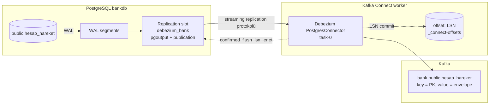
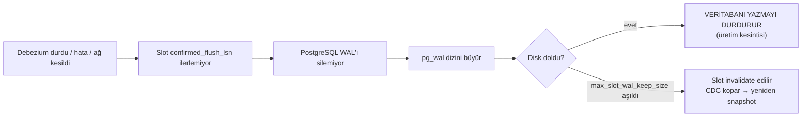
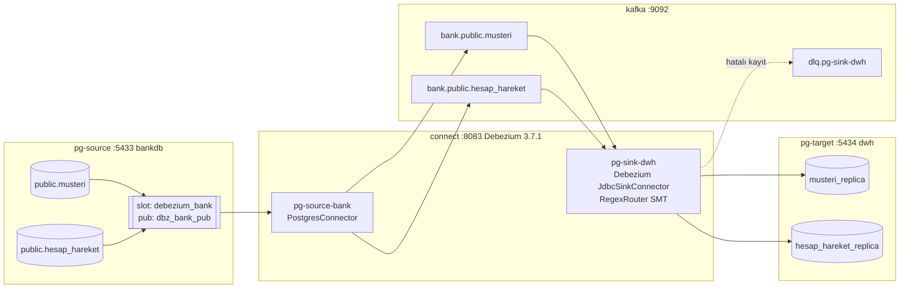

# 6. Change Data Capture (CDC) — PostgreSQL + Debezium

> **Bu bölümde:** CDC kavramı, polling farkı, WAL, logical replication, replication slot, publication, Debezium, initial snapshot, INSERT/UPDATE/DELETE olayları, before/after yapısı, tombstone, şema değişiklikleri, WAL büyüme riski, restart/recovery, snapshot tutarlılığı ve **PostgreSQL → Kafka → PostgreSQL** tam senkronizasyonun sıfırdan uygulaması.
>
> **Kod:** [`code/docker/docker-compose.cdc.yml`](../code/docker/docker-compose.cdc.yml), [`code/sql/source_init.sql`](../code/sql/source_init.sql), [`code/sql/target_init.sql`](../code/sql/target_init.sql), [`code/connect/pg-source-debezium.json`](../code/connect/pg-source-debezium.json), [`code/connect/pg-sink-debezium-jdbc.json`](../code/connect/pg-sink-debezium-jdbc.json), [`code/scripts/`](../code/scripts/).
>
> **Sürümler:** Debezium **3.7.1.Final** (6 Kasım 2026; connector'lar Java 17+, Kafka Connect 3.1+; PostgreSQL 14–18 destekli), `quay.io/debezium/connect:3.7.1.Final`, PostgreSQL 17, Kafka 4.4.0.

---

## 6.1 CDC nedir?

**Basit:** Veritabanında bir satır eklendiğinde, değiştiğinde veya silindiğinde bunu **olay** olarak yakalayıp başka sistemlere iletmek.

**Teknik:** Veritabanının **işlem günlüğünü (transaction log)** — PostgreSQL'de WAL, Oracle'da redo log, MySQL'de binlog, SQL Server'da CDC tabloları — okuyarak commit edilmiş satır değişikliklerini sırasıyla, düşük gecikmeyle ve kaynağa sorgu yükü bindirmeden yayınlamak (**log-based CDC**).

Kullanım: DWH/lakehouse'a sürekli yükleme, mikroservisler arası veri paylaşımı, önbellek (Redis) ve arama indeksi (Elasticsearch) güncelleme, denetim izi, sistem göçü (eski core → yeni core) sırasında çift yönlü senkronizasyon, Outbox Pattern.

## 6.2 Polling ile farkı

| | Query-based (polling) | Log-based CDC |
|---|---|---|
| Nasıl | `SELECT ... WHERE updated_at > :son` periyodik | WAL'ı replikasyon protokolüyle okur |
| DELETE | ❌ Göremez (soft delete gerekir) | ✅ |
| Ara durumlar | ❌ Periyotta birden çok değişiklik → sadece sonuncusu | ✅ Her commit |
| Gecikme | Periyot kadar (dakikalar) | Saniyenin altı – saniyeler |
| Kaynağa yük | Sorgu + indeks | Çok düşük (WAL zaten yazılıyor) |
| Şema şartı | `updated_at` + indeks, uygulamanın bunu güncellemesi | Yok (PK önerilir) |
| Transaction bilgisi | Yok | LSN, txId, commit sırası |
| Kurulum | Kolay (sadece SELECT yetkisi) | `wal_level=logical`, REPLICATION yetkisi, slot |

Bu rehberde polling örneği: `p05_postgres_pandas_kafka.py` ve Confluent JDBC Source ([7. bölüm](07-kafka-connect.md)).

## 6.3 PostgreSQL WAL nedir?

**Write-Ahead Log:** PostgreSQL her değişikliği veri dosyalarına yazmadan **önce** sıralı bir log'a yazar. Çökmede kurtarma (crash recovery) ve replikasyon buna dayanır. Her kaydın konumu **LSN (Log Sequence Number)** ile ifade edilir (`0/1D701C0`).

`wal_level`:
| Değer | İçerik | CDC? |
|---|---|---|
| `minimal` | Sadece crash recovery | ❌ |
| `replica` (varsayılan) | Fiziksel replikasyon | ❌ |
| **`logical`** | + mantıksal çözümleme için ek bilgi | ✅ (yeniden başlatma gerekir) |

## 6.4 Logical Replication nedir?

Fiziksel replikasyon WAL'ı **byte seviyesinde** kopyalar (birebir aynı cluster). **Logical decoding** ise WAL'ı **satır seviyesinde mantıksal değişikliklere** çevirir: "public.hesap_hareket tablosuna şu kolonlarla INSERT". Bu çeviriyi bir **output plugin** yapar:
- **`pgoutput`**: PostgreSQL'e yerleşik (10+), native logical replication'ın kullandığı plugin. **Debezium için önerilen**, ek kurulum gerektirmez, yönetilen servislerde (Supabase, RDS, Cloud SQL) hazırdır.
- `decoderbufs`: Debezium'un Protobuf plugin'i, sunucuya kurulum gerektirir.
- `test_decoding`: Okunabilir metin çıktısı; **sadece öğrenme/test** içindir.

## 6.5 Replication Slot nedir?

Bir tüketicinin WAL'da **nerede kaldığını** sunucu tarafında kalıcı olarak tutan nesne. Slot var oldukça PostgreSQL, tüketicinin onaylamadığı (`confirmed_flush_lsn`) WAL segmentlerini **silmez**. Bu sayede Debezium kapalıyken olan değişiklikler kaybolmaz — ve bu aynı zamanda en büyük operasyonel risktir (6.15).

```sql
SELECT pg_create_logical_replication_slot('debezium_bank', 'pgoutput');
SELECT slot_name, plugin, active, restart_lsn, confirmed_flush_lsn FROM pg_replication_slots;
SELECT pg_drop_replication_slot('debezium_bank');
```

## 6.6 Publication nedir?

`pgoutput` ile hangi tabloların (ve hangi işlemlerin: insert/update/delete/truncate) yayınlanacağını belirleyen tanım.
```sql
CREATE PUBLICATION dbz_bank_pub FOR TABLE public.musteri, public.hesap_hareket;
CREATE PUBLICATION tum_sema FOR TABLES IN SCHEMA bddk;            -- PG15+
CREATE PUBLICATION sadece_ekleme FOR TABLE t WITH (publish = 'insert');
ALTER PUBLICATION dbz_bank_pub ADD TABLE public.yeni_tablo;
```
Debezium publication'ı kendisi de oluşturabilir (`publication.autocreate.mode=filtered`), ancak bu, Debezium kullanıcısına tabloların **sahipliğini** vermeyi gerektirir. En az yetki için publication'ı DBA oluşturur, Debezium'a `disabled` verilir (bu rehberin yaklaşımı).

### REPLICA IDENTITY
UPDATE/DELETE olaylarında **eski satırın** ne kadarının WAL'a yazılacağı:
| Değer | UPDATE `before` | DELETE `before` |
|---|---|---|
| `DEFAULT` | `null` (PK değişmedikçe) | Sadece PK kolonları |
| `FULL` | Tüm eski kolonlar | Tüm eski kolonlar |
| `USING INDEX idx` | Index kolonları | Index kolonları |
| `NOTHING` | — | — |

`FULL` WAL hacmini artırır; denetim, fark analizi veya "eski tutar neydi?" ihtiyacı varsa açın.

## 6.7 Debezium nedir?

Red Hat öncülüğündeki açık kaynak **CDC platformu**. Kafka Connect **source connector**'ları olarak çalışır (ayrıca Kafka'sız **Debezium Server** ve gömülü **Debezium Engine** modları vardır). Connector'lar: PostgreSQL, MySQL/MariaDB, SQL Server, Oracle, Db2, MongoDB, Cassandra, Informix, Spanner, Vitess... Ayrıca kendi **JDBC Sink connector**'ı vardır (Debezium olay formatını doğrudan anlar).



## 6.8 Initial Snapshot nedir?

Connector ilk kez başlarken tablolarda **zaten var olan** satırlar WAL'da yoktur. Debezium bunları bir kez okuyup `op: "r"` (read) olayları olarak yayınlar, sonra WAL akışına geçer.

`snapshot.mode` seçenekleri (Debezium 3.x):
| Mod | Davranış |
|---|---|
| `initial` (varsayılan) | Offset yoksa snapshot + streaming |
| `initial_only` | Sadece snapshot, sonra durur |
| `no_data` | Snapshot yok (sadece şema), doğrudan streaming |
| `always` | Her başlangıçta snapshot |
| `when_needed` | Offset yoksa **veya** offset'teki LSN artık slot'ta yoksa snapshot |
| `configuration_based` / `custom` | İnce ayar / kendi sınıfınız |

**Incremental (ad hoc) snapshot:** Çalışan connector'a bir **signal** (signal tablosu veya Kafka signal topic'i) göndererek seçili tablolar parça parça (chunk) yeniden okunur; bu sırada streaming durmaz. Yeni tablo eklemek veya hedefi onarmak için idealdir.

## 6.9 INSERT, UPDATE ve DELETE olayları nasıl yakalanır?

Bu rehberin hazırlandığı ortamda PostgreSQL 16.15 üzerinde `source_init.sql` uygulandıktan sonra `test_decoding` slot'uyla **gerçekten** alınan çıktı (kısaltılmış):

```text
BEGIN 748
table public.hesap_hareket: INSERT: hareket_id[bigint]:1004 musteri_id[bigint]:1 islem_tipi[text]:'FAST' tutar[numeric]:350.40 ...
COMMIT 748
BEGIN 749
table public.hesap_hareket: UPDATE: old-key: hareket_id[bigint]:1002 musteri_id[bigint]:2 islem_tipi[text]:'EFT' tutar[numeric]:98000.00 ... new-tuple: ... tutar[numeric]:99000.00 ...
COMMIT 749
BEGIN 750
table public.hesap_hareket: DELETE: hareket_id[bigint]:1001 musteri_id[bigint]:1 islem_tipi[text]:'KART' tutar[numeric]:1250.75 ...
COMMIT 750
```
`REPLICA IDENTITY FULL` sayesinde UPDATE'te eski satırın **tamamı** (`old-key`) ve DELETE'te tüm kolonlar geldi. Aynı oturumda `pgoutput` slot'u, publication filtresiyle 10 ikili mesaj üretti (BEGIN/RELATION/INSERT/COMMIT...). Debezium bu ikili akışı okur.

Kendiniz denemek için (Docker'sız, sadece PostgreSQL ile):
```sql
-- wal_level=logical olan bir PostgreSQL'de, source_init.sql sonrası:
SELECT * FROM pg_create_logical_replication_slot('demo_slot', 'test_decoding');
INSERT INTO hesap_hareket VALUES (1004,1,'FAST',350.40,'TRY',now(),'CDC insert');
UPDATE hesap_hareket SET tutar=99000.00 WHERE hareket_id=1002;
DELETE FROM hesap_hareket WHERE hareket_id=1001;
SELECT data FROM pg_logical_slot_peek_changes('demo_slot', NULL, NULL);   -- peek: tüketmez
SELECT pg_drop_replication_slot('demo_slot');                               -- UNUTMAYIN
```

## 6.10 Before/After veri yapısı (Debezium olay zarfı — envelope)

`bank.public.hesap_hareket` topic'indeki bir **UPDATE** olayının value'su (JsonConverter, `schemas.enable=true` ile `schema` + `payload` gelir; burada sadece `payload` gösteriliyor):

```json
{
  "before": {"hareket_id": 1002, "musteri_id": 2, "islem_tipi": "EFT", "tutar": "AJWJQA==",
             "para_birimi": "TRY", "islem_zamani": "2026-11-24T06:20:00.000000Z", "aciklama": "Tedarikçi ödemesi"},
  "after":  {"hareket_id": 1002, "musteri_id": 2, "islem_tipi": "EFT", "tutar": "AJcP4A==",
             "para_birimi": "TRY", "islem_zamani": "2026-11-24T06:20:00.000000Z", "aciklama": "Tutar düzeltildi"},
  "source": {"version": "3.7.1.Final", "connector": "postgresql", "name": "bank",
             "ts_ms": 1795550000123, "snapshot": "false", "db": "bankdb", "schema": "public",
             "table": "hesap_hareket", "txId": 749, "lsn": 30843576},
  "op": "u",
  "ts_ms": 1795550000456,
  "transaction": null
}
```
Key: `{"hareket_id": 1002}` (PK).

| `op` | Anlamı | `before` | `after` |
|---|---|---|---|
| `r` | Snapshot okuması | null | satır |
| `c` | INSERT | null | yeni satır |
| `u` | UPDATE | eski satır (REPLICA IDENTITY'ye bağlı) | yeni satır |
| `d` | DELETE | silinen satır | null |
| `t` | TRUNCATE (açıksa) | — | — |

**Decimal neden `"AJcP4A=="`?** `decimal.handling.mode=precise` (varsayılan) + JsonConverter, `NUMERIC`'i Kafka Connect `Decimal` mantıksal tipine çevirir: değer = **ölçeksiz tamsayının big-endian ikili tümleyeni, base64**; ölçek (scale) şemanın `parameters.scale` alanındadır. Python'da çözmek için `common.decode_debezium_decimal("AJcP4A==", 2)` → `Decimal("99000.00")` (testlerle doğrulanmış yardımcı). Seçenekler:

| `decimal.handling.mode` | JSON'da görünüm | Kesinlik | Not |
|---|---|---|---|
| `precise` | base64 bytes (Avro'da native `decimal`) | ✅ | JDBC Sink ve Avro ile en doğru |
| `string` | `"99000.00"` | ✅ | Python/Pandas tüketicileri için kolay; sink tarafında tip dönüşümü gerekir |
| `double` | `99000.0` | ❌ | **Finansal veride kullanmayın** |

## 6.11 Tombstone mesajları

DELETE'ten sonra Debezium, aynı key ile **value = null** ikinci bir mesaj yayınlar (`tombstones.on.delete=true`, varsayılan). Amaç: topic **compacted** ise, o key'in tüm geçmişinin compaction ile silinebilmesi. Tüketiciler `msg.value() is None` durumunu ele almalıdır (`from_json_bytes(None)` → `None`).

## 6.12 Şema değişiklikleri

- PostgreSQL connector **DDL'i ayrı olay olarak yayınlamaz**; değişiklikten sonraki ilk DML olayı **yeni şemayla** gelir (`pgoutput` RELATION mesajı ile öğrenilir).
- **Kolon ekleme (nullable/varsayılanlı):** Geriye uyumlu, sorunsuz.
- **Kolon silme / tip değiştirme / yeniden adlandırma:** Tüketiciler ve sink tablo kırılabilir → Schema Registry uyumluluk kuralları ([10. bölüm](10-veri-formatlari-sema.md)) ve kontrollü dağıtım.
- **Sink tarafı:** Debezium JDBC Sink `schema.evolution=basic` ile eksik kolonları ekler (silmez, tip değiştirmez). Bu rehberde finansal tiplerin kontrolü için `none` + önceden açılmış tablo kullanıldı.
- **Prosedür (öneri):** 1) Hedefe yeni kolonu ekle → 2) kaynağa ekle → 3) uygulamayı güncelle. Silmede tersi.
- Publication `FOR TABLE` ile tanımlıysa yeni tablolar **otomatik eklenmez** (`ALTER PUBLICATION ... ADD TABLE` + `table.include.list` güncelle + incremental snapshot).

## 6.13 Replication slot ve WAL büyüme riskleri



Önlemler:
1. **`max_slot_wal_keep_size`** (PG13+): Slot'un tutabileceği WAL'a üst sınır (compose'da `2GB`). Aşılırsa slot geçersiz olur — DB'yi korur, CDC'yi kırar (bilinçli tercih).
2. **İzleme ve alarm:**
   ```sql
   SELECT slot_name, active,
          pg_size_pretty(pg_wal_lsn_diff(pg_current_wal_lsn(), restart_lsn)) AS tutulan_wal,
          wal_status, safe_wal_size
   FROM pg_replication_slots;
   ```
   `tutulan_wal` > eşik veya `active = false` > 5 dk → alarm.
3. **Heartbeat:** Az değişen bir veritabanında, slot yalnız izlenen tablolarda değişiklik olunca ilerler; diğer tabloların WAL'ı birikir. `heartbeat.interval.ms` + `heartbeat.action.query` ile periyodik küçük yazım slot'u ilerletir.
4. **Terk edilmiş slot bırakmayın:** Pipeline kapatılınca `pg_drop_replication_slot`. Test ortamlarında unutulan slot en sık üretim kazasıdır.
5. **Uzun açık transaction'lar** da WAL temizliğini engeller; izleyin.
6. **Failover:** Birincil DB değişirse (HA failover) logical slot'lar eskiden yeni primary'ye taşınmazdı. PostgreSQL 17 **failover slot** senkronizasyonunu getirdi; kullandığınız Debezium ve yönetilen servis sürümünde desteği doğrulayın.

## 6.14 Connector restart ve recovery

| Durum | Ne olur |
|---|---|
| Connector/worker yeniden başladı | `_connect-offsets`'teki son LSN'den devam eder; slot o noktadan beri WAL'ı tuttuğu için **kayıp olmaz**. Son commit edilmemiş birkaç olay **tekrar** gelebilir → **at-least-once**; sink idempotent olmalı (upsert). |
| Kafka erişilemez | Connector hata verir, task FAILED veya retry; slot WAL tutmaya devam eder (6.13 riski) |
| PostgreSQL erişilemez | Task retry (`errors.retry.timeout`), sonra FAILED; DB dönünce `POST /connectors/<ad>/restart?includeTasks=true` |
| Slot silindi / invalidate oldu | Offset'teki LSN artık yok → `when_needed` modda yeniden snapshot; aksi halde hata. Arada **veri boşluğu** olur → incremental snapshot ile hedefi onarın |
| Offset topic'i silindi | Connector ilk kez çalışıyor sanır → `initial` modda tam snapshot |

Task durumu ve yeniden başlatma:
```bash
curl -s localhost:8083/connectors/pg-source-bank/status | python3 -m json.tool
curl -X POST "localhost:8083/connectors/pg-source-bank/restart?includeTasks=true&onlyFailed=true"
```

## 6.15 Snapshot tutarlılığı

Debezium PostgreSQL connector'ı snapshot'ı **slot oluşturulduğu anın tutarlı görüntüsü** üzerinden yapar: slot yaratılırken PostgreSQL bir **exported snapshot** verir; Debezium `REPEATABLE READ` transaction'ında bu snapshot'ı kullanarak tabloları okur, sonra **tam o LSN'den** streaming'e başlar. Sonuç: snapshot ile stream arasında **boşluk veya çakışma olmaz** ve tablolar kilitlenmez (lock-free). Büyük tablolarda snapshot saatler sürebilir; bu süre boyunca slot WAL tutar → disk planlaması yapın veya incremental snapshot kullanın.

---

## 6.16 Uygulama: PostgreSQL → Kafka → PostgreSQL tam senkronizasyon (sıfırdan)

### Mimari



### Adım 1 — Ortamı başlat
```bash
docker compose -f code/docker/docker-compose.cdc.yml up -d
docker compose -f code/docker/docker-compose.cdc.yml ps      # hepsi healthy olana dek bekleyin (~1 dk)
```
`pg-source` ilk açılışta `source_init.sql`'i çalıştırır: tablolar, `REPLICA IDENTITY FULL`, `debezium` rolü (LOGIN REPLICATION), SELECT yetkileri, `dbz_bank_pub` publication'ı ve 3+3 örnek satır. `pg-target` `target_init.sql` ile replika tablolarını açar.

Kontrol:
```bash
docker compose -f code/docker/docker-compose.cdc.yml exec pg-source psql -U postgres -d bankdb -c "SHOW wal_level;"
#  wal_level
# -----------
#  logical
```

### Adım 2 — Connector'ları kaydet
```bash
bash code/scripts/register_connectors.sh
```
Beklenen çıktı (özet):
```
>> Yüklü plugin'ler (PostgreSQL ve JDBC görünmeli):
   io.debezium.connector.jdbc.JdbcSinkConnector 3.7.1.Final
   io.debezium.connector.postgresql.PostgresConnector 3.7.1.Final
>> Kaydedildi: pg-source-bank
>> Kaydedildi: pg-sink-dwh
>> Durum: pg-source-bank
{ "name": "pg-source-bank", "connector": {"state": "RUNNING", ...}, "tasks": [{"id": 0, "state": "RUNNING", ...}] }
```

Source connector'ın önemli ayarları ([`pg-source-debezium.json`](../code/connect/pg-source-debezium.json)):
| Ayar | Değer | Neden |
|---|---|---|
| `plugin.name` | `pgoutput` | Yerleşik plugin |
| `slot.name` / `publication.name` | `debezium_bank` / `dbz_bank_pub` | Açık isimler; izlenebilir |
| `publication.autocreate.mode` | `disabled` | En az yetki |
| `topic.prefix` | `bank` | Topic adı: `bank.<şema>.<tablo>` |
| `decimal.handling.mode` | `precise` | Kesin decimal; JDBC sink doğru `NUMERIC` yazar |
| `heartbeat.interval.ms` | `10000` | Slot ilerlesin |
| `database.password` | `${file:/secrets/db.properties:source_password}` | Secret connector JSON'unda düz durmaz |
| `topic.creation.default.*` | RF, partition, `compact,delete` | Debezium'un açtığı topic'lerin ayarı |

Sink connector ([`pg-sink-debezium-jdbc.json`](../code/connect/pg-sink-debezium-jdbc.json)): `insert.mode=upsert`, `primary.key.mode=record_key`, `delete.enabled=true` (DELETE ve tombstone'u hedefte siler), `RegexRouter` SMT ile `bank.public.(.*)` → `$1_replica` tablo adı, hata toleransı + DLQ.

### Adım 3 — Snapshot'ı doğrula
```bash
docker exec -it $(docker compose -f code/docker/docker-compose.cdc.yml ps -q kafka) \
  /opt/kafka/bin/kafka-console-consumer.sh --bootstrap-server kafka:19092 \
  --topic bank.public.hesap_hareket --from-beginning --max-messages 3
# 3 adet "op":"r" olayı
docker compose -f code/docker/docker-compose.cdc.yml exec pg-target psql -U postgres -d dwh \
  -c "SELECT hareket_id, islem_tipi, tutar FROM hesap_hareket_replica ORDER BY 1;"
#  hareket_id | islem_tipi |   tutar
# ------------+------------+------------
#        1001 | KART       |    1250.75
#        1002 | EFT        |   98000.00
#        1003 | HAVALE     | 1500000.10
```

### Adım 4 — INSERT / UPDATE / DELETE
```bash
bash code/scripts/cdc_demo_changes.sh
```
Beklenen hedef durumu:
```
 hareket_id | islem_tipi |   tutar    |    aciklama
------------+------------+------------+------------------
       1002 | EFT        |   99000.00 | Tutar düzeltildi
       1003 | HAVALE     | 1500000.10 | Grup içi transfer
       1004 | FAST       |     350.40 | CDC insert testi
```
1001 silindi, 1002 güncellendi, 1004 eklendi.

### Adım 5 — Dayanıklılık testi (recovery)
```bash
docker compose -f code/docker/docker-compose.cdc.yml stop connect
docker compose -f code/docker/docker-compose.cdc.yml exec pg-source psql -U postgres -d bankdb \
  -c "INSERT INTO hesap_hareket VALUES (1005,3,'EFT',777.77,'TRY',now(),'connect kapalıyken');"
# Slot WAL tutuyor mu?
docker compose -f code/docker/docker-compose.cdc.yml exec pg-source psql -U postgres -d bankdb \
  -c "SELECT slot_name, active, pg_size_pretty(pg_wal_lsn_diff(pg_current_wal_lsn(), confirmed_flush_lsn)) FROM pg_replication_slots;"
#   debezium_bank | f | 312 bytes
docker compose -f code/docker/docker-compose.cdc.yml start connect
sleep 30   # connector'lar otomatik devam eder
# pg-target'ta 1005 görünmeli
```

### Adım 6 — Temizlik
```bash
curl -X DELETE localhost:8083/connectors/pg-sink-dwh
curl -X DELETE localhost:8083/connectors/pg-source-bank
# Slot connector silinince SİLİNMEZ:
docker compose -f code/docker/docker-compose.cdc.yml exec pg-source psql -U postgres -d bankdb \
  -c "SELECT pg_drop_replication_slot('debezium_bank');"
docker compose -f code/docker/docker-compose.cdc.yml down -v
```

### Olası hatalar

| Hata (connector status `trace`) | Sebep | Çözüm |
|---|---|---|
| `logical decoding requires wal_level >= logical` | wal_level | `-c wal_level=logical` + yeniden başlat |
| `must be superuser or replication role to start walsender` | Rol yetkisi | `ALTER ROLE debezium REPLICATION;` |
| `publication "dbz_bank_pub" does not exist` | autocreate disabled ve pub yok | `CREATE PUBLICATION ...` |
| `permission denied for table ...` (snapshot) | SELECT yok | `GRANT SELECT ...` |
| `replication slot "debezium_bank" is active for PID ...` | Aynı slot'u iki connector kullanıyor | Her connector'a benzersiz `slot.name` |
| Sink: `column "tutar" is of type numeric but expression is of type character varying` | `decimal.handling.mode=string` + önceden açılmış NUMERIC kolon | `precise` kullanın veya hedef tipi uyarlayın |
| Sink: `Cannot ... without primary key` | `primary.key.mode` / key yok | `record_key` + kaynakta PK |
| Kayıtlar DLQ'ya düşüyor | Tip/kısıt hatası | `dlq.pg-sink-dwh` header'larındaki `__connect.errors.exception.message`'a bakın |

> **Doğrulama durumu:** Bu bölümdeki SQL (init script'leri, publication, slot, `test_decoding`/`pgoutput` çıktıları) PostgreSQL 16.15 üzerinde **çalıştırılmıştır**. Docker Compose dosyaları `docker compose config` ile **sözdizimi** olarak doğrulanmıştır. Debezium/Connect container'ları bu ortamda çalıştırılamamıştır (registry erişimi yoktu); adım 2–5'teki "beklenen çıktılar" Debezium dokümantasyonuna göre yazılmıştır. Kendi ortamınızda ilk çalıştırmada connector `status` çıktısını mutlaka kontrol edin.

---

## Kaynaklar

- [Debezium Releases (3.7.1.Final, desteklenen sürümler)](https://debezium.io/releases/)
- [Debezium PostgreSQL Connector dokümantasyonu](https://debezium.io/documentation/reference/stable/connectors/postgresql.html)
- [Debezium JDBC Sink Connector](https://debezium.io/documentation/reference/stable/connectors/jdbc.html)
- [Debezium — Incremental snapshots / Signaling](https://debezium.io/documentation/reference/stable/configuration/signalling.html)
- [Debezium container images (quay.io)](https://quay.io/organization/debezium) — Docker Hub deposu taşındı: [hub.docker.com/r/debezium/connect](https://hub.docker.com/r/debezium/connect)
- [PostgreSQL — Logical Decoding](https://www.postgresql.org/docs/current/logicaldecoding.html)
- [PostgreSQL — Logical Replication / Publication](https://www.postgresql.org/docs/current/logical-replication-publication.html)
- [PostgreSQL — max_slot_wal_keep_size](https://www.postgresql.org/docs/current/runtime-config-replication.html#GUC-MAX-SLOT-WAL-KEEP-SIZE)
- [PostgreSQL — ALTER TABLE REPLICA IDENTITY](https://www.postgresql.org/docs/current/sql-altertable.html#SQL-ALTERTABLE-REPLICA-IDENTITY)
