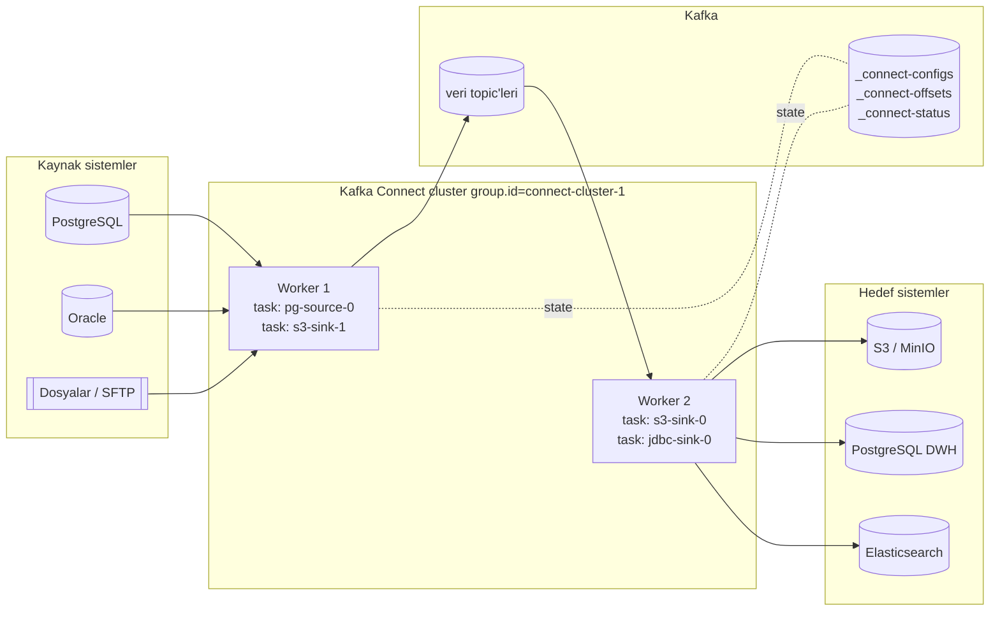
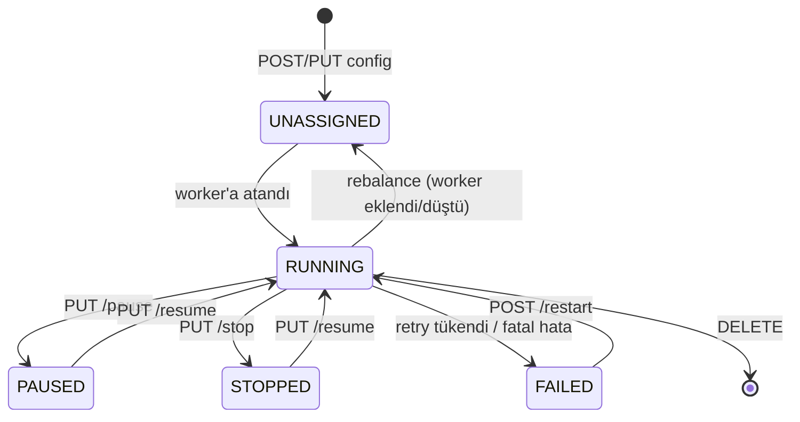

# 7. Kafka Connect

> **Bu bölümde:** Source/Sink connector, worker, standalone/distributed mod, task, converter, Single Message Transform (SMT), REST API, connector yaşam döngüsü, retry ve hata toleransı, Dead Letter Queue, izleme, plugin kurulumu ve sürüm uyumluluğu; JDBC Source, JDBC Sink ve Debezium örnekleri.
>
> **Kod:** [`code/connect/`](../code/connect/) · Ortam: [`docker-compose.cdc.yml`](../code/docker/docker-compose.cdc.yml)

---

## 7.1 Kafka Connect nedir, neden var?

**Basit:** Kafka ile veritabanları, dosya sistemleri, bulut depolama ve SaaS sistemleri arasında veri taşımak için **kod yazmadan, konfigürasyonla** çalışan entegrasyon çatısı.

**Teknik:** Kafka'nın parçası olan, ölçeklenebilir ve hataya dayanıklı bir çalışma ortamı (runtime). Offset yönetimi, yeniden deneme, paralellik, serileştirme ve izleme gibi tekrar eden işleri çözer; siz sadece connector'ı seçip yapılandırırsınız.

**Python consumer yazmak yerine ne zaman Connect?** Hedef/kaynak standart bir sistemse (PostgreSQL, S3, Elasticsearch, Snowflake, BigQuery) ve dönüşüm basitse **Connect**. Karmaşık iş mantığı, dış API çağrıları veya ML skoru gerekiyorsa **uygulama kodu** (veya Flink).



## 7.2 Temel kavramlar

| Kavram | Açıklama |
|---|---|
| **Connector** | Bir entegrasyonun mantıksal tanımı (ad + config). İşi task'lara böler. |
| **Source Connector** | Dış sistemden okur → Kafka'ya yazar (Debezium, JDBC Source, FileStream, S3 Source) |
| **Sink Connector** | Kafka'dan okur → dış sisteme yazar (JDBC Sink, S3 Sink, Elasticsearch Sink, Snowflake) |
| **Task** | Gerçek kopyalama işini yapan birim. `tasks.max` ile üst sınır; sink'te partition'lar task'lara bölünür. Debezium PostgreSQL tek task çalışır (tek slot). |
| **Worker** | Connector ve task'ları çalıştıran JVM süreci |
| **Converter** | Connect'in iç veri modeli (Struct + Schema) ↔ Kafka byte'ları. `JsonConverter`, `AvroConverter`, `ProtobufConverter`, `StringConverter`, `ByteArrayConverter` |
| **SMT (Single Message Transform)** | Mesaj başına hafif dönüşüm (alan ekle/çıkar, yeniden adlandır, topic değiştir, filtrele) |
| **Predicate** | SMT'yi koşullu uygulamak (`TopicNameMatches`, `HasHeaderKey`, `RecordIsTombstone`) |
| **Config provider** | Secret'ları dosya/env/Vault'tan okuma: `${file:/secrets/db.properties:source_password}` |

## 7.3 Standalone ve Distributed mod

| | Standalone | Distributed |
|---|---|---|
| Süreç | Tek worker | N worker, aynı `group.id` |
| State | Yerel dosya (`offset.storage.file.filename`) | Kafka topic'leri (`_connect-configs`, `-offsets`, `-status`) |
| Yönetim | Başlarken `.properties` dosyası | **REST API** |
| HA | Yok | Worker düşerse task'lar diğerlerine dağılır (rebalance) |
| Kullanım | Laptop'ta deneme, tek seferlik iş | **Production** (bu rehberin compose'u distributed tek worker) |

Standalone örneği (Kafka binary ile gelir):
```bash
bin/connect-standalone.sh config/connect-standalone.properties connector1.properties
```

Distributed iç topic'ler için production ayarları: `replication.factor=3`, `_connect-offsets` için `cleanup.policy=compact` (Connect bunu kendisi ayarlar), yeterli partition (`offset.storage.partitions=25` varsayılanı).

## 7.4 Converter seçimi

| Converter | Şema | Boyut | Not |
|---|---|---|---|
| `JsonConverter` + `schemas.enable=true` | Her mesajda gömülü | Büyük (şema her mesajda tekrar) | Schema Registry'siz, şema gerektiren sink'ler (JDBC) için. Bu rehberin CDC laboratuvarı |
| `JsonConverter` + `schemas.enable=false` | Yok | Küçük | Şemasız JSON; JDBC sink çalışmaz |
| `AvroConverter` / `ProtobufConverter` / `JsonSchemaConverter` | **Schema Registry**'de, mesajda sadece şema ID'si | Küçük | **Production önerisi**; şema evrimi denetlenir |
| `StringConverter` / `ByteArrayConverter` | Yok | Ham | Geçiş amaçlı, içeriğe dokunmadan |

Worker seviyesinde varsayılan, connector seviyesinde override:
```json
"value.converter": "io.confluent.connect.avro.AvroConverter",
"value.converter.schema.registry.url": "http://schema-registry:8081"
```

## 7.5 Single Message Transforms (SMT)

Yerleşik (Apache Kafka) SMT'ler: `InsertField`, `ReplaceField` (Kafka 3.x+: `exclude`/`include`/`renames`), `MaskField`, `ValueToKey`, `ExtractField`, `Cast`, `TimestampConverter`, `RegexRouter`, `TimestampRouter`, `Filter`, `Flatten`, `HoistField`, `HeaderFrom`, `InsertHeader`, `DropHeaders`.
Debezium SMT'leri: `ExtractNewRecordState` (zarfı aç, sadece `after`), `ByLogicalTableRouter`, `Outbox EventRouter`, `Filter`/`ContentBasedRouter` (scripting).

Örnek: CDC zarfını açıp düz satır yapma + PII maskeleme + topic adını değiştirme:
```json
"transforms": "unwrap,mask,route",
"transforms.unwrap.type": "io.debezium.transforms.ExtractNewRecordState",
"transforms.unwrap.delete.tombstone.handling.mode": "tombstone",
"transforms.mask.type": "org.apache.kafka.connect.transforms.MaskField$Value",
"transforms.mask.fields": "ad_soyad",
"transforms.mask.replacement": "***",
"transforms.route.type": "org.apache.kafka.connect.transforms.RegexRouter",
"transforms.route.regex": "bank\\.public\\.(.*)",
"transforms.route.replacement": "temiz.$1"
```
**Kural:** SMT'ler **durumsuz, mesaj başına, hafif** işler içindir. Join, aggregation, dış servis çağrısı → Kafka Streams/Flink.

## 7.6 REST API

| İşlem | Komut |
|---|---|
| Worker bilgisi | `curl -s localhost:8083/` |
| Yüklü plugin'ler | `curl -s localhost:8083/connector-plugins` |
| Config doğrula (oluşturmadan) | `curl -s -X PUT -H 'Content-Type: application/json' localhost:8083/connector-plugins/PostgresConnector/config/validate -d @config.json` |
| Oluştur/güncelle (idempotent) | `curl -X PUT -H 'Content-Type: application/json' localhost:8083/connectors/<ad>/config -d @config-only.json` |
| Liste + durum | `curl -s 'localhost:8083/connectors?expand=status'` |
| Durum | `curl -s localhost:8083/connectors/<ad>/status` |
| Duraklat / devam | `curl -X PUT localhost:8083/connectors/<ad>/pause` · `/resume` |
| Durdur (task'ları kapat, config kalır) | `curl -X PUT localhost:8083/connectors/<ad>/stop` |
| Yeniden başlat | `curl -X POST 'localhost:8083/connectors/<ad>/restart?includeTasks=true&onlyFailed=true'` |
| Offset oku / sıfırla (KIP-875, connector STOPPED iken) | `GET /connectors/<ad>/offsets` · `DELETE /connectors/<ad>/offsets` |
| Sil | `curl -X DELETE localhost:8083/connectors/<ad>` |

`code/scripts/register_connectors.sh` `PUT .../config` kullanır: aynı script tekrar çalıştırılınca connector'ı **günceller**, hata vermez (CI/CD için uygun).

## 7.7 Connector yaşam döngüsü


`PAUSED`: task'lar bellekte, veri akmıyor. `STOPPED` (KIP-875): task'lar kapatılır, kaynaklar serbest; offset düzenlemek için gereklidir. `FAILED` task'lar **kendiliğinden düzelmez** → alarm + restart.

## 7.8 Retry ve hata toleransı

| Ayar | Varsayılan | Anlamı |
|---|---|---|
| `errors.tolerance` | `none` | İlk dönüşüm/serileştirme hatasında task FAILED. `all`: hatalı kaydı atla |
| `errors.retry.timeout` | `0` | Geçici hatalarda toplam yeniden deneme süresi (ms); `-1` sonsuz |
| `errors.retry.delay.max.ms` | `60000` | Denemeler arası max bekleme |
| `errors.log.enable` / `errors.log.include.messages` | `false` | Hatalı kaydı logla (PII varsa `include.messages=false`!) |
| `errors.deadletterqueue.topic.name` | — | **Sadece sink connector'larda**: hatalı kayıt bu topic'e |
| `errors.deadletterqueue.context.headers.enable` | `false` | Hata bağlamı header'ları (`__connect.errors.*`) |

> **Önemli sınır:** `errors.tolerance` ve DLQ **converter ve SMT** aşamasındaki hataları kapsar. Sink'in hedefe yazarken aldığı hatalar (ör. DB kısıt ihlali) connector'ın kendi davranışına bağlıdır; Kafka 2.6+ `ErrantRecordReporter` API'sini destekleyen connector'lar (Debezium JDBC Sink, Confluent JDBC Sink güncel sürümleri) bunları da DLQ'ya gönderebilir. Kullandığınız sürümün dokümantasyonunu kontrol edin.

## 7.9 Dead Letter Queue (DLQ)

```bash
docker exec kafka /opt/kafka/bin/kafka-console-consumer.sh --bootstrap-server kafka:19092 \
  --topic dlq.pg-sink-dwh --from-beginning --property print.headers=true --max-messages 1
# __connect.errors.topic:bank.public.hesap_hareket,__connect.errors.partition:1,
# __connect.errors.offset:42,__connect.errors.exception.class.name:org.apache.kafka.connect.errors.DataException,
# __connect.errors.exception.message:..., ...
```
DLQ politikası: alarm (DLQ'ya mesaj geldi), sahiplik, kök neden analizi, düzeltme sonrası **redrive** (DLQ'yu kaynak topic'e geri yazan küçük bir iş veya connector'ı DLQ topic'ini okuyacak şekilde ikinci kez çalıştırmak).

## 7.10 Connector izleme

- **REST status** (`/connectors?expand=status`): `FAILED` task sayısı → en temel alarm.
- **JMX metrikleri** (`kafka.connect:type=...`): `connector-task-metrics` (status, batch-size, offset-commit-success/failure), `source-task-metrics` (`source-record-poll-rate`, `source-record-write-rate`), `sink-task-metrics` (`sink-record-read-rate`, `put-batch-avg-time-ms`, **`sink-record-lag-max`**), `task-error-metrics` (`total-record-errors`, `total-records-skipped`, `deadletterqueue-produce-requests`).
- **Debezium metrikleri** (`debezium.postgres:type=connector-metrics,context=streaming,...`): `MilliSecondsBehindSource`, `TotalNumberOfEventsSeen`, `Connected`; snapshot için `RemainingTableCount`.
- **Sink consumer lag**: sink connector'ın consumer group'u `connect-<connector-adı>`'dır → kafka-exporter ile izlenir.
- **Kaynak DB tarafı**: replication slot WAL boyutu (6.13).

## 7.11 Plugin kurulumu ve sürüm uyumluluğu

```bash
# Worker config: plugin dizinleri
plugin.path=/opt/kafka/plugins,/usr/share/java
# Her connector kendi alt dizininde (izole classloader):
/opt/kafka/plugins/debezium-connector-postgres/*.jar
/opt/kafka/plugins/confluentinc-kafka-connect-jdbc/lib/*.jar
```

Kurulum yöntemleri:
1. **Hazır image:** `quay.io/debezium/connect:3.7.1.Final` (tüm Debezium connector'ları + JDBC sink + PostgreSQL JDBC sürücüsü içerir).
2. **Kendi image'ınız** (önerilen production yöntemi):
   ```dockerfile
   FROM apache/kafka:4.4.0
   USER root
   RUN mkdir -p /opt/kafka/plugins
   # Debezium PostgreSQL connector plugin arşivi (Maven Central'dan, sürümü sabitleyin)
   ADD https://repo1.maven.org/maven2/io/debezium/debezium-connector-postgres/3.7.1.Final/debezium-connector-postgres-3.7.1.Final-plugin.tar.gz /tmp/
   RUN tar -xzf /tmp/debezium-connector-postgres-3.7.1.Final-plugin.tar.gz -C /opt/kafka/plugins && rm /tmp/*.tar.gz
   USER appuser
   ```
3. **confluent-hub CLI** (Confluent image'larında): `confluent-hub install confluentinc/kafka-connect-jdbc:<sürüm>`.

**Uyumluluk kuralları:**
- Connector'ın desteklediği **Connect API** sürümü ↔ worker'ın Kafka sürümü (Debezium 3.7: Kafka Connect 3.1+).
- Java sürümü: Kafka 4.x worker'ı Java 17+; Debezium 3.x connector'ları Java 17+.
- Aynı jar'ın farklı sürümleri **farklı plugin dizinlerinde** olmalı; Kafka 4.1+ (KIP-891) aynı connector'ın **birden çok sürümünü** aynı worker'da çalıştırmayı destekler.
- JDBC sürücüleri (PostgreSQL, Oracle `ojdbc`) connector dizinine konmalıdır; Oracle sürücüsü lisans nedeniyle çoğu image'da yoktur.
- **Lisans:** Apache Kafka Connect ve Debezium Apache 2.0'dır. Confluent JDBC connector **Confluent Community License**'tır (kullanmak serbest, rakip SaaS olarak sunmak yasak) — kurumunuzun lisans politikasıyla kontrol edin.

---

## 7.12 Örnek 1 — Debezium PostgreSQL Source

Dosya: [`code/connect/pg-source-debezium.json`](../code/connect/pg-source-debezium.json). Ayrıntılı açıklama ve çalıştırma: [6.16](06-cdc-debezium.md#616-uygulama-postgresql--kafka--postgresql-tam-senkronizasyon-sıfırdan).

## 7.13 Örnek 2 — Debezium JDBC Sink (CDC zarfını doğrudan anlar)

Dosya: [`code/connect/pg-sink-debezium-jdbc.json`](../code/connect/pg-sink-debezium-jdbc.json)
```json
{
  "connector.class": "io.debezium.connector.jdbc.JdbcSinkConnector",
  "topics": "bank.public.hesap_hareket,bank.public.musteri",
  "connection.url": "jdbc:postgresql://pg-target:5432/dwh",
  "insert.mode": "upsert",
  "delete.enabled": "true",
  "primary.key.mode": "record_key",
  "schema.evolution": "none",
  "collection.name.format": "${topic}",
  "transforms": "route",
  "transforms.route.type": "org.apache.kafka.connect.transforms.RegexRouter",
  "transforms.route.regex": "bank\\.public\\.(.*)",
  "transforms.route.replacement": "$1_replica",
  "errors.tolerance": "all",
  "errors.deadletterqueue.topic.name": "dlq.pg-sink-dwh"
}
```
Not: Debezium 3.x'te tablo adı ayarı `collection.name.format` olarak adlandırılır (eski `table.name.format`). Burada tablo adı RegexRouter ile değiştirilen topic adından türetilir.

## 7.14 Örnek 3 — Confluent JDBC Source (polling, karşılaştırma için)

Dosya: [`code/connect/jdbc-source-confluent.json`](../code/connect/jdbc-source-confluent.json)
```json
{
  "connector.class": "io.confluent.connect.jdbc.JdbcSourceConnector",
  "mode": "timestamp+incrementing",
  "timestamp.column.name": "guncellendi",
  "incrementing.column.name": "musteri_id",
  "table.whitelist": "musteri",
  "topic.prefix": "poll.",
  "poll.interval.ms": "10000",
  "numeric.mapping": "best_fit"
}
```
| `mode` | Neyi yakalar |
|---|---|
| `bulk` | Her poll'da tüm tablo |
| `incrementing` | Sadece yeni satırlar (artan ID) |
| `timestamp` | `updated_at` değişenler |
| `timestamp+incrementing` | En güvenilir polling; yine de **DELETE yok** |

Kurulum: Debezium image'ında yoktur. `confluent-hub install confluentinc/kafka-connect-jdbc:<sürüm>` veya jar'ları `plugin.path` altına koyun.

## 7.15 Örnek 4 — Confluent JDBC Sink + ExtractNewRecordState

Dosya: [`code/connect/jdbc-sink-confluent.json`](../code/connect/jdbc-sink-confluent.json). Confluent JDBC Sink Debezium zarfını anlamaz; `ExtractNewRecordState` SMT ile `after` alanı düz kayda çevrilir, DELETE'ler tombstone olarak bırakılır (`delete.enabled=true` tombstone'u DELETE'e çevirir).

## 7.16 Debezium JDBC Sink mi, Confluent JDBC Sink mi?

| | Debezium JDBC Sink | Confluent JDBC Sink |
|---|---|---|
| Debezium zarfı | Doğrudan anlar | SMT ile açılmalı |
| DELETE | `delete.enabled` | Tombstone + `delete.enabled` |
| Şema evrimi | `schema.evolution=basic` | `auto.create`, `auto.evolve` |
| Lisans | Apache 2.0 | Confluent Community License |
| Olgunluk | Daha yeni, aktif geliştiriliyor | Çok yaygın, uzun geçmiş |

---

## Kaynaklar

- [Apache Kafka — Kafka Connect](https://kafka.apache.org/documentation/#connect)
- [Apache Kafka — Connect REST API](https://kafka.apache.org/documentation/#connect_rest)
- [KIP-298: Error Handling in Connect (DLQ)](https://cwiki.apache.org/confluence/display/KAFKA/KIP-298%3A+Error+Handling+in+Connect)
- [KIP-875: First-class offsets support in Kafka Connect](https://cwiki.apache.org/confluence/display/KAFKA/KIP-875%3A+First-class+offsets+support+in+Kafka+Connect)
- [KIP-891: Running multiple versions of Connector plugins](https://cwiki.apache.org/confluence/display/KAFKA/KIP-891%3A+Running+multiple+versions+of+Connector+plugins)
- [Apache Kafka 4.1.0 Release Announcement (KIP-891, KIP-877)](https://kafka.apache.org/blog/2025/09/04/apache-kafka-4.1.0-release-announcement/)
- [Debezium JDBC Sink Connector](https://debezium.io/documentation/reference/stable/connectors/jdbc.html)
- [Debezium — New Record State Extraction SMT](https://debezium.io/documentation/reference/stable/transformations/event-flattening.html)
- [Confluent JDBC Connector (Source & Sink)](https://docs.confluent.io/kafka-connectors/jdbc/current/overview.html)
