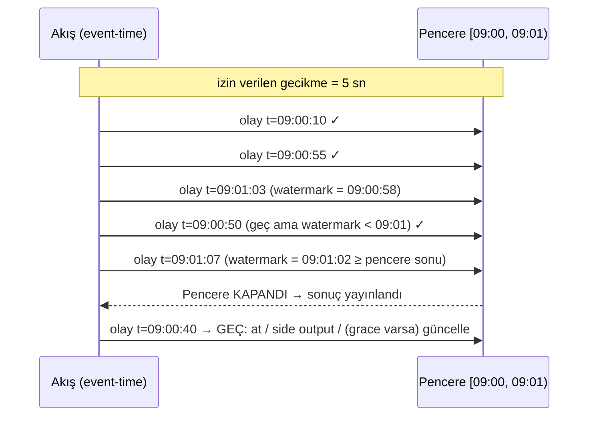
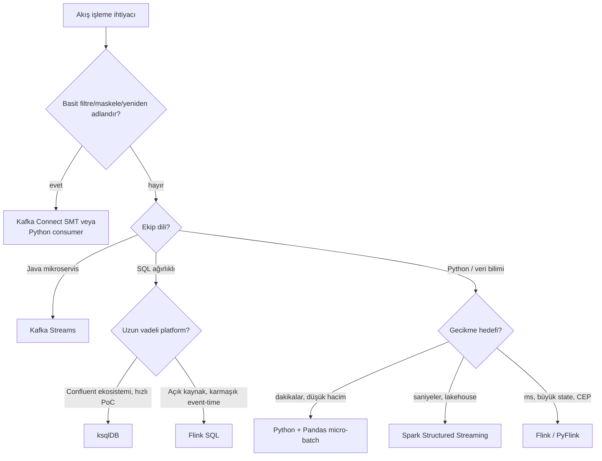

# 8. Kafka Streams, ksqlDB, Spark ve Flink

> **Bu bölümde:** Dört akış işleme aracının ayrı ayrı anlatımı ve filtering, mapping, grouping, aggregation, join, windowing, event-time, watermark, geç gelen olaylar, state yönetimi, checkpointing ve exactly-once yetenekleri açısından karşılaştırılması.
>
> **Kod:** [`code/streams/kafka-streams-java/`](../code/streams/kafka-streams-java/), [`code/ksqldb/01_islemler.sql`](../code/ksqldb/01_islemler.sql), [`code/flink/01_islemler.sql`](../code/flink/01_islemler.sql), [`code/spark/islem_ozet_structured_streaming.py`](../code/spark/islem_ozet_structured_streaming.py), ortam: [`docker-compose.streaming.yml`](../code/docker/docker-compose.streaming.yml)
>
> **Sürümler (Kasım 2026):** Kafka Streams 4.4.0 · ksqlDB (Confluent Platform 8.x, `cp-ksqldb-server:8.2.0`) · Apache Spark 4.3.0 · Apache Flink 2.3.0

---

## 8.1 Temel akış işleme kavramları

### Durumsuz (stateless) işlemler
- **Filtering:** `tutar >= 100000` olanları geçir.
- **Mapping:** Her olayı dönüştür (alan ekle, maskele, tip çevir). `flatMap`: bir olaydan N olay.
- **Branching / routing:** Koşula göre farklı çıktılara ayır.

### Durumlu (stateful) işlemler
- **Grouping:** Anahtara göre grupla (Kafka'da genelde **yeniden bölümleme — repartition** demektir: aynı grubun kayıtları aynı partition'a/instance'a taşınır).
- **Aggregation:** `count`, `sum`, `avg`, `min/max`, özel birleştirme. Sonsuz akışta "toplam" ancak bir **pencere** içinde veya sürekli güncellenen bir **tablo** olarak anlamlıdır.
- **Joins:**
  | Tür | Örnek | Not |
  |---|---|---|
  | Stream–Table | İşlem akışı + müşteri profili | Tablo güncel durumdur; olay anındaki değerle zenginleştirme |
  | Stream–Stream (windowed/interval) | EFT ve 10 dk içindeki ATM çekimi | Her iki taraf pencere kadar state'te tutulur |
  | Table–Table | Müşteri + hesap | Sonuç da tablo |
  | Temporal / versioned | İşlemi **o anki** kur ile çarpmak | Flink temporal join, Kafka Streams versioned store |

### Windowing (pencereleme)

```mermaid
gantt
  dateFormat  HH:mm
  axisFormat  %H:%M
  section Tumbling (1 dk)
  P1 :t1, 09:00, 1m
  P2 :t2, 09:01, 1m
  P3 :t3, 09:02, 1m
  section Hopping (3 dk, 1 dk adım)
  H1 :h1, 09:00, 3m
  H2 :h2, 09:01, 3m
  H3 :h3, 09:02, 3m
  section Session (30 sn boşluk)
  Oturum A :s1, 09:00, 2m
  Oturum B :s2, 09:03, 1m
```

| Pencere | Tanım | Bankacılık örneği |
|---|---|---|
| **Tumbling** | Sabit boyut, çakışmasız | Dakikalık işlem adedi/tutarı |
| **Hopping / sliding** | Sabit boyut, belirli adımla kayan, çakışan | "Son 5 dk'da müşteri toplamı" (her dakika güncel) |
| **Session** | Aktivite boşluğuna göre dinamik | Mobil bankacılık oturumu, şüpheli işlem patlaması |
| Global / cumulative | Başlangıçtan beri / gün içinde kümülatif | Günlük limit kullanımı |

### Event-time, watermark ve geç gelen olaylar
- **Event-time processing:** Hesaplar olayın **gerçekleştiği** zamana göre yapılır (bkz. 2.20).
- **Watermark:** "Bu zamandan eski olay artık **beklemiyorum**" işareti. `watermark = görülen_en_büyük_event_time − izin_verilen_gecikme`. Pencere, watermark pencere sonunu geçince kapanır ve sonuç kesinleşir.
- **Late-arriving events:** Watermark'tan sonra gelen olaylar. Seçenekler: at (drop), **grace period / allowed lateness** içinde kabul edip sonucu güncelle, **side output**'a yönlendir (ayrı işlem/DLT).
- **Bedel:** Gecikme toleransı ↑ → doğruluk ↑, sonuç gecikmesi ↑, state boyutu ↑.



### State management ve checkpointing
- **State:** Pencere toplamları, join tamponları, tekilleştirme kümeleri. Bellek + diskte (RocksDB) tutulur.
- **Hata toleransı:** State kaybolmamalı:
  - Kafka Streams/ksqlDB: her state store bir **changelog topic**'e yedeklenir; instance ölünce başka instance changelog'dan geri yükler (standby replica ile hızlanır).
  - Flink: periyodik **checkpoint** (dağıtık snapshot — Chandy-Lamport türevi barrier'lar) S3/HDFS'e; **savepoint** ile sürüm yükseltme/ölçek değiştirme.
  - Spark: **checkpointLocation** (offset'ler + state store, RocksDB opsiyonel).
- **Exactly-once processing:** State + çıktı + girdi offset'i **atomik** ilerler.
  - Kafka Streams: `processing.guarantee=exactly_once_v2` (Kafka transactions).
  - Flink: checkpoint + Kafka sink `DeliveryGuarantee.EXACTLY_ONCE` (iki aşamalı commit, transactional producer).
  - Spark: idempotent/transactional sink + checkpoint; Kafka sink'i **at-least-once**'dır.
  - ksqlDB: `processing.guarantee=exactly_once_v2` (Kafka Streams üzerinde).

---

## 8.2 Kafka Streams

**Ne:** Kafka'nın parçası olan bir **Java/Scala kütüphanesi**. Ayrı cluster yoktur: uygulamanız (Spring Boot servisi, bir JAR) Kafka Streams'i içerir; ölçeklemek için aynı `application.id` ile daha fazla instance çalıştırırsınız (consumer group mantığı).

**Ekosistemdeki konumu:** JVM ekibi olan, mikroservis içinde akış işleme isteyen, ek altyapı istemeyen kurumlar için en doğal seçimdir. Python'dan kullanılamaz (Python için resmi bir eşdeğeri yoktur; Faust/Bytewax/Quix Streams gibi topluluk/3. parti kütüphaneler vardır). Kafka 4.3 ile `streams-scala` modülü kullanımdan kaldırılma (deprecate) sürecine girdi; Java API esastır.

**Soyutlamalar:** `KStream` (olay akışı), `KTable` (key başına son değer, changelog), `GlobalKTable` (her instance'ta tam kopya — küçük referans tabloları için join'de repartition gerektirmez), **Processor API** (düşük seviye, özel state store).

Örnek ([`IslemOzetApp.java`](../code/streams/kafka-streams-java/src/main/java/rehber/IslemOzetApp.java) — kısaltılmış):
```java
islemler
  .mapValues(IslemOzetApp::parse)                                   // mapping
  .filter((k, v) -> v != null && v.has("tutar"))                    // filtering
  .map((k, v) -> KeyValue.pair(v.get("islem_tipi").asText(), v.get("tutar").asText()))  // re-key
  .groupByKey()                                                     // grouping (repartition topic)
  .windowedBy(TimeWindows.ofSizeAndGrace(Duration.ofMinutes(1), Duration.ofMinutes(2)))
  .aggregate(() -> "0", (tip, tutar, toplam) -> new BigDecimal(toplam).add(new BigDecimal(tutar)).toPlainString(),
             Materialized.as("islem-tipi-1dk-toplam"))              // RocksDB + changelog
  .suppress(Suppressed.untilWindowCloses(Suppressed.BufferConfig.unbounded()))  // tek, kesin sonuç
  .toStream()
  .to("islemler.ozet.streams");
```
Derleme/çalıştırma:
```bash
cd code/streams/kafka-streams-java && mvn -q package
KAFKA_BOOTSTRAP=localhost:9092 java -jar target/islem-ozet-1.0-jar-with-dependencies.jar
```
| Avantaj | Dezavantaj |
|---|---|
| Ek cluster yok, sadece Kafka | Sadece JVM |
| Exactly-once v2, changelog ile güçlü hata toleransı | Girdi ve çıktı Kafka olmalı (dış kaynak/hedef için Connect) |
| İnteraktif sorgular (state store'u REST ile açmak) | Repartition ve changelog topic'leri Kafka'da ek yük ve depolama |
| Olgun, Kafka ile birlikte sürümlenir | Çok büyük state'te geri yükleme süresi uzun olabilir |

## 8.3 ksqlDB

**Ne:** Kafka Streams üzerine kurulu, **SQL ile akış işleme** sunan sunucu (Confluent, Confluent Community License). `CREATE STREAM`, `CREATE TABLE ... AS SELECT` (persistent query), `EMIT CHANGES` (push query) ve materialized tablolar üzerinde **pull query** destekler. Ayrıca Kafka Connect connector'larını SQL'den yönetebilir.

**Konumu:** Java yazmadan akış işleme isteyen analist/veri mühendisi ekipleri için hızlı başlangıç. Confluent, Confluent Platform 8.x'te ksqlDB'yi sunmaya devam ediyor; ancak yeni akış işleme yatırımlarını büyük ölçüde **Flink SQL**'e yönlendirmektedir (Confluent Cloud ve Confluent Platform for Apache Flink). Yeni bir strateji kuruyorsanız uzun vadeli tercih için ikisini değerlendirin.

Örnekler: [`code/ksqldb/01_islemler.sql`](../code/ksqldb/01_islemler.sql) (ayrıntılı söz dizimi [9. bölüm](09-streaming-sql.md)).

```bash
docker compose -f code/docker/docker-compose.yml up -d
docker compose -f code/docker/docker-compose.streaming.yml up -d ksqldb-server ksqldb-cli
python code/python/03_json_producer.py --adet 5000
docker exec -it ksqldb-cli ksql http://ksqldb-server:8088
ksql> RUN SCRIPT '/ksqldb/01_islemler.sql';
ksql> SELECT * FROM islem_ozet_1dk WHERE islem_tipi = 'EFT';
```

| Avantaj | Dezavantaj |
|---|---|
| Sadece SQL; hızlı prototip | Söz dizimi standart SQL değil; sınırlı ifade gücü |
| Kafka Streams'in EOS ve state altyapısı | Lisans (Confluent Community License) |
| Pull query ile anlık durum sorgusu | Büyük ölçekte işletimi (query başına kaynak izolasyonu) zor |
| | Ekosistem desteği Flink'e kayıyor |

## 8.4 Spark Structured Streaming

**Ne:** Apache Spark'ın akış motoru; akışı **sürekli büyüyen bir tablo** gibi ele alır, aynı DataFrame/SQL API'siyle batch ve stream yazılır.

**Çalışma modları:**
- **Micro-batch** (varsayılan): `trigger(processingTime="10 seconds")` — her tetikte yeni offset aralığı işlenir. Gecikme ~saniyeler; en olgun mod.
- `trigger(availableNow=True)`: Mevcut her şeyi işle ve dur → "akış altyapısıyla batch" (artımlı ETL için çok kullanışlı).
- **Continuous processing** (deneysel, eski): milisaniye gecikme, kısıtlı operasyon seti.
- **Real-time mode** (Spark 4.1 ile tanıtılan düşük gecikmeli mod): fraud/izleme gibi işler için alt-saniye gecikme hedefler; desteklenen operasyonları kullandığınız sürümün dokümanından kontrol edin.

Örnek ([`islem_ozet_structured_streaming.py`](../code/spark/islem_ozet_structured_streaming.py)):
```python
ozet = (olaylar.withWatermark("olay_zamani", "2 minutes")
        .groupBy(F.window("olay_zamani", "1 minute"), "islem_tipi")
        .agg(F.count("*").alias("adet"), F.sum("tutar").alias("toplam")))
ozet.writeStream.outputMode("update").option("checkpointLocation", "/tmp/spark-chk/islem-ozet").start()
```
```bash
spark-submit --packages org.apache.spark:spark-sql-kafka-0-10_2.13:4.3.0 code/spark/islem_ozet_structured_streaming.py
```
| Avantaj | Dezavantaj |
|---|---|
| PySpark: Python ekibi için doğal; batch ve stream aynı kod | Micro-batch gecikmesi; per-event işleme değil |
| Lakehouse (Delta Lake, Iceberg) ile çok güçlü | Stateful akışta Flink kadar esnek değil (özel timer'lar sınırlı; `transformWithState` yeni) |
| Databricks gibi yönetilen platformlar | Kafka sink'i at-least-once |
| ML ve SQL ekosistemi | Cluster maliyeti |

## 8.5 Apache Flink

**Ne:** Gerçek zamanlı, **durumlu (stateful) akış işleme** için tasarlanmış dağıtık motor. Her olayı tek tek işler (true streaming), batch'i "sınırlı akış" olarak görür. API katmanları: **Flink SQL / Table API**, DataStream API (Java), **PyFlink**, ve düşük seviye ProcessFunction (timer'lar, keyed state).

**Güçlü yanları:**
- Gelişmiş event-time: watermark stratejileri, allowed lateness, side output.
- Çok büyük state (TB seviyesi) — RocksDB, artımlı checkpoint; Flink 2.x ile **disaggregated state** (ForSt, uzak depolamada state) yönü.
- Exactly-once: checkpoint + iki aşamalı commit'li sink'ler.
- Flink SQL: Window TVF'ler (TUMBLE/HOP/SESSION/CUMULATE), interval/temporal/lookup join, `MATCH_RECOGNIZE` (CEP: "3 başarısız giriş ardından yüksek tutarlı EFT" gibi desenler).
- **Flink CDC** (3.6): Debezium tabanlı, Kafka'sız doğrudan DB → hedef pipeline'ları.

Örnek ([`code/flink/01_islemler.sql`](../code/flink/01_islemler.sql)):
```sql
CREATE TABLE islem_akisi (
  ..., islem_ts_ms BIGINT,
  olay_zamani AS TO_TIMESTAMP_LTZ(islem_ts_ms, 3),
  WATERMARK FOR olay_zamani AS olay_zamani - INTERVAL '5' SECOND
) WITH ('connector'='kafka', 'topic'='islemler.json', 'properties.bootstrap.servers'='kafka:19092',
        'scan.startup.mode'='earliest-offset', 'format'='json');

SELECT window_start, islem_tipi, COUNT(*), SUM(tutar)
FROM TABLE(TUMBLE(TABLE islem_akisi, DESCRIPTOR(olay_zamani), INTERVAL '1' MINUTE))
GROUP BY window_start, window_end, islem_tipi;
```
```bash
docker compose -f code/docker/docker-compose.streaming.yml up -d --build flink-jobmanager flink-taskmanager
docker exec -it flink-jobmanager ./bin/sql-client.sh -f /opt/flink/rehber/01_islemler.sql
# Flink UI: http://localhost:8081
```
> **Dikkat:** `code/flink/Dockerfile` içindeki Kafka SQL connector jar URL'i bir **varsayımdır**; Flink 2.3 ile uyumlu connector sürümünü [Flink downloads](https://flink.apache.org/downloads/) sayfasından doğrulayıp `KAFKA_CONNECTOR_URL` build argümanını güncelleyin.

| Avantaj | Dezavantaj |
|---|---|
| En güçlü stateful/event-time motoru, düşük gecikme | Öğrenme eğrisi ve işletim (JobManager/TaskManager, checkpoint depolama, savepoint disiplini) |
| SQL + Java + Python | PyFlink, Java API kadar olgun değil |
| Kafka dışı kaynak/hedefler (JDBC, Iceberg, Paimon, Elasticsearch) | Sürüm geçişlerinde connector uyumluluğu dikkat ister (Flink 2.x'te connector'lar ayrı sürümlenir) |

---

## 8.6 Karşılaştırma tablosu

| Yetenek | Kafka Streams | ksqlDB | Spark Structured Streaming | Flink |
|---|---|---|---|---|
| Dağıtım modeli | Kütüphane (uygulamanın içinde) | Sunucu cluster | Spark cluster | Flink cluster |
| Dil | Java (Scala deprecated) | SQL | Python, Scala, Java, SQL, R | SQL, Java, Python |
| İşleme modeli | Olay bazlı | Olay bazlı (Streams) | Micro-batch (+ düşük gecikme modları) | Olay bazlı |
| Tipik gecikme | ms | ms–sn | sn (micro-batch) | ms |
| Filtering / mapping | ✅ | ✅ | ✅ | ✅ |
| Grouping / aggregation | ✅ | ✅ | ✅ | ✅ |
| Stream–table join | ✅ | ✅ | ✅ (static/stream) | ✅ (temporal, lookup) |
| Stream–stream join | ✅ (windowed) | ✅ (`WITHIN`) | ✅ (watermark gerekli) | ✅ (interval, window) |
| Tumbling / hopping / session | ✅ / ✅ / ✅ | ✅ / ✅ / ✅ | ✅ / ✅ (sliding) / ✅ (`session_window`) | ✅ / ✅ / ✅ (+ cumulate) |
| Event-time | ✅ (record timestamp / extractor) | ✅ (`TIMESTAMP=`) | ✅ | ✅ (en zengin) |
| Watermark | Dolaylı (stream time + grace) | Grace period | ✅ `withWatermark` | ✅ (stratejiler, idle source) |
| Geç gelen olay | Grace; sonrası drop | Grace; sonrası drop | Watermark sonrası drop | Allowed lateness + **side output** |
| State | RocksDB + changelog topic | Aynı | State store (HDFS/RocksDB) | RocksDB/ForSt + checkpoint |
| Checkpoint / kurtarma | Changelog'dan restore, standby | Aynı | checkpointLocation | Checkpoint + savepoint |
| Exactly-once | ✅ `exactly_once_v2` (Kafka→Kafka) | ✅ | Kaynak+state ✅; Kafka sink at-least-once | ✅ uçtan uca (2PC sink'lerle) |
| Kafka dışı kaynak/hedef | ❌ (Connect ile) | Connect ile | ✅ geniş | ✅ geniş |
| CEP (desen tespiti) | Elle (Processor API) | ❌ | Sınırlı | ✅ `MATCH_RECOGNIZE`, CEP lib |
| Lisans | Apache 2.0 | Confluent Community | Apache 2.0 | Apache 2.0 |

## 8.7 Hangi aracı ne zaman?



**Bankacılık önerisi:** Fraud ve limit gibi **düşük gecikmeli, durumlu, geç veriye duyarlı** işler için Flink; lakehouse'a artımlı yükleme ve ML özellik hattı için Spark (`availableNow` veya micro-batch); JVM mikroservis içi zenginleştirme için Kafka Streams; hızlı keşif ve operasyonel dashboard'lar için ksqlDB/Flink SQL.

## Kaynaklar

- [Apache Kafka — Kafka Streams](https://kafka.apache.org/documentation/streams/)
- [Kafka Streams — Windowing, grace, suppress](https://kafka.apache.org/documentation/streams/developer-guide/dsl-api.html#windowing)
- [ksqlDB for Confluent Platform (8.x)](https://docs.confluent.io/platform/current/ksqldb/index.html)
- [Spark Structured Streaming Programming Guide](https://spark.apache.org/docs/latest/streaming/index.html)
- [Spark releases / end-of-life (4.3.0, 27 Ekim 2026)](https://endoflife.date/apache-spark)
- [Apache Flink 2.3.0 Release Announcement](https://flink.apache.org/blog/)
- [Flink — Window Table-Valued Functions](https://nightlies.apache.org/flink/flink-docs-stable/docs/dev/table/sql/queries/window-tvf/)
- [Flink — Event Time and Watermarks](https://nightlies.apache.org/flink/flink-docs-stable/docs/concepts/time/)
- [Apache Flink Downloads (connector uyumluluğu, Flink CDC 3.6)](https://flink.apache.org/downloads/)
