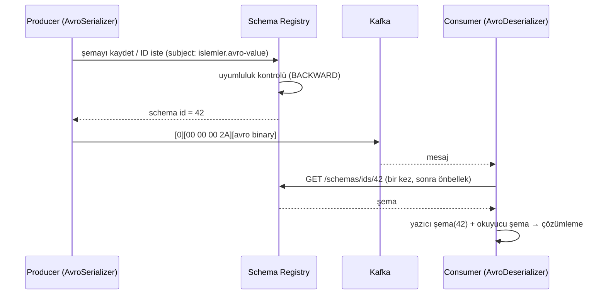

# 10. Veri Formatları ve Şema Yönetimi

> **Bu bölümde:** JSON, CSV, Apache Avro, Protocol Buffers, JSON Schema; Schema Registry; şema evrimi ve uyumluluk türleri (backward/forward/full); null handling; decimal, timestamp ve timezone; breaking change'ler. Finansal veride **Decimal hassasiyeti** ve doğru serileştirme.
>
> **Kod:** [`code/schemas/islem.v1.avsc`](../code/schemas/islem.v1.avsc), [`islem.v2.avsc`](../code/schemas/islem.v2.avsc), [`code/python/avro_producer_schema_registry.py`](../code/python/avro_producer_schema_registry.py), testler: [`tests/test_avro_schema.py`](../code/python/tests/test_avro_schema.py) (✅ fastavro 1.13.1 ile geçti)

---

## 10.1 Neden format ve şema bu kadar önemli?

Kafka'da producer ve consumer'lar **farklı ekiplerin, farklı zamanlarda dağıtılan** uygulamalarıdır. Mesajın yapısı bu ekipler arasındaki **sözleşmedir (data contract)**. Sözleşme yazılı ve denetlenen bir şey değilse, bir ekibin "küçük" değişikliği (alan adını değiştirmek, tutarı string'den sayıya çevirmek) diğer tüm tüketicileri gece yarısı kırar.

## 10.2 Format karşılaştırması

| Format | Şema | Boyut | Hız | Okunabilirlik | Evrim desteği | Tipik kullanım |
|---|---|---|---|---|---|---|
| **JSON** | Yok (örtük) | Büyük | Orta | ✅ İnsan okur | Kurala bağlı değil | Başlangıç, entegrasyon, düşük hacim |
| **CSV** | Sütun sırası | Küçük-orta | Hızlı | ✅ | ❌ Kırılgan (sıra/ayraç/tırnak) | Dosya aktarımı; Kafka mesajı olarak **önerilmez** |
| **Apache Avro** | Zorunlu (JSON ile tanımlı) | Çok küçük (alan adı yok) | Hızlı | ❌ İkili | ✅ Okuyucu/yazıcı şema çözümlemesi | Kafka ekosisteminde **de facto standart** (Connect, Debezium, ksqlDB) |
| **Protocol Buffers** | Zorunlu (`.proto`) | Çok küçük | Çok hızlı | ❌ İkili | ✅ Alan numaraları ile | gRPC ile ortak sözleşme, çok dilli mikroservisler |
| **JSON Schema** | JSON + şema | Büyük (JSON) | Orta | ✅ | ⚠️ Kuralları daha karmaşık | JSON'dan vazgeçemeyen, ama doğrulama isteyen ekipler |

**Öneri:** Kurumsal Kafka'da **Avro (veya Protobuf) + Schema Registry**. JSON'u, dış dünyaya açılan sınırlarda ve öğrenme aşamasında kullanın (bu rehberin Python örnekleri sadelik için JSON kullanır).

## 10.3 JSON — dikkat noktaları
- Sayı türü tektir ve çoğu ayrıştırıcı onu **IEEE 754 double**'a çevirir → `0.1 + 0.2 = 0.30000000000000004`. Tutarı **string** olarak taşıyın veya ayrıştırırken `parse_float=Decimal` kullanın (`common.from_json_bytes`).
- Büyük tamsayılar (> 2^53) JavaScript tüketicilerinde bozulur → ID'leri string taşımayı düşünün.
- Tarih standardı yok → ISO-8601 **ofsetli** (`2026-11-24T06:20:00+00:00`) veya epoch milisaniye; ikisini birden göndermek (bu rehber) tüketiciye kolaylık sağlar.
- Alan yokluğu ile `null` farklıdır; sözleşmede belirleyin.

## 10.4 CSV — neden Kafka mesajı olarak önerilmez
Ayraç (`;` vs `,`), ondalık ayırıcı (`12,50` — Türkçe locale), tırnak kaçışı, satır sonu, kodlama (Windows-1254 vs UTF-8), başlık satırı ve kolon sırası bağımlılığı. CSV dosyasını Kafka'ya **satır satır JSON/Avro olaya çevirerek** alın (`05_csv_to_kafka.py`, `p03`).

## 10.5 Apache Avro

```json
{
  "type": "record", "name": "Islem", "namespace": "tr.banka.odeme",
  "fields": [
    {"name": "hareket_id", "type": "long"},
    {"name": "islem_tipi", "type": {"type": "enum", "name": "IslemTipi",
        "symbols": ["EFT","HAVALE","KART","ATM","FAST","BILINMIYOR"], "default": "BILINMIYOR"}},
    {"name": "tutar", "type": {"type": "bytes", "logicalType": "decimal", "precision": 18, "scale": 2}},
    {"name": "islem_zamani", "type": {"type": "long", "logicalType": "timestamp-micros"}},
    {"name": "kanal", "type": ["null", "string"], "default": null}
  ]
}
```
- **Mantıksal tipler (logical types):** `decimal` (bytes/fixed), `timestamp-millis/micros` (UTC), `local-timestamp-*` (saat dilimsiz), `date`, `time-*`, `uuid`.
- **Null:** Union `["null", "string"]` + `"default": null`. Union'da `null` **ilk** sırada olmalı ki default `null` olabilsin.
- **Enum'a default** verin: yeni bir sembol eklendiğinde eski okuyucular default'a düşer (test: `test_bilinmeyen_enum_default_a_duser` ✅).

## 10.6 Protocol Buffers

```protobuf
syntax = "proto3";
package tr.banka.odeme.v1;
import "google/protobuf/timestamp.proto";
import "google/type/decimal.proto";   // veya: string tutar / int64 tutar_kurus

message Islem {
  int64  hareket_id   = 1;
  int64  musteri_id   = 2;
  IslemTipi islem_tipi = 3;
  string tutar        = 4;   // "1500000.10" — proto3'te yerleşik decimal yok
  string para_birimi  = 5;
  google.protobuf.Timestamp islem_zamani = 6;
  optional string kanal = 7;
  reserved 8;                // silinen alan numarası ASLA tekrar kullanılmaz
}
enum IslemTipi { ISLEM_TIPI_BILINMIYOR = 0; EFT = 1; HAVALE = 2; KART = 3; ATM = 4; FAST = 5; }
```
- Uyumluluk **alan numaralarına** dayanır; isim değiştirmek kablo formatını bozmaz, numara değiştirmek bozar.
- proto3'te skaler alanların "yok" ile "varsayılan değer" ayrımı için `optional` kullanın.
- Decimal için: `string`, ölçekli tamsayı (`int64 tutar_kurus`) veya `google.type.Decimal`.

## 10.7 JSON Schema

```json
{
  "$schema": "https://json-schema.org/draft/2020-12/schema",
  "title": "Islem", "type": "object",
  "required": ["hareket_id", "musteri_id", "tutar", "islem_zamani"],
  "properties": {
    "hareket_id":   {"type": "integer"},
    "tutar":        {"type": "string", "pattern": "^-?\\d{1,16}\\.\\d{2}$"},
    "islem_zamani": {"type": "string", "format": "date-time"},
    "kanal":        {"type": ["string", "null"]}
  },
  "additionalProperties": false
}
```
`additionalProperties: false` evrimi zorlaştırır (yeni alan eklemek tüketicileri kırar); "açık" ve "kapalı" içerik modeli seçimini bilinçli yapın.

## 10.8 Schema Registry

**Ne:** Şemaları sürümleyerek saklayan ve uyumluluk kurallarını **kayıt anında** denetleyen servis. Producer mesaja şemanın tamamını değil **5 byte'lık başlık** (magic byte `0` + 4 byte şema ID) koyar; consumer ID ile şemayı Registry'den alıp önbellekler.



Seçenekler: **Confluent Schema Registry** (Confluent Community License; `cp-schema-registry:8.2.0` bu rehberin compose'unda `--profile avro`), **Apicurio Registry** (Apache 2.0, Red Hat), **Karapace** (Apache 2.0, Aiven), bulutta AWS Glue Schema Registry, Confluent Cloud SR.

**Subject isimlendirme stratejileri:**
| Strateji | Subject | Kullanım |
|---|---|---|
| `TopicNameStrategy` (varsayılan) | `<topic>-value` | Bir topic = bir olay tipi |
| `RecordNameStrategy` | `tr.banka.odeme.Islem` | Bir topic'te birden çok olay tipi |
| `TopicRecordNameStrategy` | `<topic>-tr.banka.odeme.Islem` | İkisinin birleşimi |

Temel REST işlemleri:
```bash
SR=http://localhost:8081
curl -s $SR/subjects
curl -s $SR/subjects/islemler.avro-value/versions/latest
curl -s -X PUT -H "Content-Type: application/vnd.schemaregistry.v1+json" \
     --data '{"compatibility":"BACKWARD"}' $SR/config/islemler.avro-value
# Yeni şema uyumlu mu? (kaydetmeden test)
curl -s -X POST -H "Content-Type: application/vnd.schemaregistry.v1+json" \
     --data "{\"schema\": $(jq -Rs . < code/schemas/islem.v2.avsc)}" \
     $SR/compatibility/subjects/islemler.avro-value/versions/latest
# {"is_compatible": true}
```
Python örneği: [`avro_producer_schema_registry.py`](../code/python/avro_producer_schema_registry.py). Production'da `auto.register.schemas=false`: şemalar CI/CD hattında kaydedilir ve uyumluluk testi **merge öncesi** yapılır.

## 10.9 Schema Evolution ve Compatibility

| Uyumluluk | Garanti | İzin verilen değişiklikler (Avro) | Dağıtım sırası |
|---|---|---|---|
| **BACKWARD** (varsayılan) | Yeni şemalı **consumer**, bir önceki şemayla yazılmış veriyi okur | Alan **silme**; **default'lu** alan ekleme | Önce consumer'lar, sonra producer'lar |
| **FORWARD** | Eski şemalı consumer, yeni şemayla yazılmış veriyi okur | Alan **ekleme**; **default'lu** alan silme | Önce producer'lar |
| **FULL** | İkisi birden | Sadece **default'lu** alan ekleme/silme | Herhangi bir sıra |
| `*_TRANSITIVE` | Sadece bir öncekiyle değil, **tüm** önceki sürümlerle | Aynı | Uzun retention'lı topic'lerde (eski veri replay) önerilir |
| NONE | Kontrol yok | Her şey | **Kullanmayın** |

Testlerle doğrulanan senaryolar (`test_avro_schema.py`):
- v1 → v2: `sube_kodu` (`["null","string"]`, default `null`) eklendi.
- **Backward ✅:** v2 okuyucu v1 veriyi okur, `sube_kodu = None`.
- **Forward ✅:** v1 okuyucu v2 veriyi okur, yeni alanı yok sayar.
- Yani bu değişiklik **FULL** uyumludur.

**Bankacılık önerisi:** `FULL_TRANSITIVE` veya en az `BACKWARD_TRANSITIVE`. Retention uzun ve replay yapılıyorsa geçmişteki tüm sürümlerin okunabilmesi gerekir.

## 10.10 Breaking change'ler ve güvenli alternatifleri

| Kırıcı değişiklik | Neden kırar | Güvenli yol |
|---|---|---|
| Zorunlu (default'suz) alan eklemek | Eski veride yok → yeni okuyucu dolduramaz | Default ver veya nullable union |
| Alan adını değiştirmek | Avro adla eşler | Yeni alan ekle (default'lu) + eskisini bir süre doldur → sonra kaldır; veya Avro `aliases` |
| Tipi değiştirmek (`string` → `int`, `double` → `decimal`) | Kablo formatı farklı | Yeni alan (`tutar_v2`) + geçiş dönemi |
| `decimal` scale/precision değiştirmek | Değer anlamı değişir | Yeni alan veya yeni topic |
| Enum sembolü silmek | Eski veride var | Sembolü bırakın, kullanımdan kaldırın |
| Default'suz enum'a sembol eklemek | Eski okuyucu çözemez | Enum'a baştan `default` verin |
| Protobuf alan numarasını yeniden kullanmak | Eski veri yanlış alana düşer | `reserved` |
| Anlamı değiştirmek (ör. tutar kuruştan TL'ye) | Şema aynı, **anlam** farklı — Registry yakalayamaz! | Yeni alan adı (`tutar_tl`), sözleşme dokümantasyonu, data contract kuralları |

Gerçekten kırıcı değişiklik gerekiyorsa: **yeni topic** (`islemler.v2`), bir geçiş dönemi boyunca iki topic'e de yazma (veya Kafka Streams/Flink ile v1→v2 dönüştürme) ve tüketicilerin kademeli taşınması.

## 10.11 Null handling

| Katman | Kural |
|---|---|
| Kafka value `null` | **Tombstone** (silme) anlamına gelir; "boş olay" için kullanmayın |
| Avro | `["null", T]` + `"default": null`; zorunlu alanlar union değil |
| Protobuf | `optional` veya wrapper tipler (`google.protobuf.StringValue`) |
| JSON | Alan yokluğu ≠ `null`; sözleşmede tanımlayın |
| Pandas | `pd.NA` / nullable dtypes (`Int64`, `string`, `boolean`) |
| SQL hedef | `NOT NULL` kısıtları sözleşmeyle uyumlu olmalı; uyumsuzluk sink'te DLQ'ya düşer |

## 10.12 Decimal, timestamp ve timezone

### Finansal verilerde Decimal hassasiyeti
```python
>>> 0.1 + 0.2
0.30000000000000004
>>> t = 0.0
>>> for _ in range(10): t += 0.1      # 10 adet 10 kuruş, döngüyle toplama
>>> t
0.9999999999999999
>>> 1.15 * 100                        # 1,15 TL'yi kuruşa çevirme
114.99999999999999
>>> round(2.675, 2)                   # beklenen 2.68
2.67
>>> from decimal import Decimal, ROUND_HALF_UP
>>> Decimal("2.675").quantize(Decimal("0.01"), rounding=ROUND_HALF_UP)
Decimal('2.68')
```
(Çıktılar Python 3.13'te çalıştırılarak alındı. Not: Python 3.12+ `sum()` fonksiyonu telafili toplama kullandığı için `sum([0.1]*10)` artık `1.0` verir; ama Spark, Pandas `cumsum`, SQL `DOUBLE` veya döngüyle toplama gibi diğer yollarda hata birikmeye devam eder.)
Milyonlarca işlemde biriken float hatası mutabakat farkı, yanlış faiz ve denetim bulgusu demektir.

**Doğru serileştirme (katman katman):**
| Katman | Doğru | Yanlış |
|---|---|---|
| Kaynak DB | `NUMERIC(18,2)` | `FLOAT`, `REAL`, `MONEY` (locale'e bağlı) |
| Debezium | `decimal.handling.mode=precise` (Avro'da native decimal) veya `string` | `double` |
| Avro | `bytes` + `logicalType: decimal`, precision/scale sabit | `double` |
| Protobuf | `string` / ölçekli `int64` / `google.type.Decimal` | `double` |
| JSON | String `"1500000.10"` + `parse_float=Decimal` | Sayı + varsayılan `json.loads` |
| Python | `decimal.Decimal`, `quantize(Decimal("0.01"), ROUND_HALF_EVEN)` | `float`, `round()` |
| Pandas | `object[Decimal]` / `ArrowDtype(decimal128)`; CSV'de `dtype=str` | `float64` |
| Spark/Flink | `DECIMAL(18,2)` | `DOUBLE` |
| ksqlDB | `DECIMAL(18,2)` (AVG `DOUBLE` döner — dikkat) | `DOUBLE` |
| Hedef DB | `NUMERIC(18,2)` | `DOUBLE PRECISION` |

**Yuvarlama:** Kurumun muhasebe politikasına uyun (banker's rounding `ROUND_HALF_EVEN` veya `ROUND_HALF_UP`); tüm katmanlarda **aynı** kuralı uygulayın.

**Para birimi:** Tutar her zaman para birimi koduyla (ISO 4217) birlikte taşınmalı; JPY gibi 0, KWD gibi 3 ondalıklı para birimleri için scale'i para birimine göre belirleyin veya en büyük scale'i kullanın.

### Timestamp ve timezone
- Olay zamanını **UTC** olarak, saat dilimi bilgisiyle taşıyın (Avro `timestamp-micros`, ISO-8601 `+00:00`).
- PostgreSQL: `TIMESTAMPTZ` (içeride UTC saklar). `TIMESTAMP` (without time zone) "duvar saati"dir; kaynak sistemin saat dilimini bilmeden yorumlanamaz.
- Debezium: `TIMESTAMPTZ` → ISO-8601 string (`io.debezium.time.ZonedTimestamp`); `TIMESTAMP` → epoch mikrosaniye (`MicroTimestamp`, `time.precision.mode=adaptive_time_microseconds`) — **saat dilimi yorumu size kalır.**
- Kafka record timestamp'i epoch milisaniyedir (UTC).
- Gösterimde `Europe/Istanbul`'a çevirin. "Gün sonu" gibi iş kavramları **yerel** gündür: `date_trunc('day', islem_zamani AT TIME ZONE 'Europe/Istanbul')`.
- Hassasiyet kaybı: PostgreSQL mikrosaniye, Kafka timestamp milisaniye, Java `Instant` nanosaniye → zinciri baştan belirleyin.

## Kaynaklar

- [Apache Avro Specification (logical types, schema resolution)](https://avro.apache.org/docs/current/specification/)
- [Protocol Buffers — Language Guide (proto3)](https://protobuf.dev/programming-guides/proto3/)
- [JSON Schema](https://json-schema.org/specification)
- [Confluent Schema Registry — Schema Evolution and Compatibility](https://docs.confluent.io/platform/current/schema-registry/fundamentals/schema-evolution.html)
- [Confluent Schema Registry — Wire format](https://docs.confluent.io/platform/current/schema-registry/fundamentals/serdes-develop/index.html#wire-format)
- [Apicurio Registry](https://www.apicur.io/registry/)
- [Karapace](https://github.com/Aiven-Open/karapace)
- [Debezium PostgreSQL — Data type mappings (decimal, temporal)](https://debezium.io/documentation/reference/stable/connectors/postgresql.html#postgresql-data-types)
- [Python decimal module](https://docs.python.org/3/library/decimal.html)
- [fastavro](https://fastavro.readthedocs.io/)
