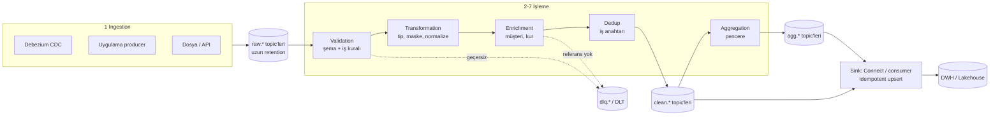
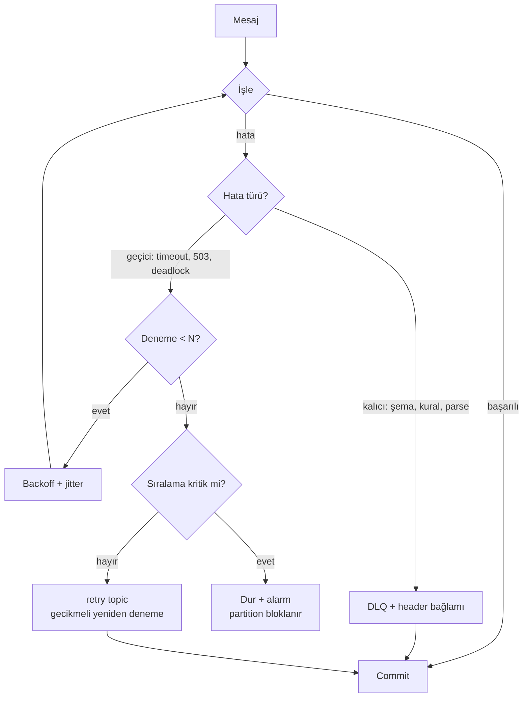
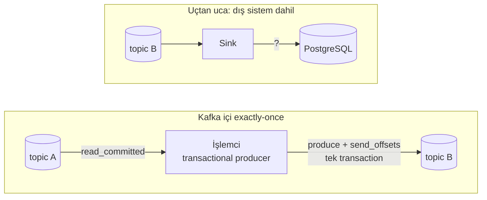
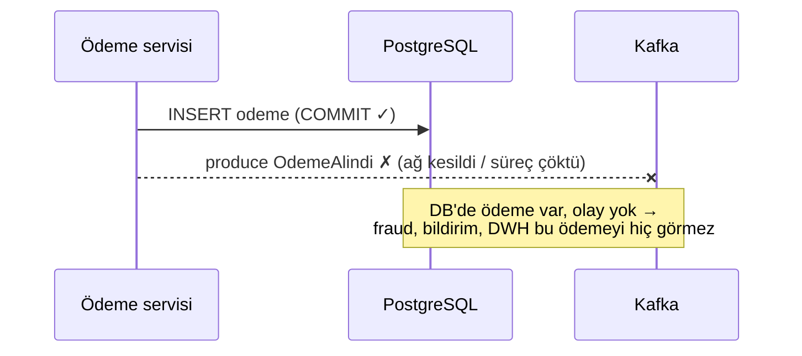
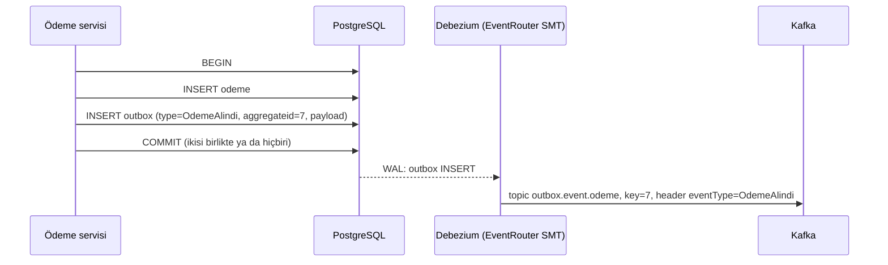

# 11. Gerçek Zamanlı ETL/ELT Tasarımı

> **Bu bölümde:** Batch ETL ile streaming ETL karşılaştırması; event ingestion, validation, transformation, enrichment, deduplication, aggregation, data quality, idempotency, upsert, replay, backfill, hata yönetimi, retry, DLQ; exactly-once ile **end-to-end** exactly-once farkı; transaction yönetimi; **Outbox Pattern** ve **dual-write problemi**.
>
> **Kod:** Önceki bölümlerdeki Python/Pandas/Connect örnekleri + [`code/sql/outbox_pattern.sql`](../code/sql/outbox_pattern.sql) (✅ PostgreSQL 16'da çalıştırıldı), [`code/connect/outbox-debezium.json`](../code/connect/outbox-debezium.json).

---

## 11.1 Batch ETL vs Streaming ETL

| Boyut | Batch ETL / ELT | Streaming ETL / ELT |
|---|---|---|
| Tetik | Zaman planı (gece 02:00) | Olay geldikçe / micro-batch |
| Gecikme | Saatler | Saniyeler–dakikalar |
| Veri hacmi / iş | Büyük, tek seferde | Küçük, sürekli |
| Hata etkisi | İş başarısız → tümü yeniden | Tek olay başarısız → DLQ, akış devam |
| Kaynak yükü | Pencere içinde yoğun sorgu | CDC ile sürekli ama hafif |
| Durum (state) | Her çalıştırma bağımsız | Pencereler, dedup kümeleri, join tamponları |
| Doğruluk modeli | Kesin (bounded) | Nihai (eventual), geç veri yönetimi |
| Yeniden çalıştırma | Kolay (job'u tekrar çalıştır) | **Replay/backfill** tasarım gerektirir |
| Test | Kolay (sabit girdi) | Daha zor (zaman, sıra, eşzamanlılık) |
| Araçlar | Airflow, dbt, Dataiku, SQL, Spark batch | Kafka + Connect/Debezium + Flink/Spark/Streams |

**ETL vs ELT (streaming bağlamında):** ETL'de dönüşüm Kafka ile hedef arasında (Flink, Python consumer) yapılır. **Streaming ELT**'de ham olaylar Kafka'dan hızlıca hedefe (lakehouse/DWH) yüklenir, dönüşüm hedefte (dbt incremental model, materialized view) yapılır. Pratikte ikisi karışıktır: **hafif temizlik ve doğrulama akışta, iş mantığı ve modelleme hedefte.**



**Katmanlı topic stratejisi (medallion benzeri):** `raw.*` (değiştirilmemiş, uzun retention → replay kaynağı) → `clean.*` (doğrulanmış, standart şema) → `agg.*` / `enriched.*` (iş olayları). Her katman kendi şema sözleşmesine ve sahibine sahiptir.

---

## 11.2 Adım adım bileşenler

### Event ingestion
- **Kaynak türleri:** CDC (Debezium), uygulama olayları (producer), dosyalar (SFTP → Connect/Python), API'ler (polling → producer), IoT (MQTT köprüsü).
- **Kurallar:** Her olayda benzersiz **olay ID'si** (`event_id`) ve **iş anahtarı** (`hareket_id`), **event time**, **kaynak** bilgisi (header), şema sürümü. Producer'lar idempotent ve `acks=all`.

### Validation (doğrulama)
- **Yapısal:** Şema uyumu (Schema Registry serializer'ı bunu producer'da zorlar).
- **Semantik:** `tutar > 0`, `para_birimi ∈ ISO 4217`, `islem_zamani` gelecekte değil, zorunlu alanlar.
- **Referans:** `musteri_id` bilinen bir müşteri mi? (enrichment ile birlikte)
- Geçersiz kayıt → DLQ + metrik; **akış durmaz.**

### Transformation
Tip dönüşümü (string → Decimal, epoch → timestamp), birim standardizasyonu (kuruş/TL), kod eşleme (kanal kodları), **PII maskeleme/tokenizasyon** (TCKN, IBAN — bkz. 13. bölüm), alan adlarının kurumsal sözlüğe göre normalize edilmesi.

### Enrichment (zenginleştirme)
| Yöntem | Nasıl | Ne zaman |
|---|---|---|
| Stream–table join | Referans veri compacted topic'te (`musteri.profil`), KTable/Flink tablosu | Referans veri değişiyor, düşük gecikme |
| Lookup (dış DB/cache) | Olay başına Redis/PostgreSQL sorgusu (Flink lookup join + cache) | Referans çok büyük, Kafka'ya alınamıyor |
| Temporal join | Olay anındaki sürüm (kur!) | Geçmişe dönük doğruluk şart |
| Broadcast | Küçük tablo her instance'ta (GlobalKTable) | Kod tabloları |

Kural: Senkron dış API çağrısı akışın **en yavaş halkası** olur; cache'leyin, timeout ve retry koyun, başarısızlıkta DLQ.

### Deduplication
| Kaynak | Çözüm |
|---|---|
| Producer retry | Idempotent producer (broker) |
| Consumer yeniden işleme | Hedefte upsert (unique key) |
| Kaynak sistem çift olay | Akışta `event_id` ile **pencereli** dedup (Flink: `ROW_NUMBER() OVER (PARTITION BY event_id ORDER BY proctime) = 1`; Kafka Streams: state store'da görülen ID'ler + TTL) |
| CDC snapshot + stream çakışması | Debezium tutarlı snapshot (sorun yok); manuel backfill'de upsert |

Dedup state'i **sınırsız büyür** → TTL / pencere süresi belirleyin (ör. 24 saat).

### Aggregation
Event-time pencereleri (8. ve 9. bölümler); sonuçların `agg.*` topic'ine (upsert/compacted) ve hedefe **upsert** ile yazılması; geç veride düzeltme (aynı pencere anahtarının güncellenmesi).

### Data Quality (veri kalitesi)
| Boyut | Akışta ölçüm |
|---|---|
| Tamlık (completeness) | Zorunlu alan null oranı; beklenen kaynak hacmi vs gelen (dakikalık sayım) |
| Geçerlilik (validity) | Kural ihlali oranı → DLQ oranı |
| Tekillik (uniqueness) | Duplicate oranı |
| Güncellik (timeliness) | `now − event_time` dağılımı, consumer lag |
| Tutarlılık (consistency) | Kaynak–hedef mutabakatı: günlük `count`/`sum(tutar)` karşılaştırması (batch kontrol!) |
| Doğruluk (accuracy) | Örneklem kontrolü, referans sistemle karşılaştırma |

**Streaming + batch mutabakat:** Akışın doğruluğunu, kaynağa karşı periyodik (gün sonu) bir **batch sayım/tutar karşılaştırması** ile denetleyin. Bankacılıkta bu kontrol, akış ne kadar sağlam olursa olsun yapılmalıdır.

### Idempotency ve Upsert
At-least-once dünyada **her işlem tekrar gelebilir** varsayımıyla tasarlayın:
- Hedef tabloda iş anahtarı PK/unique.
- `INSERT ... ON CONFLICT (hareket_id) DO UPDATE ...` (PostgreSQL), `MERGE` (Snowflake, BigQuery, Delta, Iceberg, SQL Server, PostgreSQL 15+).
- **Sıra koruması:** Eski sürüm yeniyi ezmesin → `WHERE hedef.kafka_offset <= EXCLUDED.kafka_offset` veya kaynak `lsn`/`updated_at`/sürüm numarası ile karşılaştırma (testle doğrulandı: `test_eski_offset_yeniyi_ezmez`).
- Toplayan güncellemeler (`adet = adet + 1`) **idempotent değildir** → ham veriyi upsert edip toplamı yeniden hesaplayın (5.7).

### Replay
Kafka'nın en büyük avantajlarından biri: tüketici offset'ini geri sararak geçmişi yeniden işlemek.
```bash
# Tüketici grubu DURMUŞKEN:
kafka-consumer-groups.sh --bootstrap-server $B --group dwh-yukleyici --topic clean.islemler \
  --reset-offsets --to-datetime 2026-11-20T00:00:00.000 --dry-run      # önce kontrol
kafka-consumer-groups.sh ... --execute
```
Ön koşullar: (1) ham veri hâlâ retention içinde (veya tiered storage/arşivde), (2) hedef **idempotent**, (3) dış yan etkiler (e-posta, SMS, ödeme talimatı!) replay'de **tetiklenmemeli** → yan etkili tüketicileri ayrı grupta tutun ve replay'e dahil etmeyin.

Alternatif: **Yeni consumer group** ile baştan okuyup **yeni hedef tabloya** yazmak, doğrulamak, sonra tablo adlarını değiştirmek (blue/green) — en güvenli yol.

### Backfill
Kafka retention'ında olmayan geçmiş verinin akış hattına alınması:
| Yöntem | Not |
|---|---|
| Debezium **incremental snapshot** (signal) | Tablo/filtre bazında, streaming durmadan |
| Batch iş ile doğrudan hedefe yükleme + upsert | Akışla çakışma upsert ile çözülür |
| Arşivden (S3) Kafka'ya yeniden yayınlama (`backfill.*` topic) | Canlı topic'e karıştırmayın; tüketici iki kaynağı da okur |
| Flink/Spark'ı batch modda aynı kodla çalıştırmak | "Kappa" yaklaşımı |
Backfill sırasında pencereli toplamların **event-time**'a göre doğru pencereye düşmesi ve watermark'ların geç veriyi atmaması için ayrı iş/ayrı ayarlar kullanın.

### Error handling, retry ve DLQ

Ayrıntılar ve kod: Python [4.16–4.17](04-python.md#416-12-retry-mekanizması--12_retry_consumerpy), Connect [7.8–7.9](07-kafka-connect.md#78-retry-ve-hata-toleransı).

---

## 11.3 Exactly-once ile end-to-end exactly-once farkı



| | Kafka içi EOS | End-to-end EOS |
|---|---|---|
| Kapsam | Kafka → işlemci → Kafka | Kaynak sistem → Kafka → … → hedef sistem |
| Mekanizma | Idempotent producer + transactions + `read_committed` (Kafka Streams `exactly_once_v2`) | Kafka içi EOS **+** kaynakta idempotent üretim **+** hedefte idempotent/transactional yazım |
| Hedef DB | Kapsam dışı | **Ya** idempotent upsert (etki bir kez), **ya** offset'i veriyle aynı DB transaction'ında saklama (p04), **ya** 2PC destekli sink (Flink JDBC XA sink) |
| Dış yan etkiler (SMS, ödeme talimatı) | Kapsam dışı | Ancak hedefin kendisi idempotent ise (talimat ID'si ile tekrar reddi) |

**Gerçekçi formül:** *End-to-end exactly-once ≈ at-least-once teslimat + idempotent işlem.* "Mesaj tam bir kez **teslim** edilir" değil, "**etkisi** tam bir kez oluşur".

## 11.4 Transaction yönetimi

| Katman | Transaction | Not |
|---|---|---|
| Kafka producer | `init/begin/commit/abort_transaction` | Birden çok partition/topic'e atomik yazım + offset commit |
| Kafka consumer | `isolation.level=read_committed` | Abort edilen mesajları görmez; LSO'ya kadar okur |
| Hedef DB | `BEGIN ... COMMIT` | Batch upsert + offset tablosu aynı transaction |
| Kafka + DB birlikte | **Dağıtık transaction yok** (Kafka XA desteklemez) | Bu yüzden Outbox / idempotency / offset-in-DB desenleri var |
| Flink | Checkpoint'e bağlı iki aşamalı commit | Checkpoint aralığı = çıktı görünürlük gecikmesi |

Transaction maliyetleri: `transaction.timeout.ms` boyunca açık kalan transaction tüketicilerin LSO'sunu tutar (read_committed tüketicilerde gecikme); çok küçük transaction'lar throughput'u düşürür → batch başına bir transaction.

---

## 11.5 Dual-write problemi

Uygulama aynı iş adımında **iki ayrı sisteme** yazar: önce veritabanına, sonra Kafka'ya (veya tersi).


Tersi de mümkün: Kafka'ya yazıldı ama DB commit başarısız → var olmayan bir ödeme için olay. Retry, sıralama ve "hangisini önce yazmalı" çözümleri problemi **ortadan kaldırmaz**; iki sistem arasında atomiklik yoktur.

## 11.6 Outbox Pattern

**Fikir:** Olayı Kafka'ya değil, iş verisiyle **aynı veritabanı transaction'ında** bir `outbox` tablosuna yaz. Ayrı bir süreç (tercihen **CDC/Debezium**) outbox'ı okuyup Kafka'ya yayınlasın.



Uygulama ([`code/sql/outbox_pattern.sql`](../code/sql/outbox_pattern.sql) — PostgreSQL 16'da çalıştırıldı):
```sql
BEGIN;
INSERT INTO public.odeme (odeme_id, musteri_id, tutar, durum) VALUES ('6f1c...', 7, 98000.00, 'ALINDI');
INSERT INTO public.outbox (id, aggregatetype, aggregateid, type, payload)
VALUES ('0d2b...', 'odeme', '7', 'OdemeAlindi', jsonb_build_object('odeme_id','6f1c...','musteri_id',7,'tutar','98000.00'));
COMMIT;
```
Debezium connector ([`outbox-debezium.json`](../code/connect/outbox-debezium.json)):
```json
"table.include.list": "public.outbox",
"transforms": "outbox",
"transforms.outbox.type": "io.debezium.transforms.outbox.EventRouter",
"transforms.outbox.table.field.event.key": "aggregateid",
"transforms.outbox.table.fields.additional.placement": "type:header:eventType",
"transforms.outbox.route.by.field": "aggregatetype",
"transforms.outbox.route.topic.replacement": "outbox.event.${routedByValue}"
```
(Publication `dbz_outbox_pub`'ı `CREATE PUBLICATION dbz_outbox_pub FOR TABLE public.outbox;` ile açın.)

| Avantaj | Dezavantaj / dikkat |
|---|---|
| DB ve olay **atomik** | Ek tablo, CDC altyapısı |
| Sıra: aynı aggregate için commit sırası korunur (key = aggregateid) | Teslim **at-least-once** → tüketiciler `id` ile dedup etmeli |
| Kafka erişilemezken uygulama çalışmaya devam eder | Outbox tablosunun temizliği (satır hemen silinebilir; Debezium INSERT'ü WAL'dan okumuştur) |
| Olay şeması iş tablosundan bağımsız (iç tablo yapısı sızmaz) | Polling ile outbox okumak (CDC yerine) gecikme ve yük getirir |

**Ters yön — Inbox Pattern:** Tüketici, aldığı olayın `id`'sini iş verisiyle aynı transaction'da `inbox` (işlenmiş olaylar) tablosuna yazar; tekrar gelirse unique ihlali ile atlar → tüketicide idempotency.

**Alternatif: "Listen to yourself":** Uygulama sadece Kafka'ya yazar, kendi DB'sini de Kafka'dan okuyarak günceller (event sourcing yaklaşımı). Okuma-sonrası-yazma tutarlılığı (read-your-writes) zorlaşır.

---

## 11.7 Örnek: Bankacılık "işlem → DWH" hattının uçtan uca tasarımı

| Aşama | Teknoloji | Garanti / kural |
|---|---|---|
| Kaynak | Core banking PostgreSQL → Debezium (pgoutput, heartbeat, slot izleme) | Tutarlı snapshot + at-least-once |
| Raw | `raw.core.hesap_hareket` (Avro, `compact,delete`, 30 gün + tiered storage) | Şema: FULL_TRANSITIVE |
| Clean | Flink SQL: doğrulama, tip, PII tokenizasyonu, dedup (`event_id`, 24s TTL) | Kafka içi EOS (checkpoint + transactional sink) |
| Enrich | Flink temporal join: müşteri segmenti, olay anı TCMB kuru | Geç veri: 5 dk allowed lateness, sonrası side output |
| Agg | Dakikalık/şube/segment toplamları → `agg.*` (upsert-kafka) | Pencere anahtarı ile upsert |
| Sink | Debezium JDBC Sink / Snowflake connector → DWH | Upsert (PK), DLQ |
| Kontrol | Gün sonu Airflow işi: kaynak vs DWH `count`, `sum(tutar)` mutabakatı | Fark > 0 → alarm |
| Replay | Yeni consumer group + yeni hedef tablo (blue/green) | Yan etkili tüketiciler hariç |

## Kaynaklar

- [Apache Kafka — Message Delivery Semantics](https://kafka.apache.org/documentation/#semantics)
- [KIP-98: Exactly Once Delivery and Transactional Messaging](https://cwiki.apache.org/confluence/display/KAFKA/KIP-98+-+Exactly+Once+Delivery+and+Transactional+Messaging)
- [KIP-447: Producer scalability for exactly once semantics (exactly_once_v2)](https://cwiki.apache.org/confluence/display/KAFKA/KIP-447%3A+Producer+scalability+for+exactly+once+semantics)
- [Debezium — Outbox Event Router](https://debezium.io/documentation/reference/stable/transformations/outbox-event-router.html)
- [Debezium blog — Reliable Microservices Data Exchange With the Outbox Pattern](https://debezium.io/blog/2019/02/19/reliable-microservices-data-exchange-with-the-outbox-pattern/)
- [Flink — Deduplication (SQL)](https://nightlies.apache.org/flink/flink-docs-stable/docs/dev/table/sql/queries/deduplication/)
- [Flink — Fault Tolerance Guarantees of Data Sources and Sinks](https://nightlies.apache.org/flink/flink-docs-stable/docs/connectors/datastream/guarantees/)
- [PostgreSQL — MERGE](https://www.postgresql.org/docs/current/sql-merge.html)
