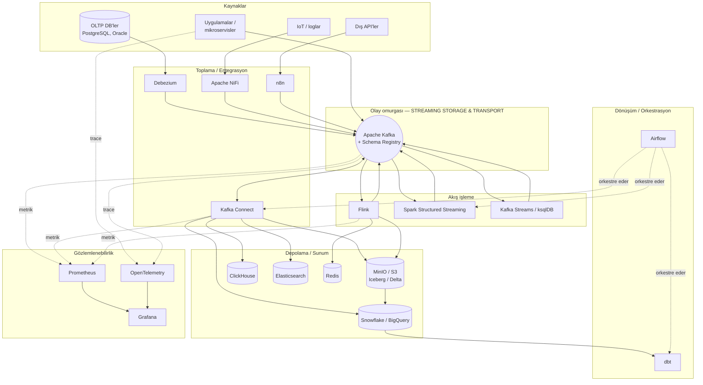

# 12. Kafka ve Diğer Veri Mühendisliği Araçları

> **Bu bölümde:** Kafka'nın Airflow, NiFi, Spark, Flink, dbt, MinIO/S3, Iceberg, Delta Lake, Snowflake, BigQuery, ClickHouse, Elasticsearch, Redis, Grafana, Prometheus, OpenTelemetry ve n8n ile birlikte kullanımı; Kafka'nın hangi katmanda durduğu, hangi aracın onun yerini alabileceği ve hangisinin onu tamamladığı.

---

## 12.1 Katmanlı referans mimari



**Kafka'nın yeri:** L3 — sistemler arası **olay taşıma ve kısa/orta vadeli olay saklama** katmanı. Hesaplama (L4), analitik depolama (L5) ve orkestrasyon (L6) Kafka'nın işi **değildir**.

---

## 12.2 Mimari tablo: rol, ilişki, entegrasyon

| Araç | Katman / rol | Kafka ile ilişki | Kafka'nın **yerini alabilir mi?** | Entegrasyon yolu |
|---|---|---|---|---|
| **Apache Airflow** | Batch orkestrasyon (DAG, zamanlama) | **Tamamlar** | Kısmen: gerçek zamanlı ihtiyaç yoksa Kafka'ya gerek kalmaz | `apache-airflow-providers-apache-kafka` (produce/consume operatörleri, `AwaitMessageTrigger`); Airflow 3'te *asset/event-driven scheduling* ile Kafka mesajıyla DAG tetikleme; daha yaygını: Airflow, Kafka'dan beslenen tablolar üzerinde batch işleri ve mutabakatı çalıştırır |
| **Apache NiFi** | Akış tabanlı veri yönlendirme (GUI), protokol dönüştürme | **Tamamlar** (kenar toplama), bazen **rakip** (basit hatlarda) | Düşük hacimli noktadan noktaya akışlarda evet; omurga olarak hayır (replay/çoklu tüketici zayıf) | `ConsumeKafka`/`PublishKafka` (Kafka 3+ client processor'ları), SFTP/HTTP/MQTT → Kafka |
| **Apache Spark** | Batch + micro-batch işleme | **Tamamlar** | Hayır (Spark saklama/taşıma yapmaz) | `spark-sql-kafka-0-10` kaynak/sink |
| **Apache Flink** | Durumlu akış işleme | **Tamamlar** | Hayır; ancak Flink CDC ile basit DB→DB hatlarında Kafka atlanabilir | Flink Kafka connector (SQL/DataStream) |
| **dbt** | SQL dönüşüm/modelleme (DWH içinde) | **Tamamlar** (Kafka'dan sonra) | Hayır | Kafka → DWH (Connect/Snowpipe Streaming) → dbt **incremental** modeller; dbt doğrudan Kafka okumaz |
| **MinIO / S3** | Nesne depolama | **Tamamlar** (uzun süreli arşiv, lakehouse) | Hayır | S3 Sink Connector (Parquet/Avro), Kafka **tiered storage**, Flink/Spark yazımı |
| **Apache Iceberg** | Açık tablo formatı (lakehouse) | **Tamamlar** | Hayır | Iceberg Kafka Connect sink (Apache Iceberg projesinin parçası), Flink/Spark Iceberg sink; bazı platformlar topic'i doğrudan Iceberg tablosu olarak sunar |
| **Delta Lake** | Açık tablo formatı | **Tamamlar** | Hayır | Spark Structured Streaming → Delta; Delta sink connector'ları |
| **Snowflake** | Bulut DWH | **Tamamlar** | Hayır | Snowflake Kafka Connector (Snowpipe Streaming), sonra dbt |
| **BigQuery** | Bulut DWH | **Tamamlar** | Hayır | BigQuery sink connector'ları, Pub/Sub köprüsü, Storage Write API |
| **ClickHouse** | Gerçek zamanlı OLAP | **Tamamlar** | Hayır | ClickHouse **Kafka table engine** + materialized view, veya ClickHouse Kafka Connect sink |
| **Elasticsearch / OpenSearch** | Arama, log analitiği | **Tamamlar** | Hayır | Elasticsearch Sink Connector, Logstash Kafka input |
| **Redis** | Önbellek, düşük gecikmeli durum; **Redis Streams** | Tamamlar (önbellek/feature store); Streams ile **kısmen rakip** | Küçük ölçekte Redis Streams Kafka'nın yerine geçebilir | Flink/consumer ile Redis'e yazma (feature store), Redis sink connector |
| **Prometheus** | Metrik toplama | Kafka'yı **izler** | — | JMX Exporter, kafka-exporter |
| **Grafana** | Görselleştirme / alarm | Kafka'yı **izler** | — | Prometheus datasource; Kafka datasource eklentisi ile topic'ten canlı panel |
| **OpenTelemetry** | Dağıtık izleme (traces/metrics/logs) | Kafka'yı **gözlemler** ve OTel verisini **taşıyabilir** | — | `traceparent` header'ı ile producer→consumer trace yayılımı; OTel Collector Kafka exporter/receiver (telemetri tamponu olarak Kafka) |
| **n8n** | İş akışı otomasyonu (low-code) | **Tamamlar** (kenar entegrasyonları) | Düşük hacimli otomasyonlarda Kafka'ya **gerek bırakmaz** | n8n **Kafka node** (mesaj gönderme) ve **Kafka Trigger** (topic dinleme) ile; ör. `alarm.fraud` topic'i → n8n → Slack/Teams/e-posta |

---

## 12.3 Araç bazında kısa notlar ve örnekler

### Airflow + Kafka
- **Yanlış kullanım:** Airflow task'ı içinde sonsuz Kafka consumer döngüsü (Airflow uzun yaşayan servisler için değildir).
- **Doğru kullanım:** (1) Gün sonu mutabakat DAG'ı (Kafka'dan beslenen DWH vs kaynak). (2) Kafka Connect connector'larını REST ile yöneten operasyon DAG'ları. (3) Belirli bir mesaj geldiğinde (ör. "BDDK dosyası yayınlandı" olayı) DAG'ı tetiklemek — Kafka provider'ın deferrable `AwaitMessageTrigger` / Airflow 3 event-driven scheduling yapısıyla.

### NiFi + Kafka
SFTP'den gelen kurum dosyaları, MQ (IBM MQ) köprüleri, HTTP webhook'ları gibi **kenar** kaynakları Kafka'ya taşımak için güçlüdür; veri kökeni (provenance) takibi iyidir. Karmaşık durumlu işleme veya omurga işlevi için Kafka + Flink tercih edin.

### dbt + Kafka (streaming ELT)
```sql
-- models/islem_gunluk.sql  (dbt incremental, Kafka'dan yüklenen ham tablo üzerinde)
{{ config(materialized='incremental', unique_key='hareket_id') }}
select hareket_id, musteri_id, islem_tipi, tutar, islem_zamani
from {{ source('kafka_raw', 'hesap_hareket_replica') }}

  where islem_zamani > (select max(islem_zamani) - interval '1 hour' from {{ this }})  -- geç veri payı

```

### ClickHouse — Kafka table engine
```sql
-- ClickHouse SQL (PostgreSQL değil!)
CREATE TABLE kafka_islemler (hareket_id UInt64, musteri_id UInt64, islem_tipi String,
                             tutar Decimal(18,2), islem_ts_ms UInt64)
ENGINE = Kafka SETTINGS kafka_broker_list = 'kafka:19092', kafka_topic_list = 'islemler.json',
                        kafka_group_name = 'clickhouse-islemler', kafka_format = 'JSONEachRow';
CREATE TABLE islemler (hareket_id UInt64, musteri_id UInt64, islem_tipi LowCardinality(String),
                       tutar Decimal(18,2), olay_zamani DateTime64(3, 'UTC'))
ENGINE = ReplacingMergeTree ORDER BY hareket_id;
CREATE MATERIALIZED VIEW mv_islemler TO islemler AS
SELECT hareket_id, musteri_id, islem_tipi, tutar, fromUnixTimestamp64Milli(islem_ts_ms) AS olay_zamani
FROM kafka_islemler;
```
`ReplacingMergeTree` arka planda duplicate'leri birleştirir (at-least-once teslimatla uyumlu).

### MinIO / S3 + Iceberg (lakehouse)
- **Ham arşiv:** S3 Sink Connector → `s3://datalake/raw/topics/islemler/year=2026/month=11/day=24/...parquet` (partition'lama: event-time alanına göre `TimeBasedPartitioner`).
- **Sorgulanabilir tablo:** Flink/Spark veya Iceberg Kafka Connect sink → Iceberg tablosu (exactly-once commit, şema evrimi, time travel). Sorgu: Trino, Spark, Snowflake/BigQuery (Iceberg katalog entegrasyonları).
- **MinIO:** On-prem S3 uyumlu depolama — bankalarda bulut kullanılamadığında lakehouse'un temeli.

### Redis
- **Feature store / anlık durum:** Flink "son 1 saatteki müşteri işlem toplamı"nı Redis'e yazar; fraud API'si milisaniyede okur.
- **Redis Streams vs Kafka:** Redis Streams küçük ölçekte basit ve hızlıdır; ancak RAM'e bağlı saklama, sınırlı replay ve ekosistem nedeniyle kurumsal omurga değildir.

### OpenTelemetry
- Producer `traceparent` header'ı ekler, consumer aynı trace'i devam ettirir → "ödeme isteği → Kafka → fraud skoru → bildirim" zincirinin tek bir trace'te görülmesi.
- Python: `opentelemetry-instrumentation-confluent-kafka` paketi (sürüm uyumluluğunu doğrulayın).
- OTel Collector, telemetri verisini Kafka'ya yazıp (kafka exporter) arka uca (Tempo, Jaeger, Elasticsearch) tamponlu iletebilir.

### n8n
- **Kafka Trigger node:** `alarm.limit_asimi` topic'ini dinle → koşula göre Teams/Slack mesajı, Jira kaydı, e-posta.
- **Kafka node:** n8n iş akışının sonucunu (ör. AI ile üretilmiş günlük rapor özeti) bir topic'e yayınla; diğer sistemler tüketsin.
- **Sınır:** n8n yüksek hacimli olay işleme motoru değildir; saniyede onlarca olay ve üzeri için tüketiciyi uygulama koduna/Flink'e bırakın, n8n'e sadece **özet/alarm** olaylarını verin.

---

## 12.4 "Kafka mı, X mi?" hızlı karar tablosu

| İhtiyaç | Öneri |
|---|---|
| Gece çalışan, kaynağı batch olan rapor | Airflow + SQL/dbt (Kafka yok) |
| SFTP'den gelen dosyayı 3 sisteme dağıtmak, düşük hacim | NiFi veya n8n yeterli olabilir |
| Core DB değişikliklerini 5+ sisteme saniyeler içinde dağıtmak | **Kafka + Debezium** |
| Gerçek zamanlı OLAP dashboard | Kafka → ClickHouse |
| Lakehouse'a sürekli yükleme | Kafka → Flink/Spark/Connect → Iceberg/Delta |
| Mikroservisler arası olaylar, replay ve denetim gerekli | **Kafka** |
| Mikroservisler arası görev kuyruğu, RPC | RabbitMQ (veya Kafka share groups'u değerlendirin) |
| Uygulama metrikleri/trace'leri | Prometheus/OTel (Kafka sadece tampon olarak) |

## Kaynaklar

- [Airflow — Apache Kafka provider](https://airflow.apache.org/docs/apache-airflow-providers-apache-kafka/stable/index.html)
- [Apache NiFi — Kafka processors](https://nifi.apache.org/components/)
- [Spark + Kafka Integration Guide](https://spark.apache.org/docs/latest/streaming/structured-streaming-kafka-integration.html)
- [dbt — Incremental models](https://docs.getdbt.com/docs/build/incremental-models)
- [Apache Iceberg — Kafka Connect](https://iceberg.apache.org/docs/latest/kafka-connect/)
- [Delta Lake — Table streaming reads and writes](https://docs.delta.io/latest/delta-streaming.html)
- [Snowflake Connector for Kafka](https://docs.snowflake.com/en/user-guide/kafka-connector)
- [ClickHouse — Kafka table engine](https://clickhouse.com/docs/engines/table-engines/integrations/kafka)
- [Elasticsearch Service Sink Connector](https://docs.confluent.io/kafka-connectors/elasticsearch/current/overview.html)
- [OpenTelemetry — Messaging semantic conventions (Kafka)](https://opentelemetry.io/docs/specs/semconv/messaging/kafka/)
- [n8n — Kafka node](https://docs.n8n.io/integrations/builtin/app-nodes/n8n-nodes-base.kafka/) · [Kafka Trigger node](https://docs.n8n.io/integrations/builtin/trigger-nodes/n8n-nodes-base.kafkatrigger/)
- [MinIO](https://min.io/docs/minio/linux/index.html)
