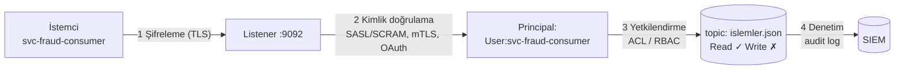

# 13. Kafka Güvenliği

> **Bu bölümde:** SSL/TLS, SASL, SCRAM, OAuth/OIDC, ACL, RBAC, ağ güvenliği, secret yönetimi, encryption at rest / in transit, audit logging, PII ve KVKK, finansal veri güvenliği, topic bazlı erişim; **development ve production konfigürasyonları ayrı ayrı.**
>
> **Kod:** [`code/security/server-sasl-ssl.properties`](../code/security/server-sasl-ssl.properties), [`client-sasl-ssl.properties`](../code/security/client-sasl-ssl.properties), [`acl_ornekleri.sh`](../code/security/acl_ornekleri.sh), [`code/k8s/strimzi-kafka.yaml`](../code/k8s/strimzi-kafka.yaml)
>
> ⚠️ Bu bölümdeki production konfigürasyonları bir cluster'a uygulanarak test **edilmemiştir**; Kafka 4.x resmi güvenlik dokümantasyonuna göre hazırlanmıştır. Kurumunuzun güvenlik ekibiyle birlikte gözden geçirin.

---

## 13.1 Güvenliğin dört katmanı


| Katman | Soru | Kafka mekanizması |
|---|---|---|
| Encryption in transit | Ağda okunabilir mi? | TLS (istemci↔broker, broker↔broker, controller) |
| Authentication | Kim? | SASL (SCRAM, PLAIN, GSSAPI/Kerberos, OAUTHBEARER) veya mTLS |
| Authorization | Ne yapabilir? | ACL (`StandardAuthorizer`), platforma göre RBAC |
| Auditing | Ne yaptı? | Authorizer log'ları, platform audit log'ları |

---

## 13.2 SSL/TLS

**Kullanım:** (a) Şifreleme, (b) sunucu kimlik doğrulama (istemci broker'ın gerçekten broker olduğunu doğrular), (c) isteğe bağlı **mTLS** ile istemci kimlik doğrulama.

Sertifika hazırlığı (kurumsal CA ile; örnek akış):
```bash
# 1) Broker anahtarı + CSR (SAN'da FQDN'ler!)
openssl req -new -newkey rsa:3072 -nodes -keyout broker-1.key -out broker-1.csr \
  -subj "/CN=broker-1.kafka.example.com" \
  -addext "subjectAltName=DNS:broker-1.kafka.example.com,DNS:broker-1.kafka.internal"
# 2) CSR'ı kurumsal CA'ya imzalatın -> broker-1.crt  (+ ca.crt)
# 3) PKCS12 keystore
openssl pkcs12 -export -in broker-1.crt -inkey broker-1.key -certfile ca.crt \
  -name broker-1 -out broker-1.keystore.p12 -passout pass:"$KEYSTORE_PW"
# 4) Truststore (CA)
keytool -importcert -alias bank-ca -file ca.crt -keystore truststore.p12 -storetype PKCS12 \
  -storepass "$TRUSTSTORE_PW" -noprompt
```
Broker ayarları (özet, tam hali dosyada):
```properties
ssl.keystore.type=PKCS12
ssl.keystore.location=/etc/kafka/secrets/broker-1.keystore.p12
ssl.keystore.password=${file:/etc/kafka/secrets/ssl.properties:keystore_password}
ssl.truststore.location=/etc/kafka/secrets/truststore.p12
ssl.endpoint.identification.algorithm=https     # hostname doğrulaması (varsayılan; kapatmayın)
ssl.enabled.protocols=TLSv1.3,TLSv1.2
```
Notlar:
- TLS açıkken **zero-copy** devre dışı kalır; CPU kullanımı artar (modern CPU'larda AES-NI ile genelde kabul edilebilir). Kapasite planına dahil edin.
- Sertifika yenileme: Kafka, keystore'u **dinamik** olarak yeniden yükleyebilir (`kafka-configs.sh --alter --entity-type brokers --entity-name <id> --add-config listener.name.client.ssl.keystore.location=...`) → yeniden başlatmadan rotasyon.
- Sertifika bitiş tarihini izleyin (alarm: < 30 gün).

## 13.3 SASL

| Mekanizma | Nasıl | Artı | Eksi | Öneri |
|---|---|---|---|---|
| `PLAIN` | Kullanıcı/şifre (TLS içinde) | Basit | Şifre broker config/JAAS'ta; özel callback olmadan yönetimi zor | Sadece TLS ile ve harici doğrulayıcıyla |
| **`SCRAM-SHA-512`** | Challenge-response; kimlik bilgileri **KRaft metadata**'sında tuzlanmış hash olarak | Şifre ağda gitmez; dinamik kullanıcı ekleme | Şifre rotasyonu istemcilerde | **On-prem için iyi varsayılan** |
| `GSSAPI` (Kerberos) | Kurumsal AD/Kerberos | Mevcut kurumsal kimlik altyapısı | Operasyonel karmaşıklık (keytab, KDC) | AD ağırlıklı bankalarda yaygın |
| `OAUTHBEARER` | JWT token (OIDC) | Merkezi IdP (Keycloak, Azure AD/Entra ID), kısa ömürlü token | IdP bağımlılığı, token yenileme | **Modern, bulut/hibrit** |

### SCRAM kullanıcıları
```bash
kafka-configs.sh --bootstrap-server $B --command-config admin.properties --alter \
  --add-config 'SCRAM-SHA-512=[iterations=8192,password=GUCLU_SIFRE]' \
  --entity-type users --entity-name svc-fraud-consumer
```
KRaft'ta ilk admin kullanıcısı, cluster formatlanırken eklenebilir: `kafka-storage.sh format ... --add-scram 'SCRAM-SHA-512=[name=admin,password=...]'`.

### Python istemcisi (SASL_SSL + SCRAM)
```python
{
  "bootstrap.servers": "broker-1.kafka.example.com:9092,broker-2.kafka.example.com:9092",
  "security.protocol": "SASL_SSL",
  "sasl.mechanism": "SCRAM-SHA-512",
  "sasl.username": "svc-fraud-consumer",
  "sasl.password": os.environ["KAFKA_SASL_PASSWORD"],     # secret manager'dan
  "ssl.ca.location": "/etc/pki/bank-ca.pem",
  "ssl.endpoint.identification.algorithm": "https",
}
```
Bu rehberin `common.base_config()` fonksiyonu bunu ortam değişkenlerinden kurar.

## 13.4 OAuth / OIDC entegrasyon seçenekleri

- **KIP-768** ile Kafka, OIDC uyumlu bir kimlik sağlayıcıdan **client credentials** akışıyla token alma (istemci) ve JWKS ile token doğrulama (broker) desteğine sahiptir; **KIP-1139** (Kafka 4.1) ile `jwt-bearer` grant tipi eklendi.
- Broker (özet):
  ```properties
  sasl.enabled.mechanisms=OAUTHBEARER
  listener.name.client.oauthbearer.sasl.server.callback.handler.class=org.apache.kafka.common.security.oauthbearer.OAuthBearerValidatorCallbackHandler
  listener.name.client.oauthbearer.sasl.jaas.config=org.apache.kafka.common.security.oauthbearer.OAuthBearerLoginModule required ;
  sasl.oauthbearer.jwks.endpoint.url=https://idp.bank.local/realms/kafka/protocol/openid-connect/certs
  sasl.oauthbearer.expected.audience=kafka
  sasl.oauthbearer.sub.claim.name=sub
  ```
  > Kafka 4.x'te güvenlik nedeniyle izin verilen OAuth URL'leri `org.apache.kafka.sasl.oauthbearer.allowed.urls` sistem özelliğiyle kısıtlanmıştır; JWKS ve token endpoint'lerinizi bu listeye eklemeniz gerekir — sürümünüzün güvenlik dokümanını kontrol edin.
- Python (librdkafka) istemcisi:
  ```python
  {"security.protocol": "SASL_SSL", "sasl.mechanism": "OAUTHBEARER",
   "sasl.oauthbearer.method": "oidc",
   "sasl.oauthbearer.client.id": "svc-fraud-consumer",
   "sasl.oauthbearer.client.secret": os.environ["OIDC_SECRET"],
   "sasl.oauthbearer.token.endpoint.url": "https://idp.bank.local/realms/kafka/protocol/openid-connect/token",
   "sasl.oauthbearer.scope": "kafka"}
  ```
- Yetkilendirme: Token'daki `sub` principal olur (`User:svc-fraud-consumer`) → ACL'ler buna göre. Strimzi + Keycloak ile token claim'lerine dayalı yetkilendirme (Keycloak Authorization Services) seçeneği vardır.
- Managed servisler: AWS MSK **IAM** auth (AWS'e özgü SASL mekanizması), Confluent Cloud API key / OAuth.

## 13.5 ACL (Access Control List)

Kafka 4.x (KRaft) yetkilendiricisi: `org.apache.kafka.metadata.authorizer.StandardAuthorizer`. ACL'ler KRaft metadata'sında saklanır.

**Model:** `Principal P, Host H'den, Resource R üzerinde, Operation O yapmaya Allow/Deny`.

| Kaynak tipi | Önemli işlemler |
|---|---|
| Topic | Read, Write, Describe, Create, Delete, Alter, DescribeConfigs, AlterConfigs |
| Group | Read, Describe, Delete |
| Cluster | IdempotentWrite, Create, Alter, Describe, ClusterAction |
| TransactionalId | Write, Describe |
| DelegationToken | Describe |

**Rol bazlı minimum ACL setleri:**
| Rol | Gerekli ACL'ler |
|---|---|
| Producer | Topic: Write, Describe · (idempotent) Cluster: IdempotentWrite |
| Transactional producer | + TransactionalId: Write, Describe |
| Consumer | Topic: Read, Describe · Group: Read |
| Kafka Connect worker | İç topic'ler (`_connect-*`) Read/Write/Describe/Create, kendi group'u, connector topic'leri |
| Kafka Streams uygulaması | Girdi Read; çıktı Write; `application.id` önekli iç topic'ler (repartition/changelog) **Create**, Read, Write; Group Read; transactional ise TransactionalId |

`acl_ornekleri.sh`'den:
```bash
# Ön ek (prefixed) ile: islemler.* topic'lerine yazma
kafka-acls.sh $B --add --allow-principal User:svc-odeme-producer \
  --operation Write --operation Describe --topic islemler. --resource-pattern-type prefixed
kafka-acls.sh $B --add --allow-principal User:svc-odeme-producer --operation IdempotentWrite --cluster
# Sadece kendi group.id'si
kafka-acls.sh $B --add --allow-principal User:svc-fraud-consumer --operation Read --group fraud-skorlama
```
Kurallar: `allow.everyone.if.no.acl.found=false`; `super.users` minimumda (broker kimliği + break-glass admin); ACL'leri **kod olarak** yönetin (Git + CI: Terraform `kafka` provider, Strimzi `KafkaUser`, JulieOps vb.).

## 13.6 RBAC (kullanılan platforma göre)

Apache Kafka'nın kendisinde **rol** kavramı yoktur (ACL'ler principal bazlıdır). Rol tabanlı yönetim platform katmanında gelir:

| Platform | RBAC yaklaşımı |
|---|---|
| Confluent Platform / Cloud | Yerleşik RBAC (DeveloperRead, DeveloperWrite, ResourceOwner, ClusterAdmin...), LDAP/AD grup eşlemesi |
| Strimzi | `KafkaUser` CR'ı ile kullanıcı başına ACL; Keycloak authorization ile rol/grup temelli |
| Amazon MSK | IAM politikaları (`kafka-cluster:ReadData`, `WriteData`...) |
| Kafbat UI | Kendi RBAC'ı (UI erişimi için) — Kafka yetkisinin yerini **almaz** |
| Self-managed | ACL'leri gruplara göre üreten IaC şablonları (ör. "rol: fraud-okuyucu" → ACL listesi) |

## 13.7 Ağ güvenliği
- Broker'lar özel ağda; istemcilere sadece **SASL_SSL** listener'ı açık.
- Controller portu (9093) sadece cluster düğümleri arasında.
- Segmentasyon: farklı güvenlik bölgeleri (DMZ, iç ağ, PCI-DSS kapsamı) için ayrı listener'lar veya **ayrı cluster'lar**.
- Bulutta: Private Link/PrivateLink, VPC peering; public endpoint yok.
- `advertised.listeners` yalnızca istemcinin erişebileceği iç adresleri yayınlasın.
- Kubernetes: NetworkPolicy ile pod bazlı izin; Strimzi her listener için NetworkPolicy üretebilir.
- Rate/kota: `quota` (producer_byte_rate, consumer_byte_rate, request_percentage) ile "gürültülü komşu" ve basit DoS etkisini sınırlayın.

## 13.8 Secret yönetimi
| Yanlış | Doğru |
|---|---|
| Şifre `server.properties`'te düz | `config.providers=file` / `env` / Vault provider: `${file:/etc/kafka/secrets/x.properties:key}` |
| Connector JSON'unda DB şifresi | `${file:/secrets/db.properties:source_password}` (bu rehberin connector'ları) — REST API'de şifre maskelenir |
| Python kodunda sabit şifre | Ortam değişkeni ← Vault Agent / K8s Secret / AWS Secrets Manager |
| Paylaşılan "kafka-user" hesabı | Uygulama başına hesap, en az yetki |
| Süresiz şifre | Periyodik rotasyon (SCRAM: yeni şifre ekle → istemcileri güncelle; OAuth: kısa ömürlü token) |

`code/connect/secrets/db.properties` **sadece yerel laboratuvarın sahte şifrelerini** içerir ve laboratuvar çalışsın diye depoda tutulur; aynı klasördeki diğer dosyalar (ör. `supabase.properties`) `.gitignore` ile dışarıda bırakılır. Gerçek secret'ları bu klasöre koymayın.

## 13.9 Encryption at rest
Apache Kafka diskteki log segmentlerini **kendisi şifrelemez**. Seçenekler:
1. **Disk/volume şifreleme:** LUKS/dm-crypt (on-prem), EBS/Persistent Disk KMS şifreleme (bulut). Çalışan sistemde root erişimine karşı korumaz ama disk çalınması/imhası senaryolarını karşılar.
2. **Uygulama seviyesinde alan şifreleme (field-level / client-side encryption):** Hassas alanlar (TCKN, IBAN, kart numarası) producer'da şifrelenir, sadece yetkili consumer çözer. Broker ve Kafka yöneticileri **düz metni hiç görmez.** Confluent'in CSFLE özelliği, açık kaynak Kroxylicious (Kafka protokol proxy'si, record encryption filtresi) gibi araçlar veya kendi KMS tabanlı serializer'ınız.
3. **Tiered storage**: Nesne depolamada sunucu tarafı şifreleme (SSE-KMS).
4. Yedek/arşiv (S3 sink) bucket'larında şifreleme ve erişim politikaları.

## 13.10 Encryption in transit
- İstemci ↔ broker: TLS (`SASL_SSL` veya `SSL`).
- Broker ↔ broker: `inter.broker.listener.name` TLS'li listener.
- Broker ↔ controller ve controller ↔ controller: `CONTROLLER:SSL`.
- Kafka Connect ↔ kaynak/hedef DB: JDBC `sslmode=verify-full` (PostgreSQL), Debezium `database.sslmode`.
- Schema Registry, Connect REST API, ksqlDB: HTTPS + kimlik doğrulama.
- Monitoring: JMX exporter endpoint'leri iç ağda ve mümkünse TLS/kimlik doğrulamalı.

## 13.11 Audit logging
- **Authorizer log'u:** `log4j2` yapılandırmasında `kafka.authorizer.logger` kategorisi. `INFO` seviyesinde **reddedilen** istekler, `DEBUG`'da izin verilenler de loglanır (hacim çok yüksek olabilir). Kafka 4.x Log4j 2'ye geçti; yapılandırma dosyası `log4j2.yaml`'dır.
- **Ne loglanmalı:** Kimlik doğrulama hataları, ACL red'leri, ACL/kullanıcı/topic config değişiklikleri (KRaft metadata olayları), admin işlemleri (offset reset, topic silme).
- **Nereye:** SIEM (Splunk, QRadar, Elastic) — log'lar değiştirilemez biçimde saklanmalı.
- Platform audit log'ları: Confluent Platform audit log'ları (ayrı topic'e yapılandırılmış olaylar), MSK için CloudTrail.
- **Veri erişim denetimi:** "Kim hangi müşterinin verisini okudu?" sorusunu Kafka cevaplayamaz (topic seviyesinde okuma vardır, kayıt seviyesinde değil). Bu soru kritikse: tüketici uygulama seviyesinde erişim logu, alan şifreleme ve tokenizasyon.

## 13.12 PII ve KVKK

Kafka'nın özellikleri KVKK yükümlülükleriyle çatışabilir; tasarım aşamasında ele alınmalıdır. (Bu bölüm teknik öneri içerir, hukuki görüş değildir; kurumunuzun KVKK ve hukuk birimleriyle değerlendirin.)

| KVKK gereksinimi | Kafka'daki zorluk | Teknik önlem |
|---|---|---|
| Veri minimizasyonu / amaçla sınırlılık | "Her şeyi topic'e koy" eğilimi | Topic sözleşmesinde PII alanlarını gerekçelendirin; gereksiz alanı kaynakta (Debezium `column.exclude.list`) çıkarın |
| Saklama süresi | Uzun retention, tiered storage, replay arşivleri | Topic başına `retention.ms` = amaç için gereken süre; arşiv bucket'larında lifecycle politikası |
| Silme / imha talebi | Log **değiştirilemez**; tek kaydı silemezsiniz | (1) Compacted topic'te key bazlı **tombstone**; (2) **Crypto-shredding**: kişi başına anahtarla şifrele, silme talebinde anahtarı imha et; (3) PII'yi Kafka'ya koyma, **token** koy (tokenizasyon servisi) |
| Erişim kontrolü | Topic okuma yetkisi = tüm kayıtlar | PII içeren ve içermeyen topic'leri ayırın (`raw.pii.*` vs `clean.*`); ACL; alan şifreleme |
| Maskeleme / anonimleştirme | Analitik tüketiciler ham veriyi görüyor | Connect `MaskField` SMT, Flink'te tokenizasyon, `clean.*` katmanında takma ad (pseudonymization) |
| Yurt dışına aktarım | Managed cloud / multi-region replikasyon | Bölge seçimi, MirrorMaker hedefleri, sağlayıcı sözleşmeleri |
| Kayıt altına alma | — | Audit log (13.11), veri envanteri: hangi topic hangi kişisel veriyi içeriyor |

Log ve hata mesajlarında PII: `errors.log.include.messages=false` (Connect), uygulama log'larında sadece ID/offset, DLQ topic'leri de PII içerebilir → aynı ACL/retention kuralları.

## 13.13 Finansal verilerde güvenlik — kontrol listesi
- [ ] Tüm listener'lar TLS; PLAINTEXT yok
- [ ] Uygulama başına kimlik (SCRAM/OAuth/mTLS), paylaşılan hesap yok
- [ ] Topic/group/transactional-id bazında en az yetki; prefixed ACL'ler IaC'da
- [ ] Kart verisi (PAN) Kafka'ya **düz** girmiyor (PCI-DSS kapsamı!) — tokenize
- [ ] TCKN/IBAN gibi alanlar alan seviyesinde şifreli veya tokenize
- [ ] `acks=all`, `min.insync.replicas=2`, `unclean.leader.election.enable=false` (bütünlük)
- [ ] Idempotent producer + tüketicide idempotency (çift işlem = çift ödeme riski)
- [ ] Audit log SIEM'de, ACL değişiklikleri onay sürecine bağlı
- [ ] Retention, iş ve mevzuat saklama süreleriyle hizalı
- [ ] DR cluster'ı da aynı güvenlik seviyesinde
- [ ] Yönetim araçları (Kafka UI, Connect REST, Schema Registry) kimlik doğrulamalı ve yetkili
- [ ] Penetrasyon testi ve konfigürasyon taraması periyodik

## 13.14 Topic bazlı erişim yönetimi — örnek tasarım

| Topic deseni | Sahibi | Yazabilir | Okuyabilir | Retention | PII |
|---|---|---|---|---|---|
| `raw.core.*` | Veri platformu | `svc-debezium-core` | `svc-flink-clean` | 30 gün | Evet (şifreli alanlar) |
| `clean.islemler.*` | Veri platformu | `svc-flink-clean` | fraud, DWH, risk | 14 gün | Tokenize |
| `agg.*` | Analitik | `svc-flink-agg` | dashboard'lar, n8n | 7 gün | Hayır |
| `alarm.fraud` | Fraud ekibi | `svc-fraud-model` | `svc-fraud-case`, n8n | 90 gün | Minimal |
| `dlq.*` | Topic sahibi | Connect / uygulama | Sadece sahibi | 30 gün | Kaynağıyla aynı |

---

## 13.15 Development vs Production konfigürasyonları

### Development (bu rehberin compose dosyaları)
```yaml
KAFKA_LISTENER_SECURITY_PROTOCOL_MAP: INTERNAL:PLAINTEXT,EXTERNAL:PLAINTEXT,CONTROLLER:PLAINTEXT
# Kimlik doğrulama yok, ACL yok, tek broker, RF=1
# Kafka UI kimlik doğrulamasız, sadece localhost
```
```python
{"bootstrap.servers": "localhost:9092"}          # security.protocol=PLAINTEXT
```
Kurallar: **Gerçek müşteri verisi kullanılmaz** (sentetik veri: `txn_data.py`); laptop dışına port açılmaz; dev secret'ları git'e girmez.

### Production
| Alan | Ayar |
|---|---|
| Listener'lar | `CONTROLLER:SSL` (mTLS), `INTERNAL:SASL_SSL`, `CLIENT:SASL_SSL` — **PLAINTEXT yok** |
| Kimlik doğrulama | SCRAM-SHA-512 veya OAUTHBEARER; controller'larda mTLS |
| Yetkilendirme | `StandardAuthorizer`, `allow.everyone.if.no.acl.found=false`, minimal `super.users` |
| Secret'lar | `config.providers` (file/Vault), K8s Secret / Vault Agent |
| Bütünlük | `default.replication.factor=3`, `min.insync.replicas=2`, `unclean.leader.election.enable=false`, `auto.create.topics.enable=false` |
| Kota | Kullanıcı/client-id bazında byte-rate kotaları |
| Audit | `kafka.authorizer.logger` → SIEM |
| Yönetim araçları | Kafka UI: OAuth/LDAP + RBAC; Connect REST: HTTPS + kimlik doğrulama (`rest.extension.classes` / reverse proxy) |
| İstemci | `security.protocol=SASL_SSL`, `ssl.endpoint.identification.algorithm=https`, CA bundle |

Tam dosya: [`code/security/server-sasl-ssl.properties`](../code/security/server-sasl-ssl.properties)

## Kaynaklar

- [Apache Kafka — Security](https://kafka.apache.org/documentation/#security)
- [Apache Kafka — Authorization and ACLs](https://kafka.apache.org/documentation/#security_authz)
- [KIP-768: Extend SASL/OAUTHBEARER with Support for OIDC](https://cwiki.apache.org/confluence/display/KAFKA/KIP-768%3A+Extend+SASL%2FOAUTHBEARER+with+Support+for+OIDC)
- [Apache Kafka 4.1.0 Release Announcement (KIP-1139 jwt-bearer)](https://kafka.apache.org/blog/2025/09/04/apache-kafka-4.1.0-release-announcement/)
- [librdkafka CONFIGURATION.md — SASL/OAUTHBEARER](https://github.com/confluentinc/librdkafka/blob/master/CONFIGURATION.md)
- [Strimzi — Securing access to Kafka](https://strimzi.io/docs/operators/latest/deploying#assembly-securing-access-str)
- [Kroxylicious — Record Encryption](https://kroxylicious.io/)
- [KVKK — 6698 sayılı Kişisel Verilerin Korunması Kanunu](https://www.kvkk.gov.tr/)
- [PCI DSS](https://www.pcisecuritystandards.org/)
