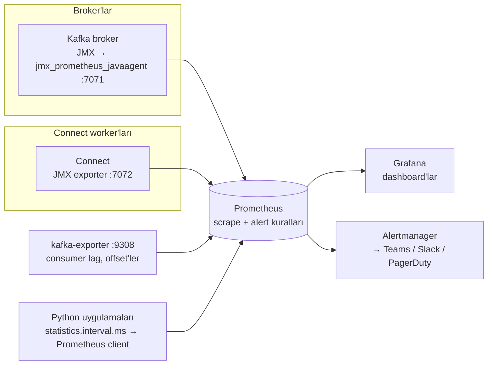

# 14. Monitoring, Performans ve Optimizasyon

> **Bu bölümde:** Consumer lag, throughput, latency, partition skew, broker CPU/RAM/disk, disk ve network I/O, under-replicated partitions, ISR, request queue, producer retry, consumer rebalance, connector health, JMX metrikleri, Prometheus, Grafana, alerting; producer ve consumer **performans parametreleri** örneklerle.
>
> **Kod:** [`code/monitoring/`](../code/monitoring/) (JMX exporter kuralları, Prometheus, alert kuralları — YAML olarak doğrulandı), [`code/docker/docker-compose.monitoring.yml`](../code/docker/docker-compose.monitoring.yml)
>
> ⚠️ Monitoring compose'undaki üçüncü parti image etiketleri (`danielqsj/kafka-exporter:v1.9.0`, `prom/prometheus:v3.5.0`, `grafana/grafana:12.1.0`) ve JMX exporter jar sürümü (1.5.0) bu ortamda çekilip doğrulanamadı; kullanmadan önce ilgili registry/GitHub sayfasından güncel etiketi kontrol edin.

---

## 14.1 İzleme mimarisi



Çalıştırma:
```bash
mkdir -p code/monitoring/jmx
curl -L -o code/monitoring/jmx/jmx_prometheus_javaagent.jar \
  https://github.com/prometheus/jmx_exporter/releases/download/1.5.0/jmx_prometheus_javaagent-1.5.0.jar
docker compose -f code/docker/docker-compose.yml -f code/docker/docker-compose.monitoring.yml up -d
# Prometheus: http://localhost:9090/targets  (tümü UP)
# Grafana:    http://localhost:3000  → Data source: Prometheus (http://prometheus:9090)
```

---

## 14.2 Metrik kataloğu

### Consumer Lag
- **Ne:** Partition başına `log_end_offset − committed_offset`; ayrıca **zaman cinsinden lag** (en eski işlenmemiş mesajın yaşı) daha anlamlıdır: "1000 mesaj geride" yerine "4 dakika geride".
- **Kaynak:** `kafka-exporter` (`kafka_consumergroup_lag`), Burrow (lag durumu değerlendirmesi), Kafbat UI; istemci tarafında librdkafka `consumer_lag` istatistiği.
- **Alarm:** Eşik (ör. > 10.000) **ve** eğilim (30 dk sürekli artış). Bkz. `alerts.yml`: `KafkaConsumerLagYuksek`, `KafkaConsumerLagArtiyor`.
- **Dikkat:** p04 gibi offset'i DB'de saklayan tüketiciler Kafka'ya da commit etmezse lag yanlış görünür (bu yüzden p04 bilgi amaçlı Kafka commit'i yapar).

### Throughput
| Metrik (JMX) | Anlamı |
|---|---|
| `kafka.server:type=BrokerTopicMetrics,name=MessagesInPerSec[,topic=]` | Gelen mesaj/sn |
| `...name=BytesInPerSec` / `BytesOutPerSec` | Gelen/giden byte/sn (Out, tüketici sayısıyla çarpılır) |
| `...name=TotalProduceRequestsPerSec` / `TotalFetchRequestsPerSec` | İstek oranları |
| `kafka.server:type=ReplicaManager,name=...` | Replikasyon trafiği |

### Latency
| Metrik | Anlamı |
|---|---|
| `kafka.network:type=RequestMetrics,name=TotalTimeMs,request={Produce,FetchConsumer,FetchFollower}` | Uçtan uca istek süresi (p50/p99) |
| Alt bileşenler: `RequestQueueTimeMs`, `LocalTimeMs`, `RemoteTimeMs`, `ResponseQueueTimeMs`, `ResponseSendTimeMs` | Darboğaz nerede? `RemoteTimeMs` yüksek → `acks=all` follower'ları bekliyor (ISR/ağ/disk) |
| Producer: `request-latency-avg`, librdkafka `rtt`, `int_latency` | İstemci tarafı |
| **Uçtan uca (end-to-end)** | `consume_zamani − event_time` (uygulama metriği) — iş tarafının görmek istediği gerçek gecikme |

### Partition Skew
- **Veri skew'i:** Bazı partition'lar diğerlerinden çok daha büyük/yoğun (hot key). Ölçüm: `kafka_log_size_bytes` (partition etiketli) veya topic partition offset'leri artış hızı.
- **Liderlik skew'i:** Liderlerin bir broker'da toplanması. Ölçüm: broker başına `LeaderCount`; çözüm: `auto.leader.rebalance.enable`, `kafka-leader-election.sh --election-type preferred`.
- **Replika/disk skew'i:** Broker'lar arası disk dengesizliği → `kafka-reassign-partitions.sh` veya Cruise Control.

### Broker CPU / RAM / Disk
| Kaynak | Ne izlenir | Not |
|---|---|---|
| CPU | Kullanım, `NetworkProcessorAvgIdlePercent` (< %30 tehlikeli), `RequestHandlerAvgIdlePercent` | TLS ve sıkıştırma CPU tüketir |
| JVM heap | `jvm_heap_used_bytes`, GC duraklamaları | Heap 6–8 GB yeterli; büyük heap GC sorunlarına yol açar |
| Page cache | OS boş RAM | Kafka'nın gerçek önbelleği; RAM'in çoğu page cache için kalmalı |
| Disk kapasitesi | Kullanım %, büyüme hızı | %70'te uyarı, %85'te kritik; disk dolarsa broker **kapanır** |
| Dosya tanıtıcıları | Açık FD sayısı / limit | Partition × segment × 3 dosya |

### Disk I/O ve Network I/O
- Disk: `iowait`, okuma/yazma IOPS ve throughput, `await`. **Okuma I/O'su artıyorsa** tüketiciler page cache'te olmayan eski veriyi okuyor (geride kalan/replay yapan tüketici) → canlı trafiği etkiler.
- Network: NIC throughput (bytes in/out), retransmit. `BytesOut ≈ BytesIn × (RF−1 + tüketici grubu sayısı)`.

### Under Replicated Partitions ve ISR
| Metrik | Normal | Alarm |
|---|---|---|
| `kafka.server:type=ReplicaManager,name=UnderReplicatedPartitions` | 0 | > 0, 5 dk |
| `...name=UnderMinIsrPartitionCount` | 0 | > 0 (yazmalar reddediliyor!) |
| `...name=IsrShrinksPerSec` / `IsrExpandsPerSec` | ~0 | Sık dalgalanma → ağ/disk/GC sorunu |
| `kafka.controller:type=KafkaController,name=OfflinePartitionsCount` | 0 | > 0 (kritik: erişilemeyen veri) |
| `kafka.controller:type=KafkaController,name=ActiveControllerCount` | Cluster toplamı 1 | ≠ 1 |
| KRaft: `kafka.server:type=raft-metrics` (ör. `current-leader`, `commit-latency-avg`), metadata log gecikmesi | | Quorum sağlığı |

### Request Queue
- `kafka.network:type=RequestChannel,name=RequestQueueSize` ve `ResponseQueueSize`.
- Kuyruk birikiyorsa: `num.io.threads` (disk/istek işleme thread'leri) ve `num.network.threads` yetersiz veya disk yavaş.

### Producer Retry
- librdkafka istatistikleri (`statistics.interval.ms` ile JSON): `txretries`, `txerrs`, `msg_cnt` (kuyruktaki), `tx`/`txbytes`; Java: `record-retry-rate`, `record-error-rate`, `buffer-available-bytes`.
- Retry artışı: lider değişimleri, `NOT_ENOUGH_REPLICAS`, ağ sorunları. Delivery callback hata sayısı uygulama metriği olarak sayılmalı.

### Consumer Rebalance
- Grup durumu (`kafka-consumer-groups.sh --describe --state`), rebalance sayısı ve süresi; librdkafka `rebalance_cnt`, `rebalance_age`.
- KIP-848 metrikleri broker tarafında group coordinator altında.
- Sık rebalance sebepleri: `max.poll.interval.ms` aşımı (uzun işlem), pod yeniden başlatmaları (→ static membership), dağıtımlar sırasında kademeli olmayan kapanış.

### Connector health
- REST: `FAILED` task sayısı (en kritik). JMX: `kafka.connect:type=connector-metrics` (`status`), `task-error-metrics` (`total-record-errors`, `deadletterqueue-produce-requests`), `sink-task-metrics` (`sink-record-lag-max`), Debezium `MilliSecondsBehindSource`.
- Kaynak DB: replication slot WAL boyutu ([6.13](06-cdc-debezium.md#613-replication-slot-ve-wal-büyüme-riskleri)).

---

## 14.3 JMX ve Prometheus

`jmx-kafka.yml` (özet) — MBean'leri Prometheus metrik adlarına çevirir:
```yaml
lowercaseOutputName: true
rules:
  - pattern: kafka.server<type=(.+), name=(.+)><>Value
    name: kafka_server_$1_$2
    type: GAUGE
  - pattern: kafka.server<type=BrokerTopicMetrics, name=(.+), topic=(.+)><>Count
    name: kafka_server_brokertopicmetrics_$1_total
    labels: {topic: "$2"}
    type: COUNTER
  - pattern: kafka.network<type=RequestMetrics, name=TotalTimeMs, request=(Produce|FetchConsumer|FetchFollower)><>(\d+)thPercentile
    name: kafka_network_request_totaltimems
    labels: {request: "$1", quantile: "0.$2"}
```
Broker'a javaagent olarak eklenir: `KAFKA_OPTS=-javaagent:/opt/jmx/jmx_prometheus_javaagent.jar=7071:/opt/jmx/jmx-kafka.yml`.

> **Kafka 4.x notu:** Metrik adlarında bazı değişiklikler (ör. KIP-1100 ile yeniden adlandırılan metrikler) ve MX4j desteğinin kullanımdan kaldırılması (KIP-1193) gibi değişiklikler vardır. Dashboard'larınızı sürüm yükseltmelerinde kontrol edin.

**Kardinalite uyarısı:** Partition etiketli metrikler (binlerce partition × broker) Prometheus'u şişirir. Partition seviyesini sadece gerekli metriklerde tutun.

## 14.4 Grafana
Önerilen paneller:
1. **Cluster sağlığı:** aktif controller, offline/under-replicated/under-min-ISR partition'lar, broker sayısı.
2. **Trafik:** topic bazında MessagesIn, BytesIn/Out.
3. **Gecikme:** Produce/Fetch TotalTimeMs p99.
4. **Kaynaklar:** CPU, heap, disk %, network, `NetworkProcessorAvgIdlePercent`, `RequestHandlerAvgIdlePercent`.
5. **Tüketiciler:** grup bazında lag (mesaj ve zaman), lag eğilimi, rebalance'lar.
6. **Connect:** task durumu, hata/DLQ oranı, Debezium `MilliSecondsBehindSource`, slot WAL boyutu.
7. **İş metrikleri:** dakikalık işlem sayısı (kaynak vs hedef), DLQ mesaj sayısı, uçtan uca gecikme.

Topluluk dashboard'ları (Grafana.com'daki Kafka/JMX exporter dashboard'ları) başlangıç noktası olabilir; metrik adlarını kendi `jmx-kafka.yml`'nizle eşleştirin.

## 14.5 Alerting

`code/monitoring/alerts.yml`'deki kurallar:
| Alarm | İfade (özet) | Önem |
|---|---|---|
| `KafkaUnderReplicatedPartitions` | `sum(underreplicatedpartitions) > 0` for 5m | critical |
| `KafkaOfflinePartitions` | `sum(offlinepartitionscount) > 0` for 1m | critical |
| `KafkaNoActiveController` | `sum(activecontrollercount) != 1` | critical |
| `KafkaConsumerLagYuksek` | `lag > 10000` for 10m | warning |
| `KafkaConsumerLagArtiyor` | `deriv(lag[15m]) > 0` for 30m | warning |
| `KafkaRequestQueueDolu` | `requestqueuesize > 100` for 5m | warning |

Eklenmesi önerilenler: disk %80, sertifika bitişi < 30 gün, Connect FAILED task > 0, DLQ'ya mesaj geldi, replication slot WAL > eşik, `UnderMinIsrPartitionCount > 0`, uçtan uca gecikme SLO ihlali.

**Alarm hijyeni:** Her alarmın bir **runbook**'u (ne anlama gelir, ilk 3 kontrol, kime eskalasyon) olmalı; "her şey kırmızı" panolar yerine SLO temelli alarmlar.

---

## 14.6 Producer performans parametreleri

| Parametre (librdkafka / Java) | Varsayılan (librdkafka) | Etki | Öneri (yüksek throughput) |
|---|---|---|---|
| `linger.ms` | 5 | Batch dolsun diye bekleme → büyük batch, daha az istek, biraz gecikme | 10–50 |
| `batch.size` | 1 MB (librdkafka: `batch.size` byte sınırı) | Partition başına batch üst sınırı | 128 KB–1 MB |
| `batch.num.messages` (librdkafka) | 10000 | Batch başına mesaj sınırı | Varsayılan |
| `compression.type` | none | Ağ ve disk kazancı, CPU maliyeti | `zstd` (oran) veya `lz4` (hız) |
| `acks` | all | Dayanıklılık vs gecikme | **all** (finans) |
| `enable.idempotence` | **false** (librdkafka) | Duplicate/sıra koruması | **true** |
| `max.in.flight.requests.per.connection` | 1000000 (librdkafka; idempotence ile ≤5'e sınırlanır) | Paralel istek | Idempotence açıkken ≤ 5 |
| `queue.buffering.max.messages` / `.kbytes` | 100000 / 1 GB | Yerel kuyruk (BufferError eşiği) | Bellek bütçesine göre |
| `delivery.timeout.ms` (`message.timeout.ms`) | 300000 | Mesajın teslim için toplam süresi (retry dahil) | İş SLA'sına göre; transactional'da ≤ `transaction.timeout.ms` |
| `partitioner` | consistent_random | Key → partition | Java ile uyum: `murmur2_random` |

**Deney (kendi ortamınızda):**
```bash
for L in 0 5 20 50; do
  docker exec kafka /opt/kafka/bin/kafka-producer-perf-test.sh --topic perf --num-records 500000 \
    --record-size 500 --throughput -1 \
    --producer-props bootstrap.servers=kafka:19092 acks=all linger.ms=$L compression.type=zstd batch.size=262144
done
# Çıktıdaki records/sec ve avg/99th latency'yi karşılaştırın
```
Genel eğilim: `linger.ms` ↑ → throughput ↑, gecikme ↑; `zstd` → ağ/disk ↓, CPU ↑; `acks=all` → gecikme ↑ (RemoteTimeMs).

## 14.7 Consumer performans parametreleri

| Parametre | Varsayılan (librdkafka) | Etki | Öneri |
|---|---|---|---|
| `fetch.min.bytes` | 1 | Broker en az bu kadar veri birikince yanıt verir | Yüksek throughput: 64 KB–1 MB |
| `fetch.wait.max.ms` | 500 | `fetch.min.bytes` için max bekleme | 100–500 |
| `fetch.max.bytes` / `max.partition.fetch.bytes` | 50 MB / 1 MB | İstek ve partition başına üst sınır | Mesaj boyutuna göre |
| `queued.min.messages` / `queued.max.messages.kbytes` | 100000 / 64 MB | librdkafka ön-getirme kuyruğu | Bellek bütçesi |
| `consume(num_messages=...)` | — | Python'da batch çekme | 100–1000 |
| `max.poll.interval.ms` | 300000 | İşleme süresi toleransı | Batch işleme süresinin 2–3 katı |
| `enable.auto.offset.store` + auto commit | true | Commit yükü | Yüksek hız: store deseni (4.14) |
| `group.protocol` | classic | Rebalance hızı | `consumer` (Kafka 4.x) |
| `group.instance.id` | — | Static membership | K8s'te pod adı |
| `client.rack` | — | En yakın replikadan okuma (KIP-392) | Çok AZ'li cluster'da AZ adı |

**Paralellik:** Tüketici throughput'u yetmiyorsa sıra: (1) işleme kodunu hızlandır (batch DB yazımı, `executemany`/COPY), (2) süreç sayısını partition sayısına çıkar, (3) partition sayısını artır (key eşlemesi değişir — planlayın), (4) partition içi key-bazlı paralellik.

## 14.8 Broker ve topic tarafı optimizasyonlar
- `num.network.threads` (≈ CPU/4), `num.io.threads` (≈ disk sayısı × 2–8), `num.replica.fetchers` (replikasyon paralelliği).
- `log.segment.bytes` (1 GB) — çok küçük segment = çok dosya.
- `message.max.bytes` / topic `max.message.bytes` — büyük mesajlar (> 1 MB) yerine **claim check** deseni: dosyayı S3'e koy, Kafka'ya referans yaz.
- Ayrı veri diskleri (`log.dirs` birden çok), XFS, `noatime`.
- Rack awareness (`broker.rack`) ile AZ'ler arası dengeli replika.
- Cruise Control ile otomatik yeniden dengeleme (Strimzi entegre).

## Kaynaklar

- [Apache Kafka — Monitoring (JMX metrikleri)](https://kafka.apache.org/documentation/#monitoring)
- [Prometheus JMX Exporter](https://github.com/prometheus/jmx_exporter)
- [kafka-exporter (danielqsj)](https://github.com/danielqsj/kafka_exporter)
- [Burrow — consumer lag checking](https://github.com/linkedin/Burrow)
- [librdkafka STATISTICS.md](https://github.com/confluentinc/librdkafka/blob/master/STATISTICS.md)
- [librdkafka CONFIGURATION.md (varsayılanlar)](https://github.com/confluentinc/librdkafka/blob/master/CONFIGURATION.md)
- [Apache Kafka 4.2 release notes (KIP-1100, KIP-1193)](https://www.confluent.io/blog/apache-kafka-4-2-release/)
- [Cruise Control](https://github.com/linkedin/cruise-control)
- [Grafana — Prometheus data source](https://grafana.com/docs/grafana/latest/datasources/prometheus/)
