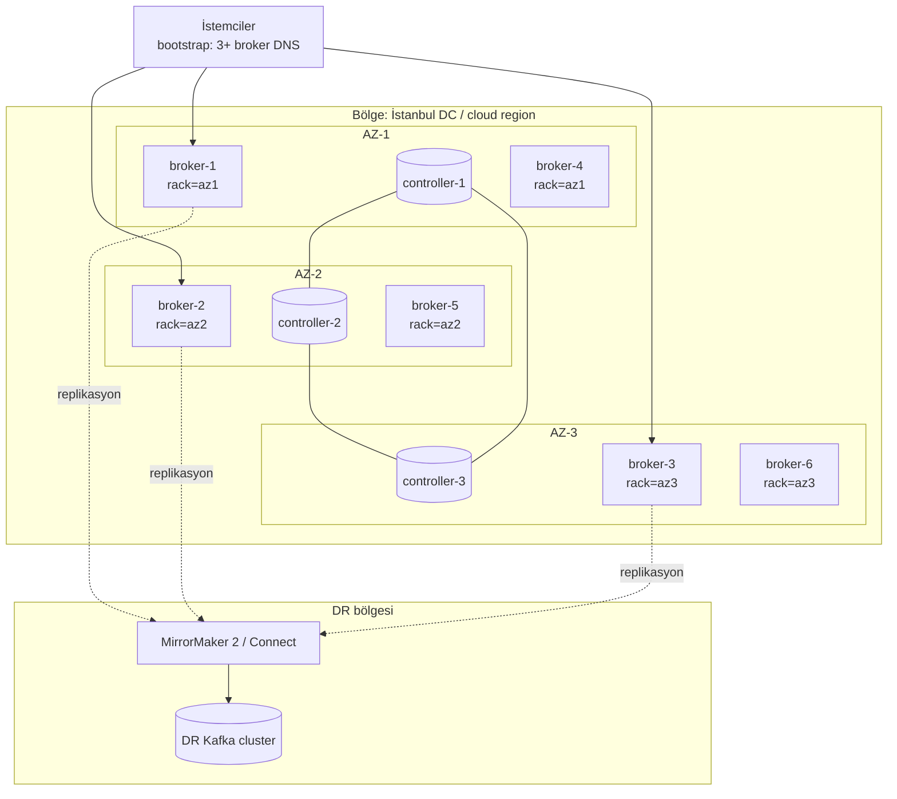
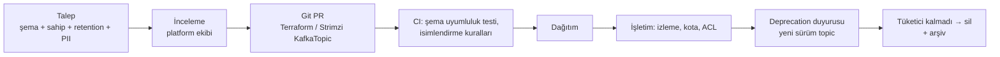

# 15. Production Mimarisi

> **Bu bölümde:** Multi-broker cluster, dedicated KRaft controller'lar, replication ve `min.insync.replicas`, HA, disaster recovery, multi-AZ, multi-region, MirrorMaker 2, backup/restore, kapasite planlama, topic yaşam döngüsü, retention ve storage planlama, autoscaling sınırları, rolling upgrade, sürüm uyumluluğu, Kubernetes ve Strimzi, CI/CD, Infrastructure as Code, SLA/SLO.
>
> **Kod:** [`code/docker/docker-compose.cluster.yml`](../code/docker/docker-compose.cluster.yml) (yerel deneme), [`code/k8s/strimzi-kafka.yaml`](../code/k8s/strimzi-kafka.yaml) (YAML sözdizimi doğrulandı; cluster'a uygulanmadı)
>
> **Sürüm önerisi (Kasım 2026):** Yeni production kurulumunda en güncel minor'ın (4.4.0, 22 Ekim 2026) ilk yamalarını beklemek yaygın bir pratiktir; olgun hat **4.3.2**. Strimzi 1.2.0, Kafka 4.3.1 desteği ekledi.

---

## 15.1 Referans production topolojisi (tek bölge, 3 AZ)



| Bileşen | Öneri |
|---|---|
| Controller | 3 (veya 5) **dedicated**, her biri farklı AZ, küçük ama hızlı diskli VM |
| Broker | ≥ 3, AZ başına eşit sayıda, `broker.rack=<az>` |
| Topic varsayılanları | `replication.factor=3`, `min.insync.replicas=2` |
| Producer | `acks=all`, idempotent |
| Kritiklik | `unclean.leader.election.enable=false` |

## 15.2 Multi-broker cluster ve dedicated KRaft controller'lar
- **Combined mode** (aynı düğüm broker+controller) production'da önerilmez: broker yükü (GC, disk) controller'ı yavaşlatır, failover etkilenir.
- Controller'lar metadata'yı tutar; disk ihtiyacı küçüktür ama **düşük gecikmeli** olmalıdır.
- 3 controller → 1 kayıp; 5 → 2 kayıp tolere. Çift sayı (4) avantaj sağlamaz.
- KIP-853 ile controller **üyeliği dinamik** değiştirilebilir (`kafka-metadata-quorum.sh add-controller / remove-controller`) → controller değiştirme/taşıma kesintisiz.

## 15.3 Replication ve `min.insync.replicas`

| RF | min.insync | acks | 1 broker kaybı | 2 broker kaybı | Veri kaybı riski |
|---|---|---|---|---|---|
| 3 | 2 | all | Yazma ✅ okuma ✅ | Yazma ❌ (NOT_ENOUGH_REPLICAS), okuma ✅ | Çok düşük |
| 3 | 1 | all | ✅ | Yazma ✅ (tek kopya!) | Var |
| 3 | 2 | 1 | ✅ | ✅ | Lider yazıp çökerse var |
| 2 | 2 | all | Yazma ❌ | ❌ | Düşük ama erişilebilirlik kötü |

**Finansal standart:** RF=3, `min.insync.replicas=2`, `acks=all`. Kritik topic'lerde RF=5 / min.insync=3 (5 AZ veya iki DC'ye yayılmış "stretch" cluster) değerlendirilebilir.

## 15.4 High Availability — hata senaryoları

| Senaryo | Etki (RF=3, min.isr=2, 3 AZ) | Otomatik toparlanma |
|---|---|---|
| Tek broker çöker | Liderler saniyeler içinde taşınır, URP alarmı | Broker dönünce follower olarak yetişir |
| Tek AZ kaybı | Her partition'ın 1 kopyası gider; yazma/okuma devam | AZ dönünce yetişme (ağır I/O — throttle) |
| 2 AZ kaybı | Yazmalar durur (bilinçli), okumalar devam eder | DR planı |
| Controller lideri çöker | Yeni Raft lideri saniyeler içinde | Otomatik |
| Disk dolması | Broker kapanır | **Önlenmeli**: alarm %70/%85, retention, tiered storage |
| Ağ bölünmesi | Azınlık tarafındaki broker'lar ISR'den çıkar | Birleşince yetişme |

## 15.5 Multi-AZ deployment
- `broker.rack` + rack-aware replica yerleşimi (topic oluşturma ve yeniden atamada replikalar farklı AZ'lere).
- **AZ'ler arası trafik maliyeti** (bulutta): replikasyon + tüketici fetch. `client.rack` + `replica.selector.class=org.apache.kafka.common.replica.RackAwareReplicaSelector` ile tüketiciler aynı AZ'deki follower'dan okur (KIP-392).
- Producer'lar her zaman lidere yazar (lider hangi AZ'deyse).

## 15.6 Disaster Recovery ve multi-region

| Yaklaşım | RPO | RTO | Not |
|---|---|---|---|
| **Active–passive (MirrorMaker 2)** | Saniyeler–dakikalar (asenkron) | Dakikalar (istemci yönlendirme + offset çevirisi) | En yaygın |
| Active–active (çift yönlü MM2) | Saniyeler | Düşük | Döngü önleme (MM2 topic ön ekleri), çakışma yönetimi, karmaşık |
| Stretch cluster (bölgeler arası tek cluster) | 0 | Düşük | Düşük gecikmeli (< ~10–20 ms) bölgeler arası bağlantı gerekir; 3. bölgede controller/tiebreaker |
| Ticari çözümler (Confluent Cluster Linking, MSK Replicator) | Saniyeler | Düşük | Offset'leri koruyarak bayt-bayt kopyalama |

> Topluluk, Kafka'ya yerleşik **cluster mirroring** (sıfır RPO'ya yakın DR, offset koruması) için KIP çalışmaları yürütmektedir; 2026 itibarıyla bu özellik tartışma/geliştirme aşamasındadır. Kullanmadan önce sürüm notlarını kontrol edin.

**DR tatbikatı** olmadan DR planı yoktur: yılda en az 1–2 kez kontrollü failover; tüketicilerin DR cluster'da **doğru offset'ten** devam ettiğinin doğrulanması.

## 15.7 Kafka MirrorMaker 2

MirrorMaker 2, Kafka Connect üzerinde çalışan üç connector'dan oluşur:
| Connector | Görev |
|---|---|
| `MirrorSourceConnector` | Topic verisini + config'leri + ACL'leri kopyalar |
| `MirrorCheckpointConnector` | Consumer group offset'lerini hedef cluster karşılığına çevirir (`emit.checkpoints`, `sync.group.offsets.enabled`) |
| `MirrorHeartbeatConnector` | Bağlantı/gecikme izleme |

`mm2.properties` (dedicated mode):
```properties
clusters = ist, ank
ist.bootstrap.servers = ist-b1:9092,ist-b2:9092,ist-b3:9092
ank.bootstrap.servers = ank-b1:9092,ank-b2:9092,ank-b3:9092
ist->ank.enabled = true
ist->ank.topics = islemler.*, clean\..*, musteri\.profil
ist->ank.groups = .*
ank->ist.enabled = false
replication.factor = 3
sync.group.offsets.enabled = true
emit.checkpoints.interval.seconds = 30
refresh.topics.interval.seconds = 60
# Varsayılan replication policy hedefte 'ist.islemler' adını verir (döngü önleme).
# Active-passive'de aynı adı korumak için:
# replication.policy.class = org.apache.kafka.connect.mirror.IdentityReplicationPolicy
# (+ SASL_SSL ayarları: ist.security.protocol=..., ank.security.protocol=...)
```
```bash
bin/connect-mirror-maker.sh mm2.properties
```
> Kafka 4.0 ile eski **MirrorMaker 1** (`kafka-mirror-maker.sh`) kaldırıldı; sadece MM2 kullanılır.

## 15.8 Backup / Restore
Bkz. [3.C.7](03-kurulum.md#c7-backup). Özet: replikasyon ≠ yedek (yanlışlıkla silinen topic tüm kopyalardan silinir!). Kritik veri için **ikinci kopya** (DR cluster veya S3 arşivi — S3 Sink + lifecycle), topic/ACL/kullanıcı/connector tanımları **Git'te**. Restore = arşivden yeniden yayınlama veya DR cluster'dan geri kopyalama; tüketiciler için offset stratejisi (zamana göre reset) önceden belgelenmeli. Yanlışlıkla topic silmeye karşı: `delete.topic.enable` ve ACL'lerle topic silme yetkisini kısıtlayın.

## 15.9 Capacity planning

**Girdi değişkenleri:** ortalama/zirve mesaj/sn, ortalama mesaj boyutu (sıkıştırma sonrası), RF, retention, tüketici grubu sayısı, büyüme oranı.

```
Günlük yazılan veri (tek kopya)  = mesaj/sn × boyut × 86 400
Disk (toplam)                    = günlük × retention_gün × RF × 1,3 (pay)
Ağa giren (broker toplam)        = mesaj/sn × boyut × RF            (producer + replikasyon)
Ağdan çıkan                      = mesaj/sn × boyut × (RF − 1 + tüketici_grubu_sayısı)
Partition sayısı (topic)         ≥ max(hedef_tput / producer_partition_tput, hedef_tput / consumer_partition_tput, max_tüketici)
```

**Örnek (bankacılık işlem akışı):** Zirve 20.000 olay/sn, 600 byte (zstd sonrası ~250 byte), RF=3, 7 gün retention, 5 tüketici grubu.
| Hesap | Sonuç |
|---|---|
| Günlük tek kopya (sıkıştırılmış, zirve sürekli varsayımı) | 20 000 × 250 × 86 400 ≈ **432 GB/gün** |
| Disk (7 gün × RF3 × 1,3) | 432 × 7 × 3 × 1,3 ≈ **11,8 TB** (6 broker → ~2 TB/broker) |
| Giriş | 20 000 × 250 × 3 = 15 MB/sn |
| Çıkış | 20 000 × 250 × (2 + 5) = 35 MB/sn |
| Partition | Tüketici başına ~2.000 olay/sn işleme kapasitesi → ≥ 10 → **12 veya 24** |

Ortalama yük zirvenin genelde çok altındadır; disk hesabını **ortalama**, ağ/CPU hesabını **zirve** ile yapın ve ölçümle doğrulayın (`kafka-producer-perf-test.sh`).

## 15.10 Topic lifecycle

- **İsimlendirme standardı** ve topic başına **metadata** (sahip ekip, veri sınıfı, PII, SLA).
- `auto.create.topics.enable=false` — topic'ler sadece IaC ile.
- Partition artırma kararı (key eşlemesi değişir) değişiklik yönetiminden geçmeli.
- Yetim topic'leri (yazan/okuyan yok) periyodik tespit.

## 15.11 Retention policy ve storage planning
| Topic sınıfı | Politika | Örnek |
|---|---|---|
| Ham CDC / raw | `compact,delete`, 7–30 gün + tiered storage | `raw.core.*` |
| İş olayları | `delete`, 7–14 gün | `clean.islemler.*` |
| Referans/durum | `compact` (süresiz) | `musteri.profil`, `kur.tcmb` |
| Denetim izi | `delete`, mevzuat süresi (yıllar) → **tiered storage** veya S3 arşivi | `audit.personel_sorgu` |
| DLQ | `delete`, 30 gün | `dlq.*` |
| Geçici/repartition | Kısa (Streams yönetir) | `*-repartition` |

**Tiered storage (KIP-405):** Broker'larda sadece son birkaç günü tutup eskisini nesne depolamaya taşıyın (`remote.storage.enable=true`, broker'da `remote.log.storage.system.enable=true` + RemoteStorageManager eklentisi). Avantaj: daha küçük diskler, daha hızlı broker değiştirme/yeniden dengeleme, ucuz uzun saklama. Dikkat: compacted topic'lerde tiered storage desteklenmez; eski veriyi okuyan tüketicilerin gecikmesi artar.

## 15.12 Autoscaling sınırları
Kafka "stateful" olduğu için web sunucusu gibi otomatik ölçeklenmez:
- **Broker eklemek kendiliğinden yük almaz** — mevcut partition'lar yeni broker'a **taşınmalıdır** (`kafka-reassign-partitions.sh` / Cruise Control); taşıma veri kopyalar (saatler, ağ/disk yükü → throttle: `leader.replication.throttled.rate`).
- **Broker çıkarmak** önce partition'ları boşaltmayı gerektirir (Kafka 4.3 ile gelen broker *cordon* özelliği ve Strimzi'nin bunu kullanması bu süreci kolaylaştırır).
- Partition sayısı azaltılamaz.
- **Tüketiciler** ölçeklenebilir (KEDA ile lag'e göre pod sayısı) ama üst sınır **partition sayısı**dır.
- Managed "serverless" seçenekler (MSK Serverless, Confluent Cloud) bu yükü sağlayıcıya kaydırır, karşılığında limitler ve maliyet modeli gelir.

## 15.13 Rolling upgrades ve version compatibility

**Rolling upgrade adımları (KRaft, ör. 4.3.2 → 4.4.x):**
1. Sürüm notlarını ve **Upgrade** bölümünü okuyun (kaldırılan config'ler, davranış değişiklikleri).
2. Staging'de aynı adımlar + istemci uyumluluk testi.
3. **Controller'ları** tek tek yükseltin (her biri sonrası quorum sağlıklı mı: `kafka-metadata-quorum.sh describe --status`).
4. **Broker'ları** tek tek: `URP = 0` olmadan sonrakine geçmeyin; controlled shutdown (liderlik devri) beklenir.
5. Tüm düğümler yeni sürümde ve stabilken **metadata sürümünü** yükseltin:
   ```bash
   kafka-features.sh --bootstrap-server $B upgrade --release-version 4.4
   ```
   Bu adım geri alınması zor olabilir; ayrı bir değişiklik olarak planlayın.
6. İstemcileri (Connect, Streams, uygulamalar) ayrı dalgada yükseltin.

**Uyumluluk:**
- Kafka istemci–broker protokolü çift yönlü uyumludur (yeni istemci eski broker'la, eski istemci yeni broker'la API sürüm müzakeresiyle konuşur), **ancak** Kafka 4.0 çok eski protokol sürümlerini kaldırdı (KIP-896): yaklaşık 2.1 öncesi istemciler 4.x broker'a bağlanamaz. Eski istemci envanterinizi çıkarın.
- 3.x ZooKeeper cluster'dan 4.x'e doğrudan geçiş yok: önce 3.9'da KRaft migration.
- Java: broker 17+, istemci 11+.
- Kafka Streams uygulamaları: `upgrade.from` ayarı gerektiren sürüm geçişlerini kontrol edin.
- Connector'lar: worker Kafka sürümüyle uyumlu connector sürümleri (bkz. [7.11](07-kafka-connect.md#711-plugin-kurulumu-ve-sürüm-uyumluluğu)).

## 15.14 Kubernetes ve Strimzi

**Strimzi:** CNCF projesi, Kafka'yı Kubernetes üzerinde **operator** ile yönetir: `Kafka`, `KafkaNodePool`, `KafkaTopic`, `KafkaUser`, `KafkaConnect`, `KafkaConnector`, `KafkaMirrorMaker2`, `KafkaRebalance` (Cruise Control) CR'ları. Strimzi 1.0 ile sadece **`kafka.strimzi.io/v1`** API'si desteklenir (eski `v1beta2` CR'lar dönüştürülmelidir).

[`code/k8s/strimzi-kafka.yaml`](../code/k8s/strimzi-kafka.yaml) içeriği:
- `KafkaNodePool controllers` (3, `roles: [controller]`) ve `brokers` (3, `roles: [broker]`, JBOD, zone anti-affinity)
- `Kafka banka-kafka`: TLS + SCRAM listener, `authorization: simple`, `rack.topologyKey=topology.kubernetes.io/zone`, dayanıklılık config'leri
- `KafkaTopic islemler`, `KafkaUser svc-fraud-consumer` (ACL'leriyle)

```bash
kubectl create namespace kafka
kubectl apply -f 'https://strimzi.io/install/latest?namespace=kafka' -n kafka
kubectl apply -f code/k8s/strimzi-kafka.yaml -n kafka
kubectl get kafka,kafkanodepool,kafkatopic,kafkauser -n kafka
```
> Alan adları ve desteklenen Kafka sürümleri Strimzi sürümüne göre değişir; uygulamadan önce kurduğunuz Strimzi sürümünün CRD referansıyla karşılaştırın.

Kubernetes'te Kafka için dikkat: **StorageClass** (yerel SSD/NVMe veya hızlı blok depolama, `volumeBindingMode: WaitForFirstConsumer`), pod disruption budget (Strimzi üretir), node başına bir broker (anti-affinity), dedicated node pool'lar (taint/toleration), ağ (dış erişim için `loadbalancer`/`nodeport`/`ingress` listener tipleri).

## 15.15 CI/CD
- **Altyapı:** Topic/ACL/kullanıcı/connector tanımları Git'te; PR → plan (diff) → onay → apply.
- **Şema:** PR'da Schema Registry uyumluluk testi (`POST /compatibility/...`), kırıcı değişiklik → merge engeli.
- **Uygulamalar:** Birim testleri (bu rehberin `pytest` paketi), broker'lı entegrasyon testleri (Testcontainers / `apache/kafka-native`), contract testleri.
- **Connector'lar:** `PUT /connectors/<ad>/config` idempotent olduğu için pipeline'dan güvenle uygulanır; önce `/config/validate`.
- **Kafka Streams/Flink:** Durumlu uygulamalarda dağıtım = savepoint/changelog uyumluluğu kontrolü.

## 15.16 Infrastructure as Code
| Araç | Kapsam |
|---|---|
| Terraform (`Mongey/kafka` provider, Confluent provider, AWS MSK kaynakları) | Topic, ACL, SCRAM kullanıcı, managed cluster |
| Strimzi CR'ları + GitOps (Argo CD / Flux) | K8s üzerinde her şey |
| Ansible (cp-ansible, topluluk rolleri) | VM üzerinde kurulum/upgrade |
| JulieOps / benzeri "topology as code" araçları | Ekip/uygulama bazlı topic + ACL topolojisi |

```hcl
# Terraform örneği (Mongey/kafka provider — sürümünü kendiniz sabitleyin)
resource "kafka_topic" "islemler" {
  name               = "clean.islemler.v1"
  partitions         = 12
  replication_factor = 3
  config = {
    "retention.ms"        = "1209600000"
    "min.insync.replicas" = "2"
    "compression.type"    = "zstd"
    "cleanup.policy"      = "delete"
  }
}
resource "kafka_acl" "fraud_read" {
  resource_name       = "clean.islemler.v1"
  resource_type       = "Topic"
  acl_principal       = "User:svc-fraud-consumer"
  acl_host            = "*"
  acl_operation       = "Read"
  acl_permission_type = "Allow"
}
```

## 15.17 SLA / SLO
| SLI | SLO örneği | Ölçüm |
|---|---|---|
| Kullanılabilirlik (produce) | Aylık %99,95 başarılı `acks=all` yazma | Sentetik producer (canary) + hata oranı |
| Dayanıklılık | Onaylanan mesaj kaybı = 0 | RF/min.isr/acks denetimi, mutabakat |
| Uçtan uca gecikme | %99 olay < 5 sn (kaynak commit → hedef tablo) | Event-time vs hedef yazım zamanı |
| Tüketici gecikmesi | Kritik gruplar < 60 sn lag (zaman) | kafka-exporter / Burrow |
| CDC tazeliği | Debezium `MilliSecondsBehindSource` < 10 sn | JMX |
| Veri kalitesi | DLQ oranı < %0,01 | DLQ sayacı / toplam |

- **Hata bütçesi:** %99,95 → ayda ~22 dk. Bütçe tükeniyorsa riskli değişiklikler (upgrade, yeniden dengeleme) ertelenir.
- **Platform vs ürün SLO'su:** Kafka platformu "yazma kullanılabilirliği"nden; topic sahibi ekip "uçtan uca tazelik"ten sorumludur.

## Kaynaklar

- [Apache Kafka — Operations (rolling upgrade, rack awareness, quotas)](https://kafka.apache.org/documentation/#operations)
- [Apache Kafka — Upgrading (4.x)](https://kafka.apache.org/documentation/#upgrade)
- [Apache Kafka — Geo-Replication (MirrorMaker 2)](https://kafka.apache.org/documentation/#georeplication)
- [KIP-382: MirrorMaker 2.0](https://cwiki.apache.org/confluence/display/KAFKA/KIP-382%3A+MirrorMaker+2.0)
- [KIP-896: Remove old client protocol API versions in Kafka 4.0](https://cwiki.apache.org/confluence/display/KAFKA/KIP-896%3A+Remove+old+client+protocol+API+versions+in+Kafka+4.0)
- [KIP-405: Tiered Storage](https://cwiki.apache.org/confluence/display/KAFKA/KIP-405%3A+Kafka+Tiered+Storage)
- [Strimzi Releases (1.2.0, desteklenen Kafka sürümleri)](https://github.com/strimzi/strimzi-kafka-operator/releases)
- [Strimzi Documentation](https://strimzi.io/documentation/)
- [Kafka Monthly Digest (Red Hat) — Haziran/Ağustos 2026](https://developers.redhat.com/blog/2026/07/01/kafka-monthly-digest-june-2026)
- [Cruise Control](https://github.com/linkedin/cruise-control)
- [Terraform Kafka provider (Mongey)](https://registry.terraform.io/providers/Mongey/kafka/latest/docs)
