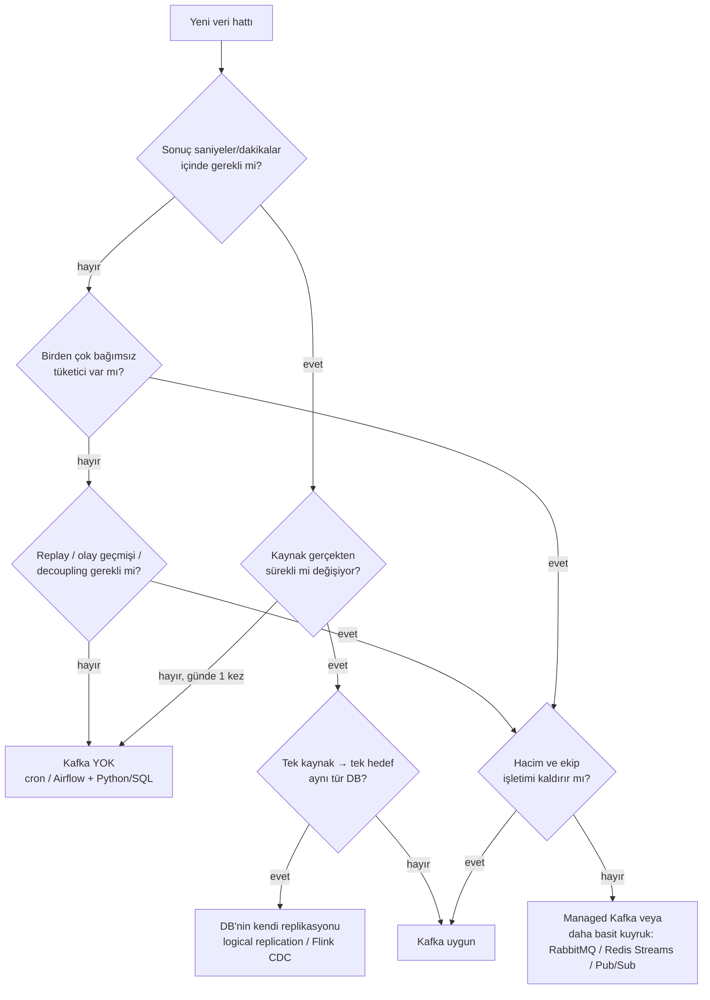

# 17. Kafka'yı Ne Zaman Kullanmamalıyım?

> **Bu bölümde:** Kafka'nın gereksiz karmaşıklık getirdiği yedi tipik senaryo ve bu durumlarda **cron, Airflow, Python veya doğrudan SQL**'in ne zaman daha mantıklı olduğu; karar ağacı ve maliyet karşılaştırması.

---

## 17.1 Temel ilke

Kafka şu üç sorudan **en az birine** "evet" denildiğinde değer üretir:
1. **Gerçek zamanlılık:** Sonucun saniyeler–dakikalar içinde gerekmesi iş değeri yaratıyor mu?
2. **Çoklu bağımsız tüketici:** Aynı olayı birden çok sistem, farklı hızlarda okuyacak mı?
3. **Olay geçmişi / replay / ayrıştırma (decoupling):** Olayları saklamak, yeniden oynatmak, üreticiyi tüketiciden ayırmak gerekiyor mu?

Hepsine "hayır" ise Kafka; cluster, güvenlik, izleme, şema yönetimi, offset ve rebalance gibi **sürekli bir işletim maliyeti** ekler ve karşılığında bir şey vermez.

---

## 17.2 Senaryolar

### 1) Günde yalnızca bir kez çalışan ETL
**Örnek:** BDDK'nın aylık/haftalık yayımladığı tabloları indirip PostgreSQL'e yazan ve metrik hesaplayan iş.
- **Neden Kafka değil:** Kaynak günde/haftada bir değişiyor; ara olay yok. Kafka sadece dosyayı bir yerden alıp başka yere koyan pahalı bir ara katman olur.
- **Doğru araç:** `cron` (tek sunucu, basit) veya **Airflow** (bağımlılıklar, retry, geçmiş çalıştırmalar, alarm). İş içinde Python + Pandas + `INSERT ... ON CONFLICT`.
- **Kafka'ya geçiş sinyali:** Aynı veriyi 3+ sistem farklı zamanlarda istemeye başlarsa ve her biri ayrı ETL yazıyorsa.

### 2) Küçük CSV dosyaları
**Örnek:** Şubelerden gelen birkaç MB'lık günlük Excel/CSV.
- **Neden değil:** Dosya zaten bir **batch birimidir**. Onu satırlara bölüp Kafka'ya koymak ve sonra yeniden birleştirmek, dosya seviyesindeki atomikliği (dosya tam mı geldi?) kaybettirir.
- **Doğru araç:** Klasöre düşen dosyayı işleyen Python script (Airflow `FileSensor` / S3 olayı), `pandas.read_csv(dtype=str)` + doğrulama + `COPY`/upsert. Dosyanın hash'ini kaydederek tekrar yüklemeyi engelleyin.

### 3) Düşük hacimli API çağrıları
**Örnek:** Günde birkaç yüz kez çağrılan bir kur servisi veya iç onay API'si.
- **Neden değil:** Senkron istek/yanıt ihtiyacını asenkron olay akışına çevirmek gecikmeyi ve hata ayıklamayı zorlaştırır; hacim, tamponlamayı gerektirmiyor.
- **Doğru araç:** Doğrudan HTTP çağrısı + retry/backoff (`retry_call`), gerekirse önbellek (Redis). Periyodik çekim için cron/Airflow. Olay bildirimine ihtiyaç varsa webhook.

### 4) Tek bir PostgreSQL veritabanı
**Örnek:** Uygulama verisi ve raporlama aynı PostgreSQL'de; birkaç tablo arası özet tablo güncellemesi.
- **Neden değil:** Veri zaten tek yerde; "taşıma" ihtiyacı yok.
- **Doğru araç:** SQL view / **materialized view** (`REFRESH MATERIALIZED VIEW CONCURRENTLY` + cron/pg_cron), trigger, `LISTEN/NOTIFY` (hafif olay bildirimi), okuma replikası (raporlama yükü için). İkinci bir PostgreSQL'e kopya gerekiyorsa **native logical replication** (`CREATE PUBLICATION` / `CREATE SUBSCRIPTION`).
- **Kafka'ya geçiş sinyali:** Değişikliklerin farklı türde birden çok hedefe (arama indeksi, DWH, cache, başka servis) gitmesi.

### 5) Gerçek zamanlı veri ihtiyacı bulunmayan raporlar
**Örnek:** Yönetime sabah 08:00'de giden günlük rapor; aylık mevzuat raporu.
- **Neden değil:** "Gerçek zamanlı" teknik bir hedef değil iş gereksinimidir. Rapor günde bir okunuyorsa saniyelik tazelik değer üretmez, ama streaming'in doğruluk/geç veri/state karmaşıklığını getirir.
- **Doğru araç:** Airflow + dbt/SQL (veya Dataiku senaryosu), gün sonu kesin (bounded) veri üzerinde **tekrarlanabilir** hesap. Mevzuat raporlarında batch'in deterministikliği bir avantajdır.

### 6) Yalnızca birkaç saniyelik basit otomasyonlar
**Örnek:** "Bir tabloya kayıt düşünce Teams'e mesaj at", "dosya gelince e-posta gönder".
- **Neden değil:** Tek tetik → tek aksiyon; hacim düşük; replay gerekmiyor.
- **Doğru araç:** **n8n** / benzeri iş akışı araçları, PostgreSQL trigger + `pg_net` / Supabase Database Webhooks, basit bir Python servisi, cron ile kısa periyotlu kontrol.
- **Kafka'ya geçiş sinyali:** Olay hacmi saniyede onlarca/yüzlerceye çıkar, kaybolmaması kritik hale gelir veya aynı olaya birden çok otomasyon bağlanır. (O noktada n8n Kafka Trigger ile Kafka'nın **tüketicisi** olur — 12. bölüm.)

### 7) Veri kaynağının zaten batch olarak güncellendiği sistemler
**Örnek:** Kaynak sistem her gece 02:00'de tabloyu `TRUNCATE + INSERT` ile tamamen yeniliyor; harici sağlayıcı saatlik dosya bırakıyor.
- **Neden değil:** CDC bu durumda her gece **tablonun tamamını silme + ekleme** olayları üretir (milyonlarca anlamsız olay); polling de aynı tabloyu okur. Kaynağın ritmi batch'tir; akışa çevirmek gerçek zamanlılık **yaratmaz**.
- **Doğru araç:** Kaynağın yükleme bitişine bağlı (sensor/olay) batch iş; artımlı karşılaştırma (önceki snapshot ile `EXCEPT` / hash farkı) ile sadece değişenleri hedefe yazmak.

---

## 17.3 Araç seçimi: cron vs Airflow vs Python vs SQL vs Kafka

| Kriter | cron + script | Airflow | Python servisi | Doğrudan SQL (view/MV/pg_cron) | Kafka (+ Connect/Flink) |
|---|---|---|---|---|---|
| Kurulum | Dakikalar | Saatler–gün | Saatler | Dakikalar | Günler–haftalar |
| İşletim yükü | Çok düşük | Orta | Düşük–orta | Çok düşük | **Yüksek** |
| Bağımlılık yönetimi (A bitince B) | ❌ | ✅ | Elle | ⚠️ | Olay bazlı |
| Retry / alarm / geçmiş | Elle | ✅ Yerleşik | Elle | Sınırlı | Bileşen başına |
| Gecikme | Periyot | Periyot (dk+) | İstenen | Periyot / anlık (view) | Saniye altı–saniyeler |
| Çoklu tüketici | ❌ | ❌ | ❌ | DB içinde | ✅ |
| Replay | Kaynaktan yeniden çalıştır | Backfill (tarih aralığı) | Elle | Yeniden hesap | ✅ Offset ile |
| Ölçek | Tek makine | Worker'lar | Yatay (elle) | DB sınırı | Yatay, çok yüksek |
| En uygun | Basit periyodik iş | Batch hatları, raporlama, ML pipeline | Özel entegrasyon, API | Tek DB içi dönüşüm | Olay omurgası, CDC, akış |

**Yaygın ve sağlıklı hibrit:** Kafka gerçek zamanlı katmanı taşır; **Airflow** gün sonu mutabakatını, raporları ve dbt modellerini çalıştırır; tek DB içi işler **SQL**'de kalır. Her şeyi Kafka'ya taşımak bir hedef değildir.

## 17.4 Maliyet perspektifi (kabaca)
| Kalem | Batch (Airflow + SQL) | Kafka platformu |
|---|---|---|
| Altyapı | Mevcut DB + 1–2 VM | ≥ 6 VM (3 controller + 3 broker) + Connect + Registry + izleme, veya managed hizmet ücreti |
| İnsan | Veri mühendisi | + platform/SRE yetkinliği (7/24 nöbet) |
| Öğrenme | Düşük | Yüksek (bu rehberin uzunluğu bir gösterge) |
| Hata türleri | İş başarısız → yeniden çalıştır | Lag, rebalance, slot/WAL, şema uyumsuzluğu, duplicate, sıra |

Kafka'ya, sağlayacağı **gecikme azalması, entegrasyon sadeleşmesi ve yeni kullanım alanları** bu maliyeti açıkça aştığında geçin; ve geçtiğinizde ilk iş olarak gerçek zamanlı değeri en yüksek **tek bir** kullanım senaryosuyla (ör. fraud veya CDC ile DWH tazeliği) başlayın.

## Kaynaklar

- [Apache Airflow — Concepts](https://airflow.apache.org/docs/apache-airflow/stable/core-concepts/index.html)
- [PostgreSQL — Materialized Views](https://www.postgresql.org/docs/current/rules-materializedviews.html)
- [PostgreSQL — LISTEN / NOTIFY](https://www.postgresql.org/docs/current/sql-notify.html)
- [PostgreSQL — Logical Replication (publication/subscription)](https://www.postgresql.org/docs/current/logical-replication.html)
- [pg_cron](https://github.com/citusdata/pg_cron)
- [Supabase — Database Webhooks](https://supabase.com/docs/guides/database/webhooks)
- [n8n Documentation](https://docs.n8n.io/)
